# XFed-IDS-ByzAgent Team Handbook

_Everything you need to understand, explain and defend the project at the final review_

VIT-AP University capstone project, 2026. Team: [Member 1], [Member 2], [Member 3], [Member 4].

Generated from `docs/handbook/src/` by `docs/handbook/build/build_handbook.py`. Every number cites the file it comes from.

# Part 0 — Start here {#part-0}

## 0.1 What the project is {#what-it-is}

XFed-IDS-ByzAgent is an intrusion detection system (IDS) for network traffic, built by four students as a VIT-AP capstone project. Ten organizations each hold their own network logs. They want one shared attack detector, but they are not allowed to pool their traffic in one place. So they use **federated learning**: each organization trains the detector on its own data, and only the model's learned numbers travel to a central server, which averages them into one shared model. Then the project asks two questions that most federated IDS projects skip. First: **do the organizations' models detect attacks for the same reasons?** (the *explanation check*). Second: **is any organization secretly poisoning the shared model?** (the *trust check*, done by an LLM agent we call ByzAgent). A live dashboard shows detection, explanations and trust decisions side by side.

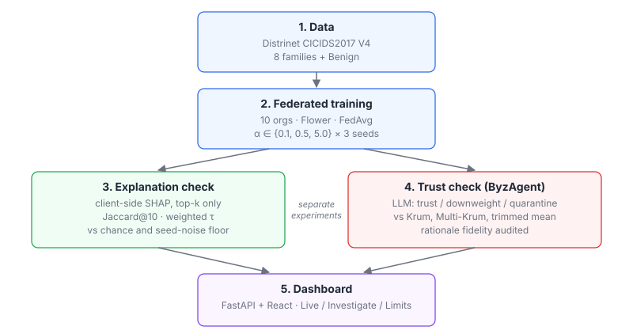

## 0.2 The one-line pitch {#pitch}

> **A federated IDS that doesn't just detect attacks, but checks whether its own explanations and its own participants can be trusted.**

(source: `CLAUDE.md`, "The project")

## 0.3 Map of the five stages {#stage-map}

| Stage | Question it answers | Main output | Chapter |
|---|---|---|---|
| 1. Data | What traffic do we learn from, and is it clean? | 1,913,502 cleaned flows in 8 attack families + Benign (source: `data/README.md`) | [2.1](#ch-data) |
| 2. Federated training | Can 10 organizations train one detector without sharing data? | 9 trained runs (3 α × 3 seeds) | [2.2](#ch-model), [2.3](#ch-fl) |
| 3. Explanation check | Do the organizations' models detect attacks for the same reasons? | Jaccard@10 and weighted τ vs α, against chance and a seed-noise floor | [2.4](#ch-expl) |
| 4. Trust check (ByzAgent) | Is any organization poisoning the model? | Trust / downweight / quarantine decisions, compared with Krum, Multi-Krum, trimmed mean | [2.5](#ch-trust) |
| 5. Dashboard | Can an analyst see all of this live? | FastAPI backend + React dashboard, three routes | [2.8](#ch-dash) |

Two later additions sit beside these stages and are reported on their own: a preregistered **accuracy improvement** ([2.6](#ch-prereg)) and an **efficiency** study ([2.7](#ch-eff)). A public **showcase site and film** ([2.9](#ch-site)) present the results to a general audience.

**One rule you must never break when you speak:** stages 3 and 4 are *different experiments with different evidence*. Never combine them into one sentence like "our system explains and defends itself." Say what each one found, separately.

## 0.4 How to use this handbook {#how-to-use}

- **If you have one evening:** read Part 0, then the "In one line" and "What we found" sections of each Part 2 chapter, then Part 6.
- **If you are presenting a stage:** read the Part 1 background it depends on, then its full Part 2 chapter, then its examiner questions.
- **Every number has a source.** It appears like this: 0.333 (source: `results/inspection/agreement_metrics.csv`). If an examiner asks "where does that come from?", open that file. Never quote a number you cannot point to.
- **Locked wording** is marked with a quote bar. Say it exactly as written; it was agreed by the team because looser versions overclaim.
- **Boxes titled "Questions an examiner might ask"** are practice. Read the question, answer it out loud, then compare with the model answer.
- Part 7 has a glossary. If a word confuses you, look there first.

## 0.5 The project in 5 minutes {#five-minutes}

Memorise this. It is the whole project in the order you would tell it.

1. **The problem.** Organizations want a shared attack detector but can't share their network traffic. Federated learning lets them train together while each keeps its data.
2. **The data.** We used Distrinet CICIDS2017 V4, a corrected version of the well-known CICIDS2017 dataset. After cleaning: 1,913,502 flows (source: `data/README.md`), grouped into 8 attack families plus Benign. Infiltration (66 flows) and Heartbleed (11 flows) are below our 1,000-flow floor, so they are reported per class but left out of the headline score (source: `data/README.md`).
3. **The setup.** 10 organizations ("silos"). We control how different their data is with a slider called Dirichlet α: 0.1 (very different), 0.5 (realistic), 5.0 (nearly identical). Three seeds each: 42, 1337, 2024.
4. **Accuracy.** A normal, centralized MLP scores macro-F1 0.9900 ± 0.0022 (source: `results/aggregated/centralized_headline.csv`). Federated averaging (FedAvg) scores 0.516 ± 0.048 / 0.941 ± 0.057 / 0.990 ± 0.001 at α = 0.1 / 0.5 / 5.0 (source: `results/aggregated/federated_headline.csv`). So: when the organizations' data is similar, federation costs nothing; when it is very different, accuracy collapses.
5. **Explanation check.** We use SHAP to find which features each model relies on, and compare each organization's top-10 list with the global model's. Agreement (Jaccard@10) goes 0.333 → 0.538 → 0.667 as α grows (source: `results/inspection/agreement_metrics.csv`). The key trick: a **null control**. Three centralized models that differ only in random seed agree at a median of 0.429 (source: `results/inspection/centralized_instability_floor.csv`). At α=0.1, federated agreement (0.333) falls below even that seed-noise floor — though this is **directional, not significant**, because the confidence intervals overlap.
6. **Trust check.** We poison 3 organizations by flipping 40% of their attack labels to "Benign". An LLM agent (ByzAgent, llama3.1:8b running locally) reads five behaviour statistics per organization each round and says trust, downweight or quarantine. Classical defenses fail here: Multi-Krum excluded a malicious silo 0% of the time (source: `docs/contribution_b_results.md` §4). ByzAgent's result, in the locked words: *"Both effects are present. A real compositional confound saturates some silos' flag rates independent of any attack; real attack-responsive detection is also present and becomes visible where silos are not already saturated. Seed 42's apparent null was partly a ceiling artifact of that seed's unusually bimodal composition."*
7. **Honesty.** ByzAgent "produces decisions plus a rationale of measured fidelity" — we measured how often its written reasons are wrong. The test set was used in documented ways, which we disclose in full; since 2026-10-12, only one preregistered configuration may ever be scored on it.
8. **Extras.** A preregistered optimizer comparison picked FedAvgM (server momentum 0.9), which on its single test run scored 0.5930 ± 0.0632 / 0.9852 ± 0.0005 / 0.9911 ± 0.0005 (source: `results/federated_methods/test_once/result.json`; `docs/contribution_a_results.md`, optimizer section). ONNX serving cut per-flow latency to 45.7 µs from 186.5 µs (source: `results/efficiency/inference_speed_summary.json`). A dashboard shows it all live.

# Part 1 — Background from scratch {#part-1}

This part explains every idea the project uses, *before* the project uses it. Nothing here is specific to our results. Where we use a number, it is either a made-up teaching example (and says so) or it cites a file.

## 1.1 Network traffic, flows and features {#bg-flows}

**In one line:** a *flow* is a summary of one conversation between two computers, and each row of our dataset is one flow described by 82 numbers.

**Everyday analogy.** Think of a phone bill. It doesn't record what you said. It records *who* you called, *when*, *for how long*, and *how much data* was used. A network flow is the same idea for computer traffic: a tool watches packets go by and, for each conversation (same source, destination, ports and protocol), writes one summary line.

**What's in a flow.** The tool used for CICIDS2017 is called CICFlowMeter. For each flow it measures things like:

- how long the flow lasted (`Flow Duration`);
- how many packets went forward and backward;
- how many bytes per second (`Flow Bytes/s`) and packets per second (`Flow Packets/s`);
- statistics of packet sizes (mean, max, standard deviation);
- the time gaps between packets ("inter-arrival times");
- how many packets carried each TCP flag (SYN, ACK, URG and so on).

Each of these is a **feature**: one number describing the flow. Our cleaned data keeps **82 candidate features** per flow (source: `data/README.md`). The raw files also have identifier columns — IP addresses, ports, a timestamp, a flow ID — but we **drop them**, because a model that learns "this IP address is the attacker" has learned the lab, not the attack. That would not work on anyone else's network.

**What one row of CICIDS2017 looks like** (shape only, values left out):

| Flow Duration | Total Fwd Packets | Flow Bytes/s | … 79 more features … | Label |
|---|---|---|---|---|
| a number | a number | a number | … | e.g. `DoS Hulk` or `BENIGN` |

The **label** is the answer: was this flow normal traffic (`BENIGN`) or part of a known attack (`DoS Hulk`, `Portscan`, `SSH-Patator`, …)? The dataset's authors created the attacks themselves in a lab over five working days, so they know which flows were attacks.

**Why a "corrected" version matters.** The original CICIDS2017 release has known errors in how flows were built and labelled. Researchers at Distrinet (KU Leuven) found and fixed many of them. We use their corrected version 4. Chapter [2.1](#ch-data) explains this.

## 1.2 What an intrusion detection system is {#bg-ids}

**In one line:** an IDS watches network traffic and raises an alert when something looks like an attack.

**Analogy.** A security guard at a building entrance. There are two styles of guard:

- A **signature-based** guard has a list of photos of known troublemakers and checks each visitor against the list. Precise, but useless against someone new.
- An **anomaly- or learning-based** guard has watched thousands of normal visitors and notices behaviour that doesn't fit. More flexible, but it can raise false alarms.

Our IDS is a **learning-based** detector: a neural network that has seen labelled examples of each attack family and of normal traffic, and learns to classify new flows. For every flow it outputs one of 9 classes: Benign or one of 8 attack families.

**Two kinds of mistake.** A *false positive* is an alarm on normal traffic (the guard stops an innocent visitor). A *false negative* is a missed attack (the guard waves a thief through). A useful IDS needs both to be rare, and it must not ignore rare attack types just because they are rare. That is why we use macro-F1 ([1.3.5](#bg-macro-f1)).

## 1.3 Basic machine learning ideas {#bg-ml}

### 1.3.1 Train, validation and test — and why the test set is sacred {#bg-splits}

**Analogy: preparing for an exam.**

- The **training set** is your textbook and homework. You learn from it.
- The **validation set** is a set of mock exams. You use them to *decide things*: which study method works, when to stop revising, which of your practice answers is best.
- The **test set** is the real final exam. You sit it **once**, at the end, and the score is what you report.

If you peek at the final exam paper while revising, your final score no longer measures what you know; it measures how well you memorised that paper. In ML, any decision made by looking at test scores — which model, which setting, which training round — quietly "leaks" the test set into the model, and the reported score becomes optimistic. That is why the test set is sacred: **every choice is made on validation; the test set is only for the final, one-time measurement.**

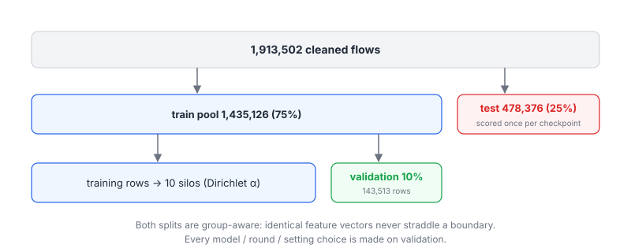

Our project takes this rule very seriously, and Part 3 tells the full, honest story of every time the test set was read.

**Group-aware splitting.** Some flows are exact copies of each other (a port scan sends many identical probes). If one copy lands in training and another in test, the model gets "free" correct answers on test. A *group-aware* split puts all copies of the same feature vector on the same side. We used scikit-learn's `StratifiedGroupKFold` for this (source: `data/README.md`).

### 1.3.2 Overfitting {#bg-overfit}

**Analogy.** A student who memorises the answers to last year's paper word for word scores 100% on that paper and fails a new one. They learned the *paper*, not the *subject*.

A model **overfits** when it fits the quirks and noise of its training data so closely that it does worse on new data. Signs: training score keeps rising while validation score stalls or falls. Ways to fight it that we use: **dropout** (randomly switching off some neurons during training, so the model can't rely on any single one), **weight decay** (a small penalty for large weights), and **early stopping / best-by-validation selection** (keep the version that scored best on validation, not the last one).

### 1.3.3 What an MLP is {#bg-mlp}

**Analogy: a committee of committees.** Imagine 82 measurements of a flow are handed to a first committee of 128 people. Each person looks at all 82 numbers, weighs them in their own way, and writes down one opinion. Those 128 opinions go to a second committee of 64 people, who do the same. The 64 opinions go to a final panel of 9 judges, one per class, who each give a score for "this flow is my class."

That is a **multilayer perceptron (MLP)**: layers of "neurons", where each neuron computes a weighted sum of the previous layer's outputs and passes it through a simple bend (an *activation function*; we use ReLU, which just replaces negative numbers with zero). Training adjusts all the weights so the final scores point at the right class.

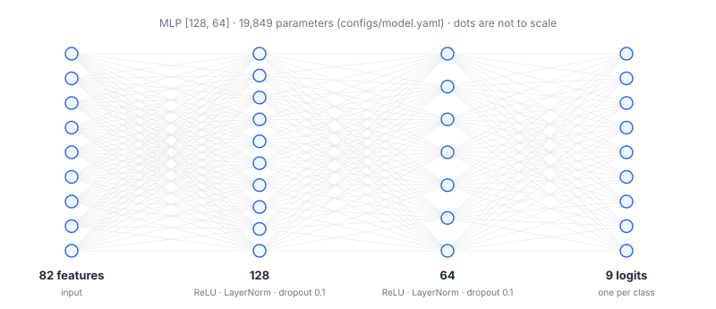

Our model's shape is **[128, 64]** with **19,849 parameters** in total (source: `configs/model.yaml`). That is tiny by modern standards, on purpose: every parameter has to travel between organizations and the server every round.

**Two extra pieces inside our MLP:**

- **Dropout 0.1**: during training, each neuron is switched off with probability 0.1 (source: `configs/model.yaml`).
- **LayerNorm**: rescales each layer's outputs to a standard range, computed fresh for each single example. We chose it over the more common BatchNorm because BatchNorm keeps running averages of the data it has seen; in federated learning those averages would come from very different organizations and averaging them makes no sense (source: `configs/model.yaml`). Chapter [2.2](#ch-model) has the details.

### 1.3.4 Softmax and confidence {#bg-softmax}

The final 9 scores the MLP produces are called **logits**. They can be any number, positive or negative. To turn them into something readable, we apply **softmax**:

**Plain version first.** Softmax turns a list of scores into a list of percentages that add up to 100%, where bigger scores get a much bigger share. It's like converting raw vote counts into vote shares, except softmax exaggerates the leader.

**Formula (after the plain version).** For logits z₁ … z₉, the probability of class i is

  p_i = e^(z_i) / (e^(z₁) + e^(z₂) + … + e^(z₉))

The predicted class is the one with the largest p_i, and that p_i is often called the model's **confidence**.

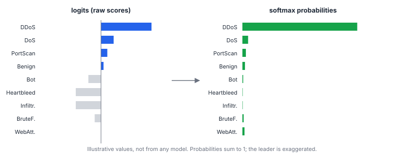

**A warning about confidence.** A softmax probability of 0.99 does *not* mean "right 99% of the time." Neural networks are often over-confident. On the dashboard we show confidence because analysts find it useful, not as a guarantee.

### 1.3.5 Macro-F1, and why we use it instead of accuracy {#bg-macro-f1}

**Why accuracy is misleading here.** In our cleaned data, Benign is about 75% of all flows (source: `data/README.md`). A "detector" that labels *everything* Benign is right about 75% of the time — and catches zero attacks. Accuracy rewards ignoring rare classes.

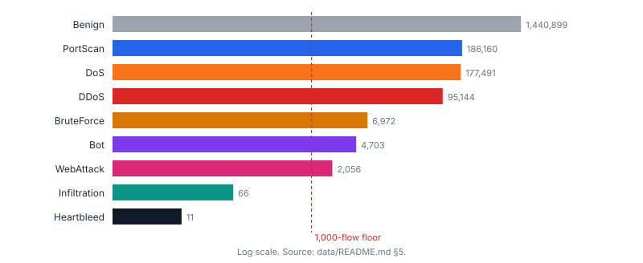

**Precision, recall and F1, with a fishing analogy.** You cast a net to catch only salmon.

- **Precision** = of the fish you caught, what fraction are salmon? (Are your alarms trustworthy?)
- **Recall** = of all the salmon in the lake, what fraction did you catch? (Do you miss attacks?)
- **F1** = the *harmonic mean* of the two: F1 = 2 × precision × recall / (precision + recall). It is high only if *both* are high.

**Macro-F1** computes F1 separately for each class, then takes the plain average, so every class counts equally regardless of size. A model that ignores WebAttack (a small class) loses a whole 1/7 of its macro-F1 score, even though WebAttack is a tiny fraction of the flows.

**Our headline metric** is macro-F1 over the **7 headline classes** (Benign plus 6 attack families: Bot, BruteForce, DDoS, DoS, PortScan, WebAttack). Infiltration and Heartbleed are below the 1,000-flow floor and are reported per class only (source: `configs/model.yaml`, `data/README.md`). The data record states it plainly: macro-F1 is the headline metric "and accuracy is never reported" (source: `data/README.md`).

### 1.3.6 Class imbalance and class weights {#bg-weights}

**Analogy.** A teacher marking a class of 100 where 75 students wrote about one topic and 1 student wrote about another. If every mistake costs the same, the teacher's marking scheme will be tuned to the 75. To be fair to the 1, you make their mistakes "cost more."

**Class weights** do exactly this: in the training loss, mistakes on rare classes are multiplied by a bigger weight. We use **effective-number** class weights with **β = 0.999** (source: `configs/model.yaml`). The idea (the "effective number of samples" idea, Cui et al. [to verify in lit review]) is that adding more examples of a class gives diminishing returns, so the weight of a class with n examples is proportional to (1 − β) / (1 − βⁿ). With β = 0.999, a class with very many examples is down-weighted heavily, and a class with few is not.

**Why not SMOTE (making synthetic minority examples)?** Our data record gives three reasons (source: `data/README.md`): SMOTE would have to run inside each organization, and at α=0.1 many organizations have too few minority examples to interpolate between; flow features are linked (rate = bytes ÷ duration) and interpolation breaks those links; and synthetic points would contaminate the explanation check, which is the project's central measurement.

## 1.4 Federated learning {#bg-fl}

### 1.4.1 The problem it solves {#bg-fl-problem}

**Analogy: a recipe club that can't share kitchens.** Ten restaurants want to create the best soup recipe together, but none will let the others into its kitchen or reveal its customers. So each restaurant tries the current recipe in its own kitchen, tweaks it, and sends *only the tweaked recipe* to a club coordinator. The coordinator blends the ten tweaked recipes into one new recipe and sends it back. Repeat. Nobody ever sees anyone else's ingredients or customers, but the club ends up with a recipe informed by all ten kitchens.

In federated learning (FL), the "recipe" is the model's weights, the "kitchens" are organizations with private data, and the "coordinator" is a server. Network traffic is sensitive (it reveals who talks to whom inside an organization), so it is a natural fit.

### 1.4.2 Clients and server {#bg-clients}

- **Clients** (we also say **silos** or **organizations**, "orgs" on the dashboard): each holds its own private data and trains a local copy of the model. We have **10**.
- **Server**: holds the global model, sends it out, collects updates, combines them. It never sees raw data.

"Cross-silo" FL means a small number of fairly reliable organizations (like ours), as opposed to "cross-device" FL with millions of phones.

### 1.4.3 Rounds and FedAvg {#bg-fedavg}

One **round** of training:

1. The server sends the current global model to every client.
2. Each client trains it on its own data for a few passes (we use **3 local epochs**).
3. Each client sends its updated weights back.
4. The server combines them into a new global model.

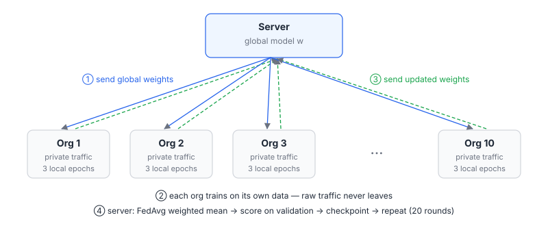

**FedAvg** (federated averaging, McMahan et al. [to verify in lit review]) is the standard way to combine: a **weighted average** of the clients' weights, where each client's weight is proportional to how many training examples it has. A client with twice the data counts twice as much.

Formula, after the plain version: if client k has n_k examples and weights w_k, the new global weights are

  w_new = Σ_k (n_k / N) · w_k, where N = Σ_k n_k.

We run **20 rounds** per training run, and keep the round whose global model scores best on validation ("best-by-validation round selection"), not simply the last one. [2.2](#ch-model) explains why that matters (the "round lottery").

### 1.4.4 What "non-IID" means {#bg-noniid}

**IID** means "independent and identically distributed": every client's data looks like a random sample of the same overall mix. **Non-IID** means the clients' data differ.

**Everyday example.** Ten hospitals train a shared disease detector. A children's hospital sees mostly childhood illnesses; a cancer centre sees mostly tumours; a rural clinic sees mostly injuries. Each hospital's local model becomes an expert in *its* patients. When you average them, the experts pull in different directions, and the average can be worse than any of them.

For network traffic this is realistic: a university network sees lots of port scans; a bank's network sees brute-force login attempts; a small company may see almost only normal traffic.

### 1.4.5 The Dirichlet α slider {#bg-alpha}

We need a *controlled* way to make clients more or less different. The standard tool is the **Dirichlet distribution**, controlled by one number, **α** (alpha).

**Plain version.** For each attack family (say, DDoS), we roll a special die that decides what share of the DDoS flows each of the 10 organizations gets. With a **small α**, the die is "lumpy": one or two organizations get almost all the DDoS flows and the rest get almost none. With a **large α**, the die is "smooth": every organization gets roughly 10%. We do this separately for every family.

- **α = 0.1**: pathological heterogeneity — a family lands almost entirely in one silo.
- **α = 0.5**: realistic heterogeneity.
- **α = 5.0**: near-IID control.

(source: `data/README.md`, §7)

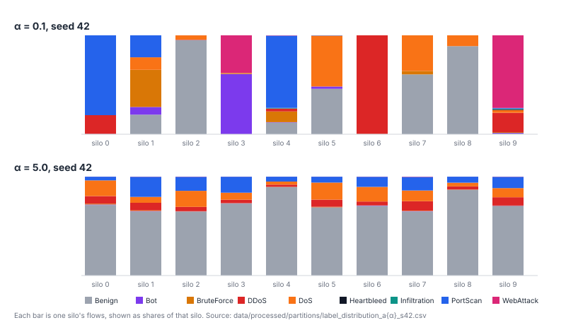

The **near-IID control** matters: without it, we couldn't tell whether a drop in accuracy is caused by *federation itself* or by *non-IID data*. Those are different claims (source: `data/README.md`).

How lumpy does it get? Out of 90 (silo, family) cells per configuration, the number left completely **empty** at seed 42 is 38 at α=0.1, 7 at α=0.5 and 3 at α=5.0 (source: `data/README.md`, §7).

**Formula (after the plain version).** For each family k, draw a proportion vector over the N=10 silos, p_k ~ Dir(α · 1_N); then p_k[i] is the fraction of family k's flows sent to silo i (source: `data/README.md`, §7).

### 1.4.6 FedProx and FedAvgM (server momentum) {#bg-fedprox}

Two well-known fixes for non-IID trouble appear in this project:

- **FedProx** (Li et al. [to verify in lit review]) adds a "leash" to local training: each client is penalised for drifting too far from the global model it received. The leash strength is **μ** (mu). Formula: the client minimises its usual loss + (μ/2)·‖w − w_global‖². Too strong a leash and nobody learns anything local; too weak and it does nothing. We test **μ = 0.0005** in the explanation check ([2.4](#ch-expl)).
- **FedAvgM** (Hsu et al., 2019) adds **momentum on the server**. Analogy: a heavy shopping trolley. Small pushes in random directions don't change its course much; consistent pushes build up speed. The server keeps a running "velocity" of how the global model has been moving, so noisy, conflicting updates from very different clients get smoothed. With momentum 0.9, the update rule is v ← 0.9·v + (w_old − w_avg), w_new = w_old − 1.0·v (source: `docs/preregistration_accuracy.md`, Part 2). This is the method our preregistered comparison selected ([2.6](#ch-prereg)). Note: the headline table writes it as "FedAvgM β=0.9"; β here is the same momentum value 0.9.

## 1.5 Explainable AI {#bg-xai}

### 1.5.1 What SHAP is — "sharing the bill" {#bg-shap}

**The question.** Our model says "this flow is DDoS." *Why?* Which of the 82 features pushed it there?

**Analogy: splitting a restaurant bill fairly.** Four friends share a meal and the bill is higher than the usual price of an empty table. How much of the *extra* did each person cause? It's tricky because orders interact (sharing a bottle of wine, a starter for two). The fair answer, proven by economist Lloyd Shapley, is: imagine the friends arriving in every possible order, see how much the bill goes up when each person sits down, and average that over all orders. Each person's average contribution is their **Shapley value**. The Shapley values always add up exactly to the extra amount on the bill.

**SHAP** (SHapley Additive exPlanations, Lundberg & Lee [to verify in lit review]) applies this to a model's prediction:

- the "bill" is the model's output for this flow;
- the "empty table price" is the model's average output (the **base value**);
- each "friend" is a feature;
- each feature's SHAP value is how much it pushed this prediction up or down from the average.

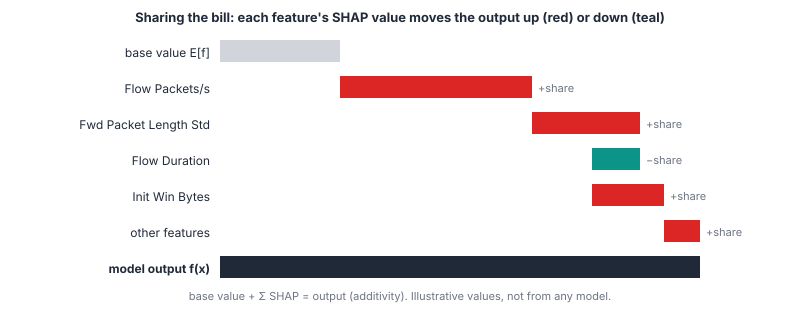

A large positive SHAP value for `Flow Packets/s` means "this feature pushed the model strongly towards DDoS for this flow." Ranking features by the *size* (absolute value) of their SHAP values gives a **top-k list**: the k features that mattered most.

### 1.5.2 Base value and logits {#bg-base}

- The **base value** (also written E[f]) is the model's average output over a **background** set of example rows. It's the "starting point" before we know anything about this particular flow. We use a fixed, seeded background of rows drawn from each silo's own training data (locked decision 4: 100–200 rows per silo; source: `CLAUDE.md`).
- We explain the model's **logits** (the raw scores before softmax, [1.3.4](#bg-softmax)), one set of SHAP values per class. Logits are used because they add up cleanly; probabilities after softmax don't.
- For comparing explanations we use the SHAP vector of the **true class** of each row ("ground-truth anchoring"), so two models are always compared on "how does your output support the correct answer" (source: `docs/measurement_protocol.md` §3).

### 1.5.3 Additivity and the residual {#bg-additivity}

**Additivity** is SHAP's promise that the pieces add up: base value + sum of all SHAP values = the model's actual output. In formula form, for class c: Σ_f SHAP[f, c] = f(x)_c − E[f]_c.

In practice the SHAP software *estimates* the values by sampling, so the sum is a little off. The gap is the **additivity residual**:

  residual = | Σ SHAP − (f(x) − E[f]) |

Think of it as a rounding error in the bill-splitting: the shares add up to almost, but not exactly, the bill. A small residual means the explanation is internally consistent; a large residual means the explanation for that row should be treated with caution. We measured and disclosed it ([2.4](#ch-expl), [3.2](#audits)).

### 1.5.4 GradientExplainer vs DeepExplainer {#bg-explainers}

The SHAP library offers several ways to estimate SHAP values for neural networks:

- **DeepExplainer** uses a fast rule-based shortcut (DeepLIFT). It is exact for some layer types but not for all. On our model it **failed on the LayerNorm layers**: additivity error 2.43 against a 0.01 tolerance (source: `CLAUDE.md`, "Findings that limit what can be claimed").
- **GradientExplainer** (expected gradients) averages gradients along paths between background rows and the input. It works with any differentiable layer, including LayerNorm, at the cost of sampling noise. We use it with `nsamples=4000` for headline numbers (source: `docs/contribution_a_results.md` §3).
- **KernelExplainer** is model-agnostic and slow; we used it only as a cross-check ([2.4](#ch-expl)).

So GradientExplainer was chosen because a test showed DeepExplainer fails on our architecture — not by default.

## 1.6 Comparing explanations {#bg-compare}

### 1.6.1 Top-k lists {#bg-topk}

After SHAP, each model has a ranking of 82 features for each explained flow. We keep the **top 10** (k = 10) by absolute SHAP value. The question becomes: do two models put the same features in their top 10?

### 1.6.2 Jaccard@10 {#bg-jaccard}

**Plain version.** Put the two top-10 lists side by side. Count the features that appear in both (the overlap). Divide by the number of different features that appear in at least one list (the union). 1 means identical sets; 0 means nothing in common. Order inside the top 10 doesn't matter.

**Worked example (made-up lists).** If 7 features are in both lists, the overlap is 7 and the union is 10 + 10 − 7 = 13, so Jaccard@10 = 7/13 ≈ 0.538.

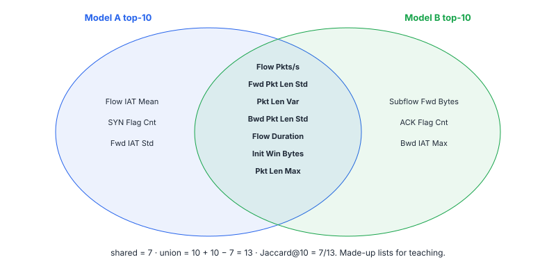

**Formula.** J(A, B) = |A ∩ B| / |A ∪ B|.

Notice how unforgiving it is: sharing 5 of 10 features gives only 5/15 ≈ 0.333.

### 1.6.3 Weighted Kendall's τ {#bg-tau}

Jaccard ignores order and everything outside the top 10. **Kendall's τ** (tau) looks at the *whole* ranking. Plain version: take every pair of features and ask "do both models put these two in the same order?" τ is (agreeing pairs − disagreeing pairs) / all pairs, so +1 is identical order, 0 is unrelated, −1 is reversed.

**Weighted** τ (we use `scipy.stats.weightedtau`) gives more weight to pairs involving important features, so disagreements among the 60 features that nobody cares about don't swamp agreement on the ones that matter (source: `docs/measurement_protocol.md` §6).

**Why both?** Two models can share the same top 10 in a different order (high Jaccard, lower τ), or agree on the overall order but differ on the exact top 10 (lower Jaccard, high τ). Reporting both catches both cases (source: `docs/measurement_protocol.md` §6).

### 1.6.4 Chance level {#bg-chance}

**Plain version.** If two "models" picked their top 10 *completely at random* from 82 features, how much would they overlap by luck? Not zero — on average k²/n features (k = 10, n = 82) land in both lists by luck. Turned into a Jaccard value, that is **0.065** (source: `docs/measurement_protocol.md` §4). Any real agreement must be compared with this, not with 0.

**Formula.** E[|A∩B|] = k²/n and E[|A∪B|] = 2k − k²/n; chance Jaccard is their ratio, with k = 10 and n = 82 (source: `docs/measurement_protocol.md` §4).

### 1.6.5 A "null control" / seed-noise floor, and why it matters {#bg-floor}

**The problem.** Neural network training is random: the starting weights and the order of examples depend on a **random seed**. Train the *same* model on the *same* data twice with different seeds, and you get two slightly different models — and their SHAP top-10 lists will differ a bit too. So when a federated silo's explanation differs from the global model's, how much of that difference is caused by federation and heterogeneity, and how much would have happened anyway, just from the seed?

**Analogy.** Two judges at a talent show give different scores. Before concluding "they have different taste," check how much *the same judge* varies when shown the same act twice. That self-variation is the noise floor.

**Our null control.** Train three centralized models (no federation at all), identical except for seed (42, 1337, 2024). Explain the same 14 rows with each. Measure Jaccard@10 between every pair. The median is the **centralized-seed instability floor**: the agreement you get from seed noise alone. Ours is median 0.429, range [0.429, 0.484] (source: `results/inspection/centralized_instability_floor.csv`).

A federated agreement number above the floor shows something beyond seed noise. A number *below* the floor means the silos agree with the global model *less* than two re-runs of the same centralized model agree with each other. Without this floor, a number like "Jaccard@10 = 0.53" has nothing to be compared against. The project treats this null control as its **headline methodological contribution** (source: `docs/contribution_a_results.md` §1).

![The two reference lines: chance level (0.065) and the seed-noise floor (median 0.429, range [0.429, 0.484]).](img/fig10_numberline.svg)

## 1.7 Poisoning and Byzantine attacks {#bg-poison}

### 1.7.1 Label flipping {#bg-labelflip}

In FL the server can't see clients' data, so a dishonest client can train on bad data and send a harmful update. This is **data poisoning**. The simplest form is **label flipping**: the client keeps its traffic but changes some labels.

Our attack is **targeted to Benign**: a malicious silo relabels a fraction of its *attack* flows as "Benign" before training. The goal of such an attacker is a shared model that waves attacks through. We flip **40%** of eligible rows (`flip_fraction: 0.40`) (source: `docs/contribution_b_results.md` §2). Only non-Benign rows can be flipped, so a silo with very little attack traffic is mechanically a weak attacker — this detail matters later.

Two timing modes: **sudden** (40% from round 1) and **gradual** (starts at 5% and ramps up by 5 points per round, reaching 100% at round 20) (source: `docs/contribution_b_results.md` §2).

### 1.7.2 "Byzantine" clients and "f" attackers {#bg-byzantine}

The name comes from the "Byzantine generals" problem in computer science: some generals may be traitors sending false messages, and the loyal ones must still agree. A **Byzantine client** is one that may send *any* update, possibly malicious. **f** is the number of attackers. We test **f = 3** (silos {0, 3, 5}) and **f = 2** (silos {0, 3}) out of 10 (source: `docs/contribution_b_results.md` §2).

### 1.7.3 Krum, Multi-Krum and trimmed mean {#bg-krum}

These are classic **robust aggregation** rules — replacements for FedAvg designed to resist bad updates.

**Krum** (Blanchard et al.; the year is not recorded in our docs [to verify in lit review]). Plain version: each update is a point in a huge space. Honest updates should cluster together; attackers should sit apart. For each update, add up its squared distances to its *n − f − 2* nearest neighbours. The update with the smallest total is the most "central"; **Krum ships that one update alone** as the next global model.

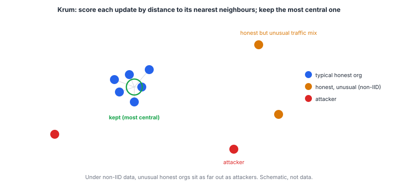

**Multi-Krum** repeats the Krum selection to keep the **n − f** most central updates and averages them. So it drops exactly f updates per round.

**Coordinate-wise trimmed mean** (Yin et al. [to verify in lit review]). Plain version: for every single weight, line up the 10 clients' values, throw away the highest and lowest few, and average the rest. Like Olympic judging, where the highest and lowest scores are discarded. The trim fraction is **β** (beta); we set β = f / n (0.3 at f=3, 0.2 at f=2) (source: `docs/contribution_b_results.md` §4).

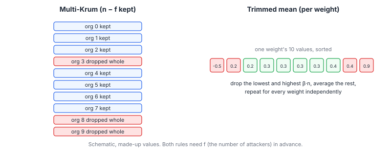

**A trap for non-IID data.** All three rules assume "unusual = malicious." But under non-IID data, an honest organization with an unusual mix of traffic *also* looks unusual. That is exactly the problem our trust check runs into ([2.5](#ch-trust)).

### 1.7.4 What an "oracle attacker count" means {#bg-oracle}

Krum, Multi-Krum and trimmed mean all need to be told **f**, the number of attackers, in advance. In real life nobody knows that. We gave these baselines the **true f** — an "oracle," as if someone whispered the answer. This is a **deliberate advantage** for the baselines. ByzAgent was given neither f nor anything else privileged (source: `docs/contribution_b_results.md` §1). Every ByzAgent-vs-baseline comparison must say this.

## 1.8 LLM agents {#bg-llm}

**What an LLM is.** A large language model is a neural network trained on huge amounts of text to predict the next word. Given a prompt, it writes a continuation. Instruction-tuned models (like ours) have been further trained to follow instructions and produce structured answers such as JSON.

**What an "agent" means here.** Our use is modest: each round, the server writes a prompt containing five numbers per organization, the LLM returns a JSON decision (trust / downweight / quarantine) plus a short written rationale per organization. That is all. It does not browse, plan, or take other actions.

**Why local (Ollama, llama3.1:8b).** We run **`llama3.1:8b-instruct-q4_K_M`** through **Ollama** on our own laptop (source: `configs/agent.yaml`). Reasons:

- *Privacy*: the whole point of FL is that organizations' information stays put; sending their behaviour statistics to a cloud API would undercut that.
- *Hardware*: "8b" means 8 billion parameters; "q4_K_M" means 4-bit quantized, so it fits the 6 GB GPU (~4.8 GB resident, source: `configs/agent.yaml`).
- *Reproducibility and cost*: a fixed local model version, no API changes, no fees.
- *Chosen by test*: three local models were compared; only llama3.1 combined valid JSON, correct client IDs and explanations citing real numbers ([2.5](#ch-trust)).

**Nondeterminism.** An LLM picks each next word by sampling from probabilities. With **temperature 0.2** (source: `configs/agent.yaml`) it is fairly but not fully predictable: send the same prompt twice and you may get a slightly different answer. So we never report one LLM decision as "the" answer; we report **decision stability** — how often repeated calls agree ([2.5](#ch-trust)).

**Why trust an LLM at all?** We don't, blindly. We audit it: we check whether the numbers it cites are real and correctly described, and whether its decisions actually track the statistics. That audit is why our locked wording is that ByzAgent **"produces decisions plus a rationale of measured fidelity"** — never that it "understands" or reasons reliably.

## 1.9 Statistics we used {#bg-stats}

### 1.9.1 Mean ± sd over seeds {#bg-meansd}

We repeat every federated configuration with 3 seeds. We report the **mean** and the **standard deviation (sd)** across those 3 runs, e.g. 0.941 ± 0.057 (source: `results/aggregated/federated_headline.csv`). The sd tells you how much results swing just from randomness. Our headline tables use the *population* sd (dividing by n, not n − 1) (source: `docs/preregistration_accuracy.md`, Part 2). With n = 3, treat the sd as a rough indication, not a precise number.

### 1.9.2 Median and IQR {#bg-median}

The **median** is the middle value when sorted; unlike the mean, one extreme value can't drag it around. The **IQR** (interquartile range) is the spread of the middle half of the data (75th percentile minus 25th). We use medians for the headline agreement numbers because per-row Jaccard values are lumpy and skewed (source: `docs/contribution_a_results.md` §2).

### 1.9.3 Cluster bootstrap confidence intervals {#bg-bootstrap}

**Bootstrap, plain version.** You have one sample and want to know how much a statistic would wobble if you had collected a different sample. Trick: create many fake samples by drawing from your own data *with replacement*, recompute the statistic each time, and look at the spread. The middle 95% of those values is a **95% confidence interval (CI)**.

**Cluster bootstrap.** Our rows are not independent: many rows come from the same silo and the same run. Resampling individual rows would pretend we have more independent evidence than we do. A **cluster** bootstrap resamples whole groups (clusters) instead of single rows, which gives wider, more honest intervals. Our α=0.1 interval is [0.250, 0.429] against the floor range [0.429, 0.484] (source: `CLAUDE.md`, "Findings that limit what can be claimed"). Because they touch at 0.429, we say the below-floor result is **directional, not significant**.

### 1.9.4 Spearman and partial correlation {#bg-corr}

- **Correlation (r)** measures how strongly two quantities move together, from −1 to +1.
- **Spearman** correlation works on *ranks* rather than raw values, so it captures any consistently increasing or decreasing relationship and isn't thrown off by outliers.
- **Partial correlation** asks: do X and Y still move together *after removing the part of both that is explained by Z*? Analogy: ice-cream sales and drownings are correlated, but both are driven by hot weather. Control for temperature and the correlation disappears. We use partial correlation to ask whether label skew predicts explanation agreement *after controlling for silo size* ([2.4](#ch-expl)).

### 1.9.5 Effect size {#bg-effect}

A **p-value** says how surprising a result would be if nothing were going on; an **effect size** says *how big* the difference is. For the trust check we use **Glass's delta**: (mean of malicious silos − mean of clean silos) ÷ (standard deviation of the clean silos) (source: `docs/contribution_b_results.md` §3). "Big" here means "many clean-silo standard deviations apart."

### 1.9.6 Why we report r and n, with no p-values {#bg-nopvalue}

A p-value assumes every data point is an independent observation. Our silos are **not independent**: all 10 silos in one run share the same global model trajectory. Treating 30 silos as 30 independent points would overstate the evidence; the number of truly independent units is closer to the number of seeds (3) (source: `docs/contribution_a_results.md`, Limitations #18). A p-value computed as if n were 30 would look more convincing than the evidence deserves. So we report the correlation **r** and the count **n**, and let readers judge. This is a deliberate project rule (source: `CLAUDE.md`).

### 1.9.7 Pre-registration {#bg-prereg}

**Analogy: the sealed envelope.** Before a match, you write your prediction and the rule for judging it, seal it in an envelope, and hand it to a friend. After the match, you open it. Nobody can accuse you of changing your story after seeing the result.

**Pre-registration** in research means writing down, *before* looking at the data, exactly what you will compare, how you will decide, and what counts as success — and committing it publicly (for us, to git, with a timestamp). We used it twice: for the rolling-history test in the trust check ([2.5](#ch-trust)) and for the accuracy-improvement experiment ([2.6](#ch-prereg)). It protects against the most common way honest people fool themselves: choosing the analysis after seeing which one looks best.

## 1.10 Self-check: could a non-ML friend follow this? {#bg-check}

We re-read Part 1 asking one question per section: could a friend who has never studied ML explain it back? The rewrites made after that check:

- Every term now has an everyday analogy *before* its formula (exam paper, committee, fishing net, recipe club, restaurant bill, talent-show judge, Olympic judging, sealed envelope).
- The Jaccard example uses a picture with countable features, so the 7/13 can be checked by eye.
- "Logit", "base value" and "residual" are each introduced with the bill analogy, rather than with symbols.
- Dirichlet α is explained as a "lumpy vs smooth die," with a picture made from our real partition files.
- Remaining hard spots, flagged honestly: weighted Kendall's τ and the cluster bootstrap are the two ideas that need a second read. For an exam answer, the one-sentence versions are enough: "τ asks whether two rankings put pairs of features in the same order, giving more weight to important features," and "a cluster bootstrap estimates uncertainty by resampling whole silos rather than single rows, because rows from one silo are not independent."

# Part 2 — The system, stage by stage {#part-2}

Each chapter follows the same eight sections, so you always know where to look: **In one line · Why this exists · How it works · What we actually did · What we found · What this does NOT mean · Where it lives in the code · Questions an examiner might ask.**

## 2.1 Data {#ch-data}

### In one line

We took the corrected Distrinet CICIDS2017 V4 dataset, cleaned 2,099,976 raw flows down to 1,913,502, mapped 14 raw labels into 8 attack families plus Benign, split it once into train and test without letting duplicates leak across, and locked the federated partitions with SHA256 hashes (source: `data/README.md`).

### Why this exists

Every later number depends on the data being right. CICIDS2017 is one of the most used IDS datasets, and also one of the most criticised: published studies found mislabelled flows, broken flow construction and duplicated captures in the original release. A model trained on bad labels learns bad lessons, and a split that lets duplicate rows straddle train and test inflates every score. This stage exists to make the data trustworthy *and* to record every cleaning decision with its row count, so anyone can check it.

### How it works

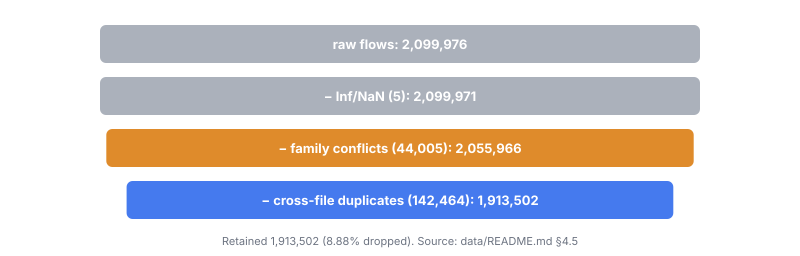

1. **Load** the five per-day CSV files (Monday to Friday of the lab capture). 2,099,976 flows, 91 columns: 7 identifiers, `Label`, `Attempted Category`, and 82 candidate features (source: `data/README.md` §1).
2. **Drop identifiers** (`id`, `Flow ID`, `Src IP`, `Src Port`, `Dst IP`, `Dst Port`, `Timestamp`) so the model learns behaviour, not addresses.
3. **Map labels to families** (raw label → family), *before* any other cleaning step.
4. **Remove non-finite values** (infinities).
5. **Remove family conflicts**: groups of rows with identical features but different families.
6. **Remove cross-day duplicates**.
7. **Split** once, globally, group-aware, 75/25 train/test.
8. **Carve validation** out of the training pool (10%, also group-aware).
9. **Partition** the training pool into 10 silos with a Dirichlet draw, for each (α, seed), and store the row→silo assignment with a SHA256 hash.

**Analogy for the order of steps.** Sorting laundry: you first decide which pile each item belongs to (family mapping), *then* you look for items that are identical but in different piles (conflicts). If you looked for conflicts first, using the original tags, you'd wrongly treat a "navy sock" and a "dark-blue sock" as a conflict even though both go in the "socks" pile. That exact bug happened once and was fixed (see below).

### What we actually did

**Dataset: Distrinet CICIDS2017 V4, not the original.** The lineage has two papers, and both are cited (source: `data/README.md` §1):

- Engelen, Rimmer & Joosen (WTMC 2021) found errors in traffic generation, flow construction, feature extraction and labelling, fixed CICFlowMeter, and introduced the `X - Attempted` label convention.
- Liu, Engelen, Lynar, Essam & Joosen (IEEE CNS 2022) found further errors and released the refined version 4, which we use.
- *Rejected:* the original CIC release (known errors). *Not used:* a third correction branch by Lanvin et al. (CRiSIS 2022), which addresses different issues (source: `data/README.md` §1).

**"Attempted" flows join their parent family.** A flow labelled `X - Attempted` belongs to attack class X but carried no payload — the attack was launched but didn't land. The initial plan was to fold these into Benign, as Engelen et al.'s own benchmark does. The counts overturned it: for some families most flows are Attempted (Web Attack – XSS 97%, Web Attack – Brute Force 95%, Botnet 85%) (source: `data/README.md` §2). Folding them into Benign would have wiped out most of Bot and WebAttack. *Cost, stated:* the model learns to alert on failed attempts too, so per-family scores mix completed and attempted attacks.

**14 raw labels → 8 families + Benign** (source: `data/README.md` §3):

| Family | Raw labels folded in |
|---|---|
| Benign | BENIGN |
| DoS | DoS Hulk, DoS GoldenEye, DoS Slowloris, DoS Slowhttptest (+ Attempted) |
| DDoS | DDoS |
| PortScan | Portscan, Infiltration - Portscan |
| BruteForce | FTP-Patator, SSH-Patator (+ Attempted) |
| WebAttack | Web Attack Brute Force / XSS / SQL Injection (+ Attempted) |
| Bot | Botnet (+ Attempted) |
| Infiltration | Infiltration (+ Attempted) |
| Heartbleed | Heartbleed |

**`Infiltration - Portscan` goes to PortScan.** 67,072 raw flows (source: `data/README.md` §3). By name it is part of the infiltration scenario; by feature signature (short flows, few bytes, many probes) it is a port scan. Routing it to Infiltration would make that family over 99.9% scan-shaped, and every "Infiltration" explanation would really explain a port scan. *Cost:* Infiltration drops to 66 flows, below the floor. Accepted deliberately.

**The 1,000-flow floor.** Families below 1,000 flows are **kept in the data**, **reported per class**, but **excluded from headline macro-F1**: Infiltration (66) and Heartbleed (11) (source: `data/README.md` §3). With 11 examples, a macro-F1 that includes Heartbleed would swing wildly from one flow being right or wrong.

**Cleaning, with every count** (source: `data/README.md` §4.5):

| Stage | Rows removed |
|---|---:|
| Start | 2,099,976 |
| Inf / NaN | −5 |
| Family conflicts | −44,005 |
| Cross-file duplicates | −142,464 |
| **Retained** | **1,913,502** (8.88% dropped) |

- **Inf/NaN:** exactly 5 flows with `Flow Duration == 0` produce infinite rates (both rate columns divide by duration). The ICMP columns hold −1 for non-ICMP flows; that's CICFlowMeter's "not applicable" code, not corruption, so it was left alone (source: `data/README.md` §4.1).
- **Family conflicts:** 43,890 rows in Benign|PortScan groups and 115 in Bot|Infiltration groups (source: `data/README.md` §4.2). Even in the corrected dataset, ~43,890 flows are feature-identical to traffic of another family once identifiers are removed. No model can separate identical inputs with different labels; this is a ceiling set by the 82-feature space, and it is reported as a limitation.
- **The conflict bug that was caught.** An earlier version checked conflicts on the *raw* label and destroyed 58,307 rows where `Infiltration - Portscan` and `Portscan` "conflicted," although both map to PortScan (source: `data/README.md` §4.2). It didn't crash; it produced plausible output for a full cycle. It was caught only by logging *which* combinations conflicted.
- **Duplicates: drop only across days.** The raw exact-duplicate rate is 18.3%, almost all in scans and bots (Portscan 99.2% of its rows sit in duplicate groups) (source: `data/README.md` §4.3). A port scan sends many identical probes that differ only in port number — a column we dropped. These are distinct events that *look* identical, not one event recorded twice. So duplicates are dropped only when a group spans **more than one day-file**, which matches the capture-overlap problems documented in the correction papers. The dedup key is the raw label (provenance), on purpose different from the conflict key (family).
- **Near-constant features kept.** 8 of 82 features have one value covering ≥99.9% of rows, but none is strictly constant; `ICMP Type`/`Code` are the only features that could describe an ICMP attack. **All 82 features retained** (source: `data/README.md` §4.4).

**Final family distribution** (source: `data/README.md` §5):

| Family | Flows | Below floor |
|---|---:|:---:|
| Benign | 1,440,899 | |
| PortScan | 186,160 | |
| DoS | 177,491 | |
| DDoS | 95,144 | |
| BruteForce | 6,972 | |
| Bot | 4,703 | |
| WebAttack | 2,056 | |
| Infiltration | 66 | ✓ |
| Heartbleed | 11 | ✓ |

**Group-aware, global split, before partitioning.** After cleaning, 213,752 rows still share a feature vector with at least one other row (1,714,074 distinct vectors among 1,913,502 rows) (source: `data/README.md` §6). A random split would put copies on both sides. Deleting them would strip most of PortScan. Instead, every distinct feature vector is a **group**, and `StratifiedGroupKFold` keeps each group on one side. The pipeline *verifies* this and raises an error if any vector appears on both sides. Result: 1,435,126 train / 478,376 test (25.0%), with every headline family at exactly 25.0% in test (source: `data/README.md` §6). The split is done **once, before federation**, so the centralized and federated models are scored on the identical test set.

**Validation.** A 10% group-aware validation mask is carved from the training pool (`val_fraction: 0.10`, seed 42; source: `configs/model.yaml`), giving the 143,513-row centralized validation set used for every model and round selection (source: `docs/efficiency_results.md`).

**Partitions on disk, with a SHA256 manifest.** For each of the 9 (α, seed) configurations the pipeline writes the **row → silo assignment** (about 2 MB) rather than 90 copies of the data. The manifest stores a SHA256 hash of the assignment array itself, and `load_silo()` recomputes and checks it every time a silo is loaded; it was verified to detect a single flipped value among 1.4M entries (source: `data/README.md` §7). Analogy: a tamper seal on a medicine bottle — if anything changed, you know before you use it.

**Leakage controls, summarised** (source: `data/README.md` §8): scalers fit per silo on that silo's train rows only; group-aware split, verified; dedup before partitioning; manifest hash checked at load; SHAP background drawn from training rows only; floor exclusions decided once from pooled counts.

### What we found

- 8.88% of raw rows were removed, each removal step with its own count (source: `data/README.md` §4.5).
- Benign is 75% of the data; Heartbleed is 0.0006% (source: `data/README.md` §5). This drives the choice of macro-F1 and class weights.
- The partitions behave as intended: empty (silo, family) cells at seed 42 fall from 38 (α=0.1) to 7 (α=0.5) to 3 (α=5.0), and the mean largest single-silo share of a family falls from 0.694 to 0.372 to 0.177, against a uniform ideal of 0.100 (source: `data/README.md` §7).
- At α=0.1, silo sizes range from about 143 rows to about 636,676 (source: `data/README.md` §7).

### What this does NOT mean

- It does not mean CICIDS2017 V4 is *perfect*. 43,890 Benign/PortScan flows were indistinguishable by features and had to be dropped; this is a limit of the feature space.
- It does not mean our results transfer to real enterprise traffic. CICIDS2017 is a lab capture over five days.
- Per-family scores mix completed and attempted attacks, by design.
- Even at α=5.0 some cells are empty: Heartbleed has 8 training flows and cannot occupy 10 silos (source: `data/README.md` §7).

### Where it lives in the code

| File | What it does |
|---|---|
| `configs/data.yaml` | Every data parameter, including `family_map` and the floor |
| `src/data/clean.py` | Load → map → Inf/NaN → conflicts → dedup → `clean.parquet` |
| `src/data/mapping.py` | Raw label → family; raises on any unmapped label |
| `src/data/families.py` | Global group-aware split → `train_pool.parquet`, `test_global.parquet` |
| `scripts/make_val_split.py` | Group-aware 10% validation mask |
| `src/data/partition.py` | Dirichlet partitioning, manifest, `load_silo()` with hash check |
| `scripts/check_partitions.py` | Pre-flight check for silos that would crash a round |
| `data/README.md` | The decision record this chapter is built from |

### Questions an examiner might ask

_Numbers in these model answers repeat numbers already given with their source earlier in this chapter; the source notes are not repeated here._

**Q: Why not use the original CICIDS2017 like most papers?**
A: The original release has documented errors in flow construction and labelling. Engelen et al. (WTMC 2021) and Liu et al. (IEEE CNS 2022) corrected them; we use the V4 release from the second paper and cite both.

**Q: Why did you put "Attempted" attacks in the attack families instead of Benign?**
A: Because for Web Attack – XSS, Web Attack – Brute Force and Botnet, 85–97% of the flows are Attempted. Folding them into Benign would have nearly erased those families. The cost is that per-family scores mix failed and successful attacks; we state it.

**Q: You dropped 142,464 duplicates. Isn't duplication normal for scans?**
A: Yes, so we did *not* drop same-day duplicates — a scan's identical probes are distinct events. We only dropped groups spanning more than one day-file, which match the capture-overlap problems the correction papers describe.

**Q: How do you know duplicates didn't leak between train and test?**
A: Every distinct feature vector is a group, and `StratifiedGroupKFold` keeps groups on one side. The script doesn't trust the library: it checks and raises if any vector appears on both sides.

**Q: Why exclude Infiltration and Heartbleed from the headline?**
A: They have 66 and 11 flows. One flow right or wrong would move a headline average noticeably. They stay in the data and are reported per class.

**Q: What does the SHA256 manifest protect against?**
A: Silently training on a different partition than the one reported — for example, if a code change regenerated it. The hash is over the assignment array, checked every time a silo loads, and was verified to catch one flipped value in 1.4M.

**Q: Did any cleaning bug affect results?**
A: Two were caught *before* results: conflict detection on raw labels (would have destroyed 58,307 learnable rows) and dedup keyed on family (would have deleted 58,228 rows). Both are recorded in `data/README.md`.

---

## 2.2 Model and training {#ch-model}

### In one line

A small MLP ([128, 64], 19,849 parameters, LayerNorm, dropout 0.1) with StandardScaler inputs and effective-number class weights (β=0.999), trained with AdamW, where the reported version of every federated run is the round with the best *validation* score (source: `configs/model.yaml`).

### Why this exists

The explanation check and trust check both need one trustworthy model to study. If the model were poorly configured, every later finding could be blamed on it. So each setting was chosen by a small experiment (a "pilot") rather than by habit, and the reason for each is written in `configs/model.yaml` next to the value.

### How it works

- **Input:** 82 features, each standardised (mean 0, standard deviation 1) using a scaler fitted on the silo's own training rows.
- **Network:** 82 → 128 → 64 → 9, ReLU activations, LayerNorm, dropout 0.1.
- **Loss:** cross-entropy weighted by effective-number class weights (β=0.999), the *same* 9 weights for every silo.
- **Optimizer:** AdamW, learning rate 1.0e-3, weight decay 1.0e-4, batch size 1024 (source: `configs/model.yaml`).
- **Labels:** a **frozen 9-wide vocabulary** (Benign=0 … WebAttack=8), never derived from a silo's own rows (source: `configs/model.yaml`). If a silo has no Heartbleed flows, its model still has a Heartbleed output; otherwise silos' outputs wouldn't line up and couldn't be averaged.

### What we actually did

| Choice | Why | Rejected alternative, and why |
|---|---|---|
| **StandardScaler** | RobustScaler degenerates on 28 of 82 zero-inflated features (their IQR is 0, so it only centres them and leaves them unscaled); StandardScaler degenerates on just 1 (`Bwd URG Flags`, all zero) (source: `configs/model.yaml`) | RobustScaler, robust-with-clipping |
| **Effective-number class weights, β=0.999** | Best on validation macro-F1 (0.9941) in the weights pilot (source: `configs/model.yaml`) | none, inverse-sqrt, β=0.9999, β=0.99999. Larger β over-corrected: Infiltration precision fell from 0.92 to 0.12 between β=0.999 and 0.99999 (source: `configs/model.yaml`) |
| **MLP [128, 64]** | The top 4 architectures were within 0.0008 validation macro-F1 of each other, less than epoch-to-epoch noise. So the tie-breaker was size: 19,849 parameters vs 56,073 ([256,128]) vs 209,673 ([512,256,128]) — 3.7× and 10.6× less to send every round (source: `configs/model.yaml`) | Bigger models: no measurable gain; the largest also showed a one-epoch instability (validation macro-F1 0.988 → 0.881) |
| **Dropout 0.1** | Direction vs 0.3 flips with model size; inside noise (source: `configs/model.yaml`) | 0.3 |
| **LayerNorm, not BatchNorm** | BatchNorm stores running statistics of the data it saw. In FL those statistics come from incompatible per-silo distributions, and FedAvg would average them meaninglessly (source: `configs/model.yaml`) | BatchNorm |
| **3 local epochs** | Re-checked on validation: 3 epochs beat 1 at α=0.5 in all three seeds, mean best-by-validation macro-F1 0.9425 vs 0.8602 (source: `results/federated/epochs_provenance_val.json`, `docs/test_set_exposure_audit.md` §2) | 1 epoch |
| **Frozen 9-wide label vocabulary** | Every silo's output layer means the same thing | Per-silo label sets |
| **Global fixed class weights** | If each silo computed its own weights, each would minimise a different loss, and FedAvg would average models optimising different objectives (source: `scripts/export_class_weights.py` docstring) | Per-silo weights |
| **Best-by-validation round selection** | See "the round lottery" below | Reporting round 20 |

**Honest note on three of these choices.** Three early choices were *recorded* with test-set numbers as their justification: 3 local epochs, FedProx μ=0.0005 and StandardScaler. Re-checked on validation, the same μ and scaler are selected; for local epochs, validation also selects 3 over 1 at α=0.5 in all three seeds (source: `CLAUDE.md`, "Test-set use"). Part 3 tells the full story.

**Honest note on the class weights.** The 9 global weights are computed once from the pooled (centralized) training counts and given to every silo (source: `scripts/export_class_weights.py`). In a real deployment those counts would need to be shared or estimated; in our simulation it is a simplification we state.

**Best-by-validation round selection and the round lottery.** A federated run lasts 20 rounds. The global model's quality jumps around from round to round under non-IID data, because each round's average is pulled by very different clients. If you report "whatever round 20 happened to be," you are entering a lottery.

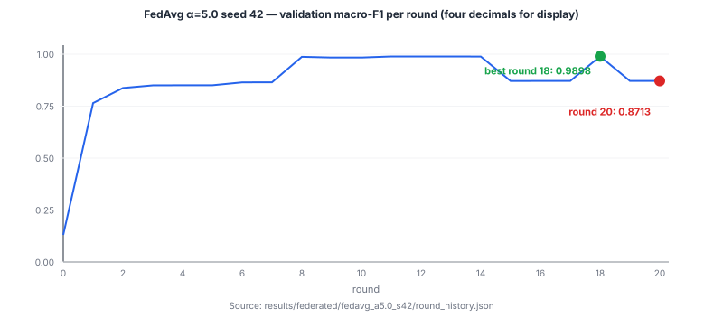

The largest gap between the best-by-validation round and round 20 is **0.118** (α=5.0, seed 42, validation macro-F1: best 0.9898 at round 18 vs 0.8713 at round 20) (source: `results/federated/round_lottery_val.csv`). So **every reported number uses the validation-selected round.** Analogy: if you're picking a player for the final, you choose on their best form in practice matches, not on whatever the last practice happened to be.

*Kept as a record:* the lottery was first measured with test scores (a round-20 test score of the unselected checkpoint), with a maximum of 0.1199 (α=0.5, seed 1337); that test-based version is superseded by the validation-only one (source: `docs/contribution_a_results.md`, Limitations #1).

### What we found

- Centralized MLP macro-F1: **0.9900 ± 0.0022** over 3 seeds (source: `results/aggregated/centralized_headline.csv`).
- XGBoost (a strong non-neural reference): **0.9946 ± 0.0001** (source: `results/aggregated/xgboost_headline.csv`).
- The served demo model, `fedavg_a0.5_s42`, is round 18 with validation macro-F1 **0.9760** (source: `results/federated/fedavg_a0.5_s42/final_metrics.json`).

### What this does NOT mean

- The pilots were small: a handful of arms each, centralized, on one seed family. They show the chosen settings are reasonable, not optimal.
- XGBoost being slightly higher does not make it the right model here: tree ensembles don't average across clients the way neural network weights do, and SHAP on an MLP is what the explanation check needs. XGBoost is a reference line, not a competitor.
- The round lottery means a single federated run's "last round" number is unreliable; it does not mean federated training is broken.

### Where it lives in the code

| File | What it does |
|---|---|
| `configs/model.yaml` | Every model and training setting, with the reason next to each lock |
| `src/models/` | The MLP definition |
| `src/train/centralized.py` | Centralized training (baselines, pilots) |
| `src/train/xgboost_baseline.py`, `scripts/tune_xgboost.py` | XGBoost reference (tuning early-stops on validation) |
| `scripts/run_pilots.py` | Scaler, class-weight and architecture pilots |
| `scripts/export_class_weights.py` | Writes `configs/global_class_weights.json` once |
| `results/aggregated/*_headline.csv` | Headline tables |
| `results/federated/round_lottery_val.csv` | The validation-only round lottery |

### Questions an examiner might ask

_Numbers in these model answers repeat numbers already given with their source earlier in this chapter; the source notes are not repeated here._

**Q: Why such a small model?**
A: The top four architectures scored within 0.0008 of each other on validation, so extra capacity bought nothing measurable. The smallest has 19,849 parameters, 3.7× and 10.6× fewer than the next two — and every parameter travels every round.

**Q: Why LayerNorm instead of BatchNorm?**
A: BatchNorm keeps running statistics of its input data. Averaging those across organizations with very different traffic is meaningless. LayerNorm normalises each example on its own and has no such state.

**Q: Why not just report the final round?**
A: Because of the round lottery: at α=5.0, seed 42, round 20 was 0.118 lower than the best round on validation. Choosing by validation is the standard, fair fix, and it never looks at test data.

**Q: Isn't choosing the best round on validation a form of cheating?**
A: No — that's what validation is for. Cheating would be choosing it on the test set. The test set scores only the already-chosen checkpoint.

**Q: Why StandardScaler rather than RobustScaler, which handles outliers better?**
A: RobustScaler divides by the IQR, which is zero for 28 of our 82 zero-inflated features, so those were left unscaled. StandardScaler fails on only one all-zero feature. Validation also picked it.

**Q: Why effective-number weights and not plain inverse-frequency?**
A: The pilot showed stronger correction hurts: from β=0.999 to β=0.99999, Infiltration precision fell from 0.92 to 0.12. β=0.999 scored best on validation.

---

## 2.3 Federated training {#ch-fl}

### In one line

Ten simulated organizations train the MLP together with Flower and FedAvg for 20 rounds of 3 local epochs each, at α ∈ {0.1, 0.5, 5.0} × seeds {42, 1337, 2024}, on CPU, with partitions checked by hash every time they load.

### Why this exists

This is the "federated" in federated IDS. It produces the trained models that both the explanation check and the trust check study, and it answers the first question an examiner asks: how much accuracy does federation cost, and when?

### How it works


1. Flower's simulation engine starts one server and 10 client processes on one laptop.
2. Each round, the server sends the global weights to **all 10** silos (`fraction-train = 1.0`; source: `federated/pyproject.toml`).
3. Each silo loads its partition (hash-checked), scales its own data with its own scaler, and trains 3 local epochs.
4. The server averages the updates with FedAvg (sample-count weighted), scores the new global model on the centralized validation split, and saves a checkpoint for that round.
5. After 20 rounds, the round with the highest validation macro-F1 is the run's model.

**Locked decision 5: all 10 silos train, regardless of size.** Even the 143-row silo at α=0.1 trains. The size floor (T_SILO=400) applies only later, to decide which silos are *eligible for explanation analysis* (source: `CLAUDE.md`; `docs/contribution_a_results.md` §6). Dropping small silos from training would change the federation we're studying.

### What we actually did

- **Framework: Flower (flwr) 1.33.0** (source: `README.md`, tech stack).
- **The authoritative harness is `federated/xfed_federated/`**, invoked as `flwr run federated local-simulation`. A bare `flwr run` from the repo root **fails on purpose**: an older prototype in `src/federated/` never implemented best-by-validation selection, so the root `pyproject.toml` had its Flower app section removed to make it impossible to train against the wrong harness by accident (source: `docs/contribution_b_results.md` §10).
- **9 configurations:** α ∈ {0.1, 0.5, 5.0} × seeds {42, 1337, 2024}.
- **20 rounds, 3 local epochs** (source: `federated/pyproject.toml`).
- **CPU, not GPU.** Flower builds an isolated environment for each run, and that environment used **torch 2.13.0+cpu**. This was verified for the August environments and all runs from 2026-10-12 on, so the published federated runs most likely trained on CPU (source: `docs/preregistration_accuracy.md`; `docs/contribution_a_results.md`, optimizer section). The GPU ran the centralized MLP, XGBoost and Ollama (source: `CLAUDE.md`, Environment). We disclose this because an earlier description said the federated runs used the GPU.
- **Partitions on disk** with the SHA256 manifest from [2.1](#ch-data).
- **Server-side validation** on the centralized 143,513-row validation split. In a real deployment the server wouldn't hold a centralized validation set; this is a simulation simplification.
- **Legacy client-side test scoring.** The published runs also scored each silo on its own local test shard every round (`fraction-evaluate = 1.0`). Nothing reads those scores; the flag is now off by default (`legacy-client-test-eval = false`) (source: `README.md`, step 4; `docs/test_set_exposure_audit.md` row 3). Part 3 covers it.

### What we found

| α | FedAvg macro-F1 (mean ± sd, 3 seeds) | Per seed (42 / 1337 / 2024) |
|---|---|---|
| 0.1 | **0.516 ± 0.048** | 0.5426 / 0.4481 / 0.5572 |
| 0.5 | **0.941 ± 0.057** | 0.9753 / 0.9866 / 0.8605 |
| 5.0 | **0.990 ± 0.001** | 0.9900 / 0.9905 / 0.9889 |

(source: `results/aggregated/federated_headline.csv`; per-seed values from `docs/contribution_a_results.md`, optimizer section)

Compare: centralized MLP 0.9900 ± 0.0022 (source: `results/aggregated/centralized_headline.csv`).

**Reading.**

- **At α=5.0 (near-IID), federation costs nothing**: 0.990 vs 0.990 centralized.
- **At α=0.5, it mostly works**, but one seed (2024) is much worse (0.8605), which inflates the spread.
- **At α=0.1, accuracy collapses** to 0.516. Many silos hold only one or two families; averaging their very different models produces a global model that misses whole families.

So the near-IID control does its job: the drop is caused by **non-IID data**, not by federation as such.

**Time and bytes.** One round over 25 logged method runs had a median of 51.4 seconds on the laptop's CPU (source: `results/efficiency/communication.json`). Each round moves 1,587,920 bytes of fp32 weights in total (793,960 each way) (source: `results/efficiency/communication.json`).

### What this does NOT mean

- It does not mean "federated learning is worse than centralized." At α=5.0 they tie. The cost depends on heterogeneity.
- It does not mean α=0.1 is realistic. It is a deliberately pathological stress test.
- n=3 seeds per α: the ± values are rough.
- Ten processes on one laptop is a simulation; there is no real network, no dropped clients and no stragglers.
- These are not GPU results.

### Where it lives in the code

| File | What it does |
|---|---|
| `federated/xfed_federated/server_app.py` | Server strategy, validation scoring, checkpointing, logging strategies (`LoggingFedAvg`, Krum, trimmed mean, ByzAgent) |
| `federated/xfed_federated/client_app.py` | Local training on one silo |
| `federated/xfed_federated/_vendored/` | Vendored copies of data loading, metrics, attacks, agent (Flower isolates the app) |
| `federated/pyproject.toml` | Rounds, local epochs, fractions, pinned versions |
| `federated/flwr_config.example.toml` | Example user-level Flower simulation config |
| `tools/run_sweep.ps1`, `tools/run_sweep_fedprox.ps1` | The 9-configuration sweeps |
| `scripts/aggregate_federated.py` | Builds `results/aggregated/federated_headline.csv` |
| `results/federated/<tag>/` | Per-run `round_history.json`, `final_metrics.json`, checkpoints |
| `src/federated/` | Early prototype, **unused**, kept as it was |

### Questions an examiner might ask

_Numbers in these model answers repeat numbers already given with their source earlier in this chapter; the source notes are not repeated here._

**Q: Isn't your federated accuracy worse than centralized?**
A: Only under heterogeneity. At α=5.0 FedAvg scores 0.990 ± 0.001, the same as centralized 0.9900 ± 0.0022. At α=0.5 it's 0.941 ± 0.057 and at α=0.1 0.516 ± 0.048. The near-IID control shows the drop comes from non-IID data, not federation itself.

**Q: Why train tiny silos that can't learn anything?**
A: Locked decision 5: all 10 silos train regardless of size, because that's the federation we're studying. Small silos are only excluded later from the *explanation* analysis, by a stated size floor.

**Q: Did you use the GPU for federated training?**
A: No. Flower's isolated runtime installed torch 2.13.0+cpu, verified for the August environments and every run from 2026-10-12 on. The GPU trained the centralized MLP and XGBoost and ran Ollama.

**Q: What stops someone from accidentally running the wrong harness?**
A: The root `pyproject.toml` has no Flower app section, so a bare `flwr run` fails immediately. Every reported number came from `flwr run federated local-simulation`.

**Q: Why is α=0.5 seed 2024 so much worse?**
A: That seed's partition happens to be harder: its best-by-validation macro-F1 was 0.8644 against 0.9760 and 0.9871 for the other seeds (source: `docs/preregistration_accuracy.md`, baseline table). It's why we run three seeds and report the spread.

**Q: Is a centralized validation set realistic in FL?**
A: No; it's a simulation simplification that lets us pick rounds fairly and compare methods on identical terms. A deployment would need held-out validation data agreed by the participants.

## 2.4 Explanation check {#ch-expl}

### In one line

Each organization explains its own model with SHAP on its own machine, only the top-10 feature rankings go to the server, and we measure how well those rankings agree with the global model's — finding that agreement falls as data becomes more heterogeneous, down to a level at α=0.1 that sits below a seed-noise floor (directional, not significant).

### Why this exists

**The claim** this chapter tests, from the canonical results document: **"Under realistic non-IID federation, accuracy parity between silos does not imply explanation parity."** (source: `docs/contribution_a_results.md` §1)

Why should anyone care? An analyst who gets an alert wants to know *why*. If every organization's model raises the same alert for *different reasons*, then an explanation that convinces one analyst might be meaningless at another organization. A model can be accurate and still be "right for different reasons" across sites.

Oki et al. (IEEE Networking Letters, 2024) showed that federated training *reduces* explanation distance in a distributed IDS. We don't dispute that. We ask **where that reduction breaks down** as client data becomes more different (source: `docs/contribution_a_results.md` §1). And we add a reference line nobody in this space reports: how much explanations differ from **random seed alone**.

### How it works

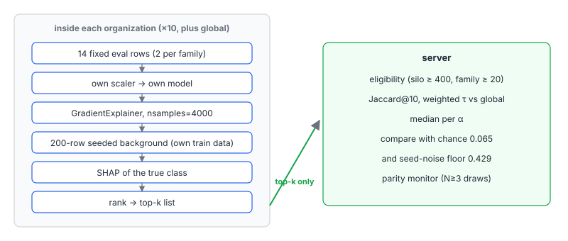

1. **A fixed evaluation set.** Every model explains the *same physical rows*: 14 rows, 2 per headline family, drawn once with `EVAL_SEED = 12345`. (The target was 20 rows; 20 // 7 = 2 per class gives 14.) Each model rescales the raw rows with its own scaler (source: `docs/measurement_protocol.md` §2).
2. **Client-side SHAP.** Each silo runs `GradientExplainer` (`nsamples=4000`) on its own model, with a fixed, seeded, class-stratified background of 200 rows from its *own* training data (source: `docs/measurement_protocol.md` §5; locked decision 4 in `CLAUDE.md`).
3. **Anchor on the true class.** For each row, take the SHAP vector of the row's true family, so models are compared on how they support the correct answer, not on what each happened to predict (source: `docs/measurement_protocol.md` §3).
4. **Only rankings leave.** Each silo turns its SHAP vector into a top-k ranking. **Only the top-k ranking crosses the client → server boundary** — no SHAP magnitudes, no raw data (locked decision 4; source: `CLAUDE.md`).
5. **Compare with the global model.** For each (silo, row), compute Jaccard@k (k ∈ {5, 10, 20}; headline k=10) and weighted Kendall's τ between the silo's ranking and the global model's (source: `docs/measurement_protocol.md` §6).
6. **Eligibility.** A (silo, row) pair counts only if the silo is big enough (T_SILO = 400 flows) and holds enough of that row's family (M_FAMILY = 20) (source: `docs/contribution_a_results.md` §6). A silo with no Bot traffic can't be expected to explain Bot.
7. **Reference lines.** Compare with chance (0.065) and with the centralized-seed instability floor.

**Analogy for the whole check.** Ten doctors in ten hospitals each diagnose the same 14 patient files. We don't ask only "did they reach the same diagnosis?" (accuracy) but "did they cite the same symptoms?" (explanations). And before blaming the hospitals for disagreeing, we measure how much *one* doctor disagrees with *themself* on different days (the seed-noise floor).

### What we actually did

| Choice | Why | Alternative rejected |
|---|---|---|
| **GradientExplainer** | DeepExplainer fails on LayerNorm (additivity error 2.43 vs 0.01 tolerance) (source: `CLAUDE.md`) | DeepExplainer |
| **CPU for SHAP** | Measured: GPU ran about 3× slower, because kernel-launch overhead dominates on a ~19.5k-parameter model (source: `docs/contribution_a_results.md`, Limitations #7) | GPU |
| **Ground-truth class anchoring** | Separates "explains the same label differently" from "predicts a different label" (source: `docs/measurement_protocol.md` §3) | Each model's predicted class (answers a different question) |
| **Two metrics** (Jaccard@10 and weighted τ) | Each misses things the other catches (source: `docs/measurement_protocol.md` §6) | One metric only |
| **Median** as the headline aggregate | Per-row values are lumpy; median is robust (source: `docs/contribution_a_results.md` §2) | Mean |
| **Null control** (3 centralized seeds) | Without it, no number can be told apart from seed noise (source: `docs/contribution_a_results.md` §1) | No reference line (what prior work does) |
| **Top-k only crosses the boundary** | Keeps the privacy premise: raw SHAP vectors can reveal information about the local data (locked decision 4) | Sending full SHAP vectors |

**Three validation checks** that the agreement signal reflects real model behaviour, not a measurement artifact (source: `docs/contribution_a_results.md` §3):

1. **Explainer cross-check.** KernelExplainer vs GradientExplainer on the same models: median weighted τ 0.730, median Jaccard@10 0.538 (n=14) (source: `results/inspection/kernel_vs_gradient_validation.csv`).
2. **Background ablation.** A common background vs per-silo backgrounds: median weighted τ 0.807, median Jaccard@10 0.603 (n=42) (source: `results/inspection/common_background_ablation.csv`). Cross-silo disagreement is not a background-sampling artifact.
3. **Faithfulness spot-check** (α=0.5, seed 42). *Deletion*: remove the top-ranked features first (replace with the training mean) and watch confidence fall — lower area under the curve (AUC) is better. *Insertion*: start fully masked and restore top features first — higher AUC is better. All four probed models have deletion AUC below insertion AUC: global 0.167/0.696, silo_0 0.274/0.800, silo_1 0.166/0.628, silo_2 0.179/0.655 (source: `results/inspection/deletion_auc.csv`, `insertion_auc.csv`).

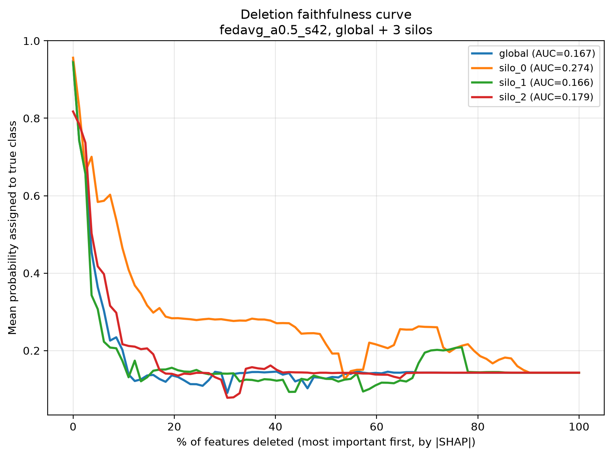

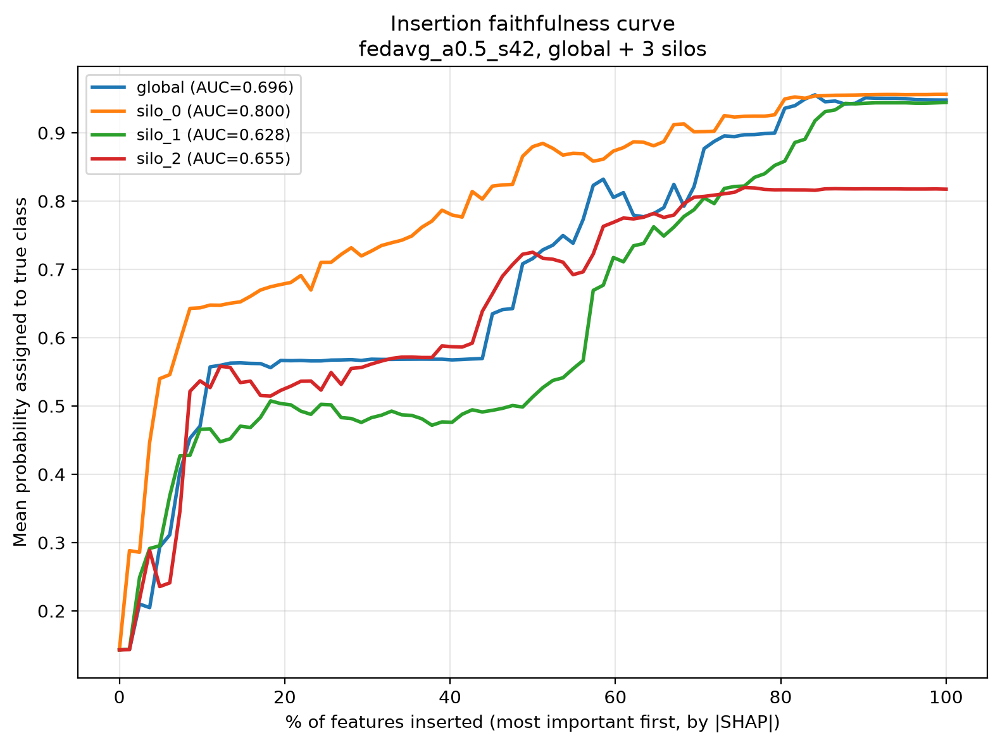

### What we found

**1. Headline agreement** (median over eligible rows) (source: `results/inspection/agreement_metrics.csv`; `docs/contribution_a_results.md` §2):

| α | Jaccard@10 | Weighted τ |
|---|---|---|
| 0.1 | **0.333** | **0.592** |
| 0.5 | **0.538** | **0.787** |
| 5.0 | **0.667** | **0.844** |

| Reference | Value |
|---|---|
| Chance-level Jaccard@10 (k=10, n=82) | 0.065 (source: `tools/agreement_metrics.py`, `chance_jaccard()`) |
| Centralized-seed instability floor (Jaccard@10) | median 0.429, range [0.429, 0.484] across 3 seed pairs (source: `results/inspection/centralized_instability_floor.csv`) |

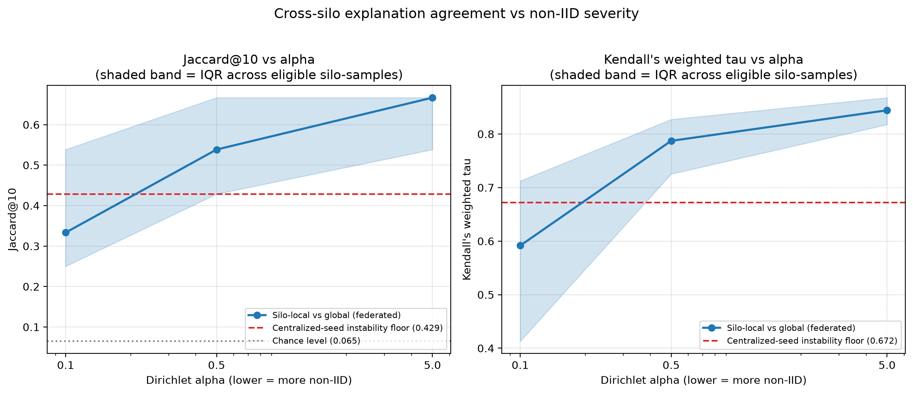

**Reading.** Agreement rises with α. The medians sit 5.1×–10.3× above chance (source: `docs/contribution_a_results.md` §2), so the federated signal is real. At α=5.0 agreement is comfortably above the seed-noise floor. At **α=0.1, Jaccard@10 (0.333) falls below the floor's lower bound (0.429)**: silo-vs-global agreement is not distinguishable from pure seed noise, **even though accuracy at that α still reaches 0.516 ± 0.048** (source: `docs/contribution_a_results.md` §2).

**It is directional, not significant.** The cluster-bootstrap CI at α=0.1 is [0.250, 0.429]; the floor's range is [0.429, 0.484]. They overlap, so we **never** state the below-floor result as confirmed (source: `docs/contribution_a_results.md` §2).

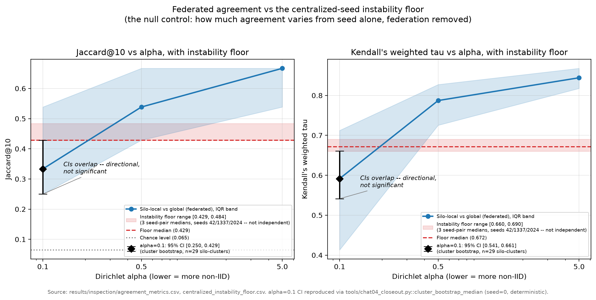

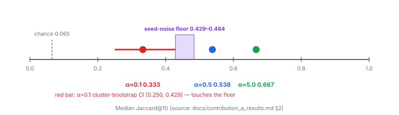

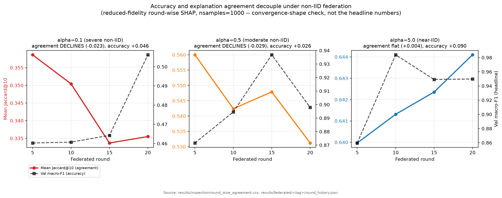

**2. Round-wise agreement.** Measured at rounds 5, 10, 15 and 20 (source: `results/inspection/round_wise_agreement.csv`; `docs/contribution_a_results.md` §3):

| α | Jaccard@10, round 5 → 20 | Val macro-F1, round 5 → 20 |
|---|---|---|
| 0.1 | 0.359 → 0.336 | 0.460 → 0.506 |
| 0.5 | 0.560 → 0.531 | 0.872 → 0.898 |
| 5.0 | 0.640 → 0.644 (range 0.640–0.644) | 0.860 → 0.950 |

At α=0.1 and α=0.5, agreement *declines* from round 5 to round 20 while validation accuracy *rises*; at α=5.0 agreement is flat. This is **directional, not formally tested**, and was computed at reduced SHAP fidelity (`nsamples=1000`), so its magnitudes are not comparable to the headline table (source: `docs/contribution_a_results.md` §3).

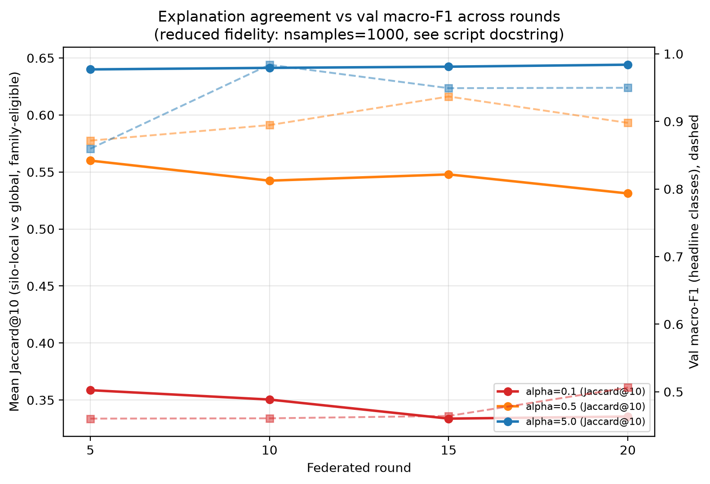

**3. Size and heterogeneity are tangled.** Under the Dirichlet partitioner, a silo's size is a *deterministic output* of the same label-skew draw that creates heterogeneity: size_i = Σ_family available_family × p_family[i] (source: `docs/contribution_a_results.md` §5). So "small silos agree less" could just be "skewed silos agree less" in disguise. Size-controlled partitions were proven impossible under this partitioner (source: `CLAUDE.md`). We used partial correlation instead.

- **Order matters, and we state it: entropy first, then KL.** Label entropy was the *pre-specified* heterogeneity measure. At α=0.5 its correlation with agreement (r=−0.12 to −0.15) did not survive conditioning on log(size): the partial correlation weakened and **flipped sign** (to +0.23/+0.13 for Jaccard@10/τ, n=30) (source: `docs/contribution_a_results.md` §5). Entropy was abandoned for that reason. **KL divergence from the global family distribution** was tried after, and it does survive:

| α | Jaccard@10 partial r | Weighted τ partial r | n |
|---|---|---|---|
| 0.1 | −0.57 | (not separately reported) | 29 |
| 0.5 | −0.82 | −0.87 | 30 |

(source: `results/inspection/size_matched_heterogeneity.csv`; `docs/contribution_a_results.md` §5; r and n only, no p-values)

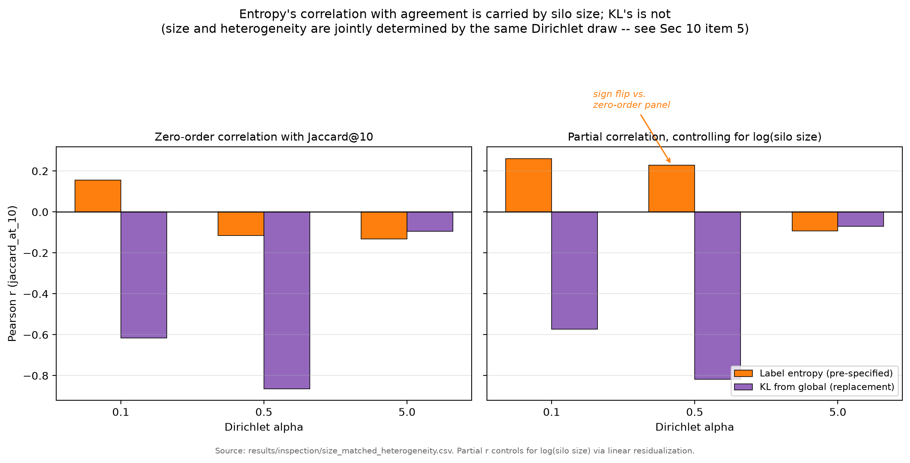

Analogy for KL: entropy asks "how evenly mixed is this silo?"; KL asks "how far is this silo's mix from the overall mix, and in which direction?" A silo that is 100% PortScan and one that is 100% Benign can have the same entropy (zero) but very different KL.

**4. FedProx at μ=0.0005** (one value, not swept; source: `docs/contribution_a_results.md` §6):

- **α=0.5:** Jaccard@10 up in all 3 seeds (+0.0263, +0.0173, +0.0042) while test macro-F1 is flat and sign-mixed (+0.0041, −0.0020, −0.0014). Agreement improves with flat accuracy.
- **α=0.1:** inconclusive at n=3 — agreement and accuracy move together in every seed, so an explanation-specific effect can't be separated from an accuracy effect.
- **α=5.0:** no effect.
- μ=0.01 was tried once (α=0.5, seed 42) and collapsed macro-F1 to 0.71 with Bot/WebAttack recall 0.0 (source: `docs/contribution_a_results.md` §6).

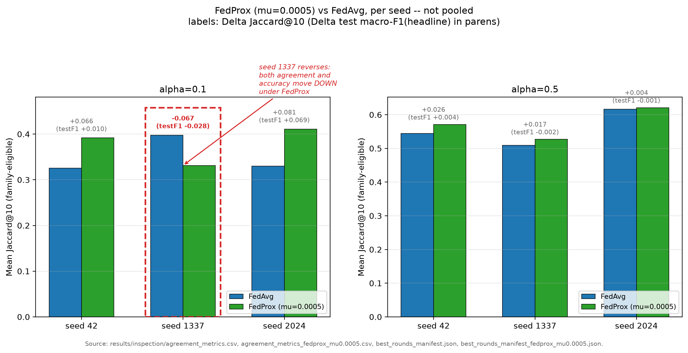

**5. Parity monitor.** A server-side drift alarm that uses only what crosses the trust boundary (top-10 lists). It flags a silo whose deviation from the fleet is an outlier by a modified z-score (median/MAD, cutoff 3.5, Iglewicz & Hoaglin 1993) (source: `results/inspection/parity_monitor_metadata.json`). **Result: 3 flags out of 356 rows, all at α=0.5, round 5** (source: `results/inspection/parity_monitor.csv`).

- **Zero flags at α=0.1 does not mean α=0.1 is healthy.** Its median per-silo deviation at round 5 was 0.694 — worse than every flagged α=0.5 silo — but when *everyone* disagrees, nobody stands out (source: `docs/contribution_a_results.md` §4).
- **The multi-draw bug that was caught.** An earlier single-draw version flagged two α=0.1 silos that did not reproduce on fresh explainer draws of the same checkpoints. Cause: a tie-heavy cluster of deviation values crushed that round's MAD to 0.042 (fresh draws had ~0.13). Fix, now in production: run the explainer N≥3 times with fixed seeds and average the deviations *before* thresholding (source: `docs/contribution_a_results.md` §4). That's why the locked rule says parity flags need N≥3 draws.

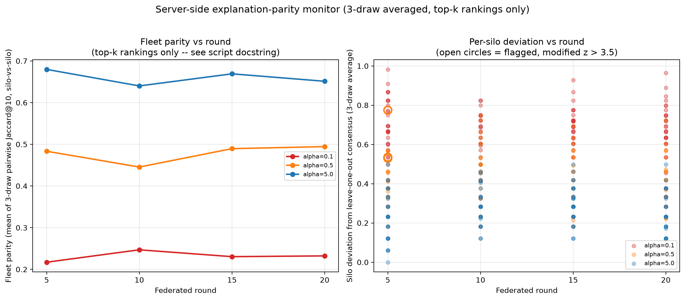

**6. The residual audit and sensitivity check.** SHAP's additivity is never perfect ([1.5.3](#bg-additivity)). We measured it and asked whether it moves the headline.

- On 500 validation rows for the served model, the largest absolute residual per row (logit space) has median 0.472, p95 1.105, max 3.336. Relative to the size of the output (max over classes of |ΣSHAP − (f(x) − E[f])| ÷ max over classes of |f(x) − E[f]|): median 3.2%, p95 7.7%, max 21.2% (one Infiltration row); 18 rows above 8%, mostly Bot (7), Benign (4) and WebAttack (4) (source: `results/shap/fedavg_a0.5_s42/val_pool_summary.json`; `CLAUDE.md`).
- **An earlier "~3–8%" figure had no backing file and was dropped.** It can't be recomputed for the 14 test rows, because their stored SHAP files hold no model outputs (source: `CLAUDE.md`).
- **Audit over 594 stored SHAP files** (source: `results/inspection/residual_audit.md`): residuals above the validation-pool maximum (3.336) occur in 4 of 99 final-round FedAvg files — three α=0.1 silos (two of them the smallest silo in their configuration) and the α=5.0 seed-1337 global model (3.500). None at α=0.5.
- Within α=0.1, silo residual and Jaccard@10 correlate at Spearman r=−0.237 (n=29, final round) (source: `results/inspection/residual_audit.md`).
- **Pre-specified sensitivity rule**: exclude silos whose final residual exceeds 3.336. This removes 2 silos with eligible rows (8 of 220 rows). The α=0.1 headline is **unchanged**: Jaccard@10 0.333 → 0.333; weighted τ 0.592 → 0.597 (source: `results/inspection/residual_sensitivity.json`).
- **Post-hoc, not part of the rule:** dropping the whole α=5.0 seed-1337 run leaves Jaccard@10 at 0.667 and τ at 0.844 (source: `results/inspection/residual_sensitivity.json`; `CLAUDE.md`).
- Caveat: each stored file's residual is a maximum over 14 rows, so comparing it with a per-row maximum is coarse (source: `docs/contribution_a_results.md`, Limitations #21).

**7. A recurring α=0.5 pattern, with no mechanism proposed.** Three separate analyses single out α=0.5: all 3 parity flags, the strongest KL partial correlation, and the cleanest FedProx effect. The canonical document deliberately refuses to invent a story for it and leaves it open (source: `docs/contribution_a_results.md` §7).

### What this does NOT mean

- **Not "first to measure"** explanation agreement in federated IDS. Oki et al. measured it; we characterise where their finding breaks down.
- **Not significant** at α=0.1: directional only, CIs overlap.
- **Not causal** for heterogeneity: the KL partial correlation is observational, on silos whose size and skew came from the same draw.
- **Not a full faithfulness guarantee**: one configuration (α=0.5, seed 42), 3 of 10 silos, no agreed threshold; nothing downstream depends on it (source: `docs/measurement_protocol.md` §7).
- **The floor is only 3 points** (3 seed pairs): enough for a median, not a reliable interval (source: `docs/measurement_protocol.md` §10).
- **Chance (0.065) assumes uniform, independent features**; real rankings aren't uniform. No permutation baseline was computed (source: `docs/measurement_protocol.md` §10).
- **SHAP's Monte Carlo sampling is unseeded**: re-running SHAP on identical inputs changed values (mean absolute difference 0.0188, max 0.403). Each headline number reflects one draw per (config, silo) (source: `docs/contribution_a_results.md`, Limitations #17).
- **Silos in one run aren't independent**; effective n is closer to the 3 seeds (source: `docs/contribution_a_results.md`, Limitations #18).
- **Explanations never leave in raw form**, so all server-side analysis sees only a compressed summary (source: `docs/contribution_a_results.md`, Limitations #10).
- **Background substitution is off-manifold**: SHAP's "missing feature" baseline is not a real flow — a general limit of perturbation-based explanation (source: `docs/contribution_a_results.md`, Limitations #11).
- The 14 explained rows come from the test set as **inputs only**, never as a selection score (source: `docs/test_set_exposure_audit.md`, row 6).
- Bot/WebAttack near-duplication was **tested and not confirmed** as an inflation source; thin support (Bot 3,527 and WebAttack 1,542 training rows) is the likelier explanation (source: `docs/contribution_a_results.md`, Limitations #2).
- PortScan is the genuine generalisation family (23× further test nearest-neighbour distance) (source: `CLAUDE.md`).
- **Whether FedAvgM changes explanation agreement is untested** — every number here is FedAvg (or FedProx μ=0.0005) (source: `docs/contribution_a_results.md`, optimizer section).

### Where it lives in the code

| File | What it does |
|---|---|
| `tools/eval_set_config.py` | Single source of `N_EVAL_ROWS`, `EVAL_SEED` (consolidated from seven duplicated copies) |
| `tools/extract_best_rounds.py` | Best-by-validation checkpoint manifest |
| `tools/local_shap_pipeline.py` | Client-side SHAP for every silo and the global model |
| `tools/agreement_metrics.py` | Jaccard@k, weighted τ, `chance_jaccard()` |
| `tools/centralized_shap_floor.py` | The seed-noise floor |
| `tools/round_wise_shap.py`, `tools/round_wise_agreement.py` | Rounds 5/10/15/20 |
| `tools/parity_monitor.py`, `tools/parity_noise_floor.py` | Multi-draw drift monitor and the diagnostic that found the bug |
| `tools/deletion_curve.py`, `tools/insertion_curve.py` | Faithfulness spot-check |
| `tools/kernel_validation.py`, `tools/common_background_ablation.py` | Validation checks |
| `tools/residual_audit.py` | Read-only residual audit |
| `results/inspection/` | All CSV/JSON outputs cited above |
| `docs/contribution_a_results.md` | Canonical results |
| `docs/measurement_protocol.md` | The reusable protocol |

### Questions an examiner might ask

_Numbers in these model answers repeat numbers already given with their source earlier in this chapter; the source notes are not repeated here._

**Q: Is 0.333 vs 0.429 significant?**
A: No, and we never say it is. The cluster-bootstrap CI at α=0.1 is [0.250, 0.429]; the floor's range is [0.429, 0.484]. They overlap, so the result is directional, not significant. What *is* solid is the trend across α and that every α sits well above chance.

**Q: Why should I care whether explanations agree, if the model is accurate?**
A: Because analysts act on explanations. If ten organizations' models flag the same attack for different reasons, an explanation shown to one analyst may not hold at another site. Our point is that accuracy parity doesn't guarantee explanation parity.

**Q: Isn't the disagreement just random noise?**
A: That's exactly what the null control answers. Three centralized models differing only by seed agree at a median Jaccard@10 of 0.429. At α=5.0 federated agreement (0.667) is well above that; at α=0.1 (0.333) it's below.

**Q: Why GradientExplainer and not DeepExplainer?**
A: We tested DeepExplainer: it fails on our LayerNorm layers, additivity error 2.43 against a 0.01 tolerance. GradientExplainer handles LayerNorm.

**Q: Your SHAP values don't add up exactly. Doesn't that break everything?**
A: We measured it: median relative residual 3.2%, p95 7.7% on 500 validation rows. The large residuals cluster in small α=0.1 silos, and a pre-specified rule excluding them leaves the α=0.1 headline at 0.333 (τ 0.592 → 0.597).

**Q: Why did you switch from entropy to KL? Isn't that p-hacking?**
A: We report the order openly: entropy was pre-specified and failed the size conditioning — its sign flipped. KL was tried after. That is why we call the KL result observational and report r and n only.

**Q: Why no p-values?**
A: The 10 silos in one run share one training trajectory, so they aren't independent observations. A p-value treating n=30 as independent would overstate the evidence. We report r and n.

**Q: What's the chance level and why does it matter?**
A: Two random top-10 lists from 82 features overlap with Jaccard 0.065 on average. Without it, readers compare against 0, which is the wrong anchor. Our medians are 5.1×–10.3× chance.

**Q: Did the parity monitor ever raise a false alarm?**
A: Yes — an earlier single-draw version flagged two silos that didn't reproduce. We traced it to a tie-heavy draw that crushed the MAD to 0.042, and fixed it by averaging N≥3 explainer draws before thresholding.

**Q: Does FedProx fix explanation disagreement?**
A: At μ=0.0005 only, and only clearly at α=0.5: Jaccard@10 rose in all 3 seeds with flat accuracy. At α=0.1 it's inconclusive at n=3; at α=5.0 there's no effect. We didn't sweep μ.

## 2.5 Trust check (ByzAgent) {#ch-trust}

### In one line

We poisoned some organizations with a label-flipping attack, gave a local LLM agent (ByzAgent) five behaviour statistics per organization per round, compared its trust / downweight / quarantine decisions with Krum, Multi-Krum and trimmed mean, and found that every method — including ByzAgent — is entangled with how *unusual* an organization's data is, not only with whether it is attacking.

**Reminder:** this is a separate experiment from the explanation check. Its findings are reported here, on their own, and never combined with Chapter 2.4's.

### Why this exists

In federated learning the server can't see the data, so it can't check whether a client is honest. Classical robust aggregators (Krum, trimmed mean) assume "unusual update = malicious update." Under non-IID data that assumption is shaky, because honest organizations with unusual traffic also look unusual. We wanted to know:

1. Does a realistic label-flipping attack actually hurt the shared model?
2. Which behaviour statistics reveal attackers?
3. Do classical defenses catch them in a non-IID setting?
4. Can an LLM agent, reading the same statistics a human operator would see, make better-informed trust decisions — and can we check the reasons it gives?

### How it works

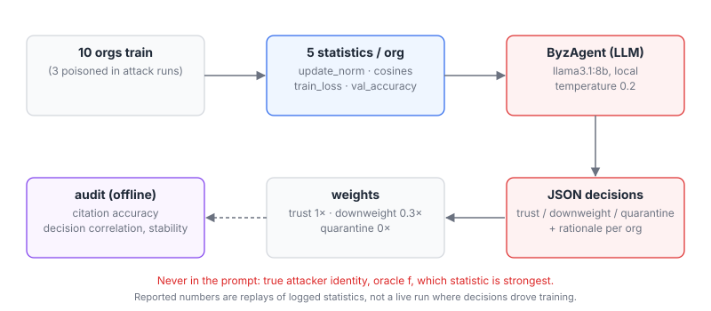

**The attack** (`configs/attack.yaml`; source: `docs/contribution_b_results.md` §2):

| Parameter | Value |
|---|---|
| Partition | α=0.5, seed 42 |
| f (malicious silos) | 3 |
| Malicious silos | {0, 3, 5} |
| Mode | sudden |
| flip_fraction | 0.40 |
| Strategy | targeted_to_benign |
| attack_seed | 9001 |

A secondary condition uses **f=2, silos {0, 3}** (source: `docs/contribution_b_results.md` §2).

**This is a worst-case attacker, never a realistic one.** The locked framing, used wherever this attack is cited:

> Worst-case/upper-bound adversary with full knowledge of federation composition. Selected by enumerating all C(10,3)=120 malicious-silo triples at alpha=0.5 seed=42 against the global per-silo family composition and maximizing the minimum per-family coverage across the 6 non-Benign headline families at flip_fraction=1.0 (achieved: 38.60% min, on DoS). NOT a realistic or naturalistic attacker — no real attacker has this global view.

(source: `results/attacks/PHASE0_SUMMARY.md`, quoted in `docs/contribution_b_results.md` §2)

An earlier rule ({0, 1, 9}, chosen by size) reached only 13.98% attack-row coverage and was retired as too weak a test (source: `docs/contribution_b_results.md` §2).

**The five behaviour statistics** (per silo, per round; source: `docs/contribution_b_results.md` §3):

| Statistic | Plain meaning |
|---|---|
| `update_norm` | How far the silo's weights moved from last round's global model (L2 distance) |
| `cosine_to_global` | Does the silo's update point the same way as this round's average? |
| `cosine_to_peer_mean` | Does it point the same way as the *unweighted* mean of all updates? (Unweighted on purpose, so a large malicious silo can't define its own baseline) |
| `train_loss` | The silo's own final local training loss (already in its reply; zero extra computation) |
| `val_accuracy` | Its model's accuracy on the server's fixed 143,513-row validation set |

**ByzAgent's prompt** (`src/agents/byz_agent.py`, `PROMPT_TEMPLATE`) contains: the five definitions; a required caveat — *"this specific attack biases val_accuracy upward for malicious clients on this Benign-heavy validation set — do not read high val_accuracy alone as evidence of trustworthiness"*; a note that natural non-IID differences can also move these statistics; the instruction *"cite the specific numeric value(s) that informed this decision"*; and a strict JSON schema enforced through Ollama's `format` field (source: `src/agents/byz_agent.py`; `docs/contribution_b_results.md` §5). It **never** contains the true malicious silos, the oracle f, or any hint about which statistic is strongest.

**Decisions and what they do** (`configs/agent.yaml`): *trust* → normal sample-count weight; *downweight* → 0.3 × weight; *quarantine* → weight 0 that round. One retry on malformed output, then it fails loudly (`AgentResponseError`) rather than silently defaulting (source: `configs/agent.yaml`). Temperature 0.2, `keep_alive: 0` so the model unloads from the 6 GB GPU between rounds (source: `configs/agent.yaml`).

**How the numbers were produced: replay.** The reported agent numbers come from **retrospective replays** of logged statistics from undefended FedAvg runs, not from a run where ByzAgent's decisions drove training (source: `README.md`, step 6; `docs/efficiency_results.md` Part A). Why: see "Why no live run" below.

### What we actually did — phase by phase

The trust check was built in phases, each with its own summary file (source: `docs/contribution_b_results.md` §11).

**Phase 0 — is the attack strong enough to matter?** We report **all four statistics** for every comparison: mean and median over 20 rounds, the **final-5-round mean** (rounds 16–20; the primary attack-effect statistic) and the **max** (the best-by-validation statistic that selects the deployed checkpoint) (source: `docs/contribution_b_results.md` §2):

| Statistic | Clean, seed 42 | Poisoned {0,3,5} | Poisoned {0,3} |
|---|---|---|---|
| mean (20 rounds) | 0.8535 | 0.8236 (Δ−0.0299) | 0.8253 (Δ−0.0282) |
| median | 0.8487 | 0.8438 (Δ−0.0048) | 0.8489 (Δ+0.0003) |
| **final-5 mean** | **0.9513** | **0.8746 (Δ−0.0766)** | **0.8787 (Δ−0.0726)** |
| max | 0.9760 | 0.9763 (Δ+0.0004) | 0.9867 (Δ+0.0107) |

The attack is real: the final-5 mean drops by 0.0766 (f=3) and 0.0726 (f=2). But the **max barely moves** — a constant-strength attack shifts the whole curve down a little, and the single best round can still be high. **Lesson, locked as a rule:** model selection stays best-by-validation max, attack effects are reported as the final-5 mean, and every comparison reports all four (source: `CLAUDE.md`; `docs/contribution_b_results.md` §2).

**Phase 1 — which statistics reveal attackers?** Glass's delta (malicious − clean) ÷ sd(clean), computed on the poisoned run and on a clean-run control with the same silo grouping (source: `docs/contribution_b_results.md` §3):

| Statistic | f=3 ratio (poisoned ÷ clean control) | f=2 ratio | Verdict |
|---|---|---|---|
| **train_loss** | **33.8×** | **154.3×** | clear separation |
| cosine_to_peer_mean | 1.11× | 1.17× | no separation |
| update_norm | 1.12× | 1.67× | no separation |
| cosine_to_global | 0.93× | 0.86× | no separation |
| val_accuracy | 0.31× | 0.31× | **inverts** |

- **train_loss is the only strong signal** — and that's the easy case: flipping labels directly raises the loss.
- **33.8×–154.3× is a seed-42 effect-size ratio, not a per-round detection threshold.** A per-round train_loss threshold chosen on seed 42 did not transfer (seed 1337 poisoned flag rate 0.017 vs logged 0.483) (source: `docs/efficiency_results.md` Part A).
- **val_accuracy inverts**: flipping attack labels to Benign makes malicious models *better* at the Benign-heavy validation set, so a naive reader would trust attackers more. Hence the prompt caveat.

**Phase 2 — classical baselines** (seed 42; all given the **true f as an oracle**; source: `docs/contribution_b_results.md` §4). Success means recovering at least half the gap between clean and poisoned FedAvg (`recovery_fraction ≥ 0.5`).

| Strategy | Condition | final-5 mean | recovery_fraction | Verdict |
|---|---|---|---|---|
| Multi-Krum (primary) | f=3 {0,3,5} | 0.8534 | −0.2766 | fails |
| Multi-Krum (primary) | f=2 {0,3} | 0.9766 | 1.3490 | "succeeds" — **not attack mitigation** (see below) |
| Trimmed mean | f=3 | 0.8696 | −0.0647 | fails |
| Trimmed mean | f=2 | 0.9419 | 0.8702 | "succeeds" — not confirmed as attack-attributable |
| Classical Krum (secondary only) | f=3 | 0.7738 | −1.3139 | fails |
| Classical Krum (secondary only) | f=2 | 0.7651 | −1.5652 | fails |

**Does the exclusion hit the attackers?** No:

| Strategy | Malicious exclusion rate | Correct chance baseline |
|---|---|---|
| Multi-Krum, f=3 | **0.0000** | 0.30 |
| Multi-Krum, f=2 | **0.0000** | 0.20 |
| Classical Krum, f=3 / f=2 | 1.0000 | 0.900 (it keeps 1 of 10 every round, so it excludes 9 regardless) |

(source: `docs/contribution_b_results.md` §4)

**The 0% belongs to Multi-Krum.** Classical Krum's exclusions are chance-level, because it keeps one client of ten every round (source: `CLAUDE.md`).

**Why Multi-Krum "succeeds" at f=2 without detecting anything.** It excluded the same two silos, **{2, 7}**, in every round of both conditions — the two largest (30.3% and 23.0% of the fleet) and Benign-heavy (>90%) — regardless of who was attacking. Dropping them raised the attackers' share of the remaining weight from 9.8% to 21.0%, which plausibly improved macro-F1 by rebalancing labels. A defense can't legitimately beat "no attack, no defense" (recovery > 1.0) by keeping the attack fully in the average. So **Multi-Krum's f=2 recovery of 1.35 must never be cited as attack detection** (source: `docs/contribution_b_results.md` §4).

**Confirmed with zero attackers present:** in the clean control, Multi-Krum excludes exactly {2, 7, 9} in 20/20 rounds; classical Krum selects only {4, 5}; trimmed mean's excess trim rate on {2, 7, 9} (+0.1726) matches the attack runs within 0.002–0.006 (source: `docs/contribution_b_results.md` §4). The confound is a property of the partition and each defense's geometry, not of the attack.

**The cost of defending when nobody attacks** (test macro-F1 of the clean-control runs vs clean FedAvg 0.9753): Krum −22.7pp (0.7480), Multi-Krum −4.9pp (0.9261), trimmed mean −1.6pp (0.9590) (source: `CLAUDE.md`; `docs/contribution_b_results.md` §4).


**Phase 3 — ByzAgent.**

*Model selection, by test, on 22 synthetic cases* (source: `docs/contribution_b_results.md` §5):

| Model | JSON parse | ID coverage | Explanations citing real numbers |
|---|---|---|---|
| **llama3.1:8b-instruct-q4_K_M** | 100% | 100% | **65.1%** |
| qwen2.5:7b-instruct-q4_K_M | 100% | 100% | 0.8% |
| phi3.5:latest | 100% | 59.1% (disqualifying) | 0% |

Adding "cite the specific numeric value(s)" to the prompt raised the grounded-explanation rate to 91.6% on a held-out synthetic subset (source: `docs/contribution_b_results.md` §5).

*Decisions, seed 42* (200 (silo, round) observations per condition; source: `docs/contribution_b_results.md` §5):

| Condition | Malicious flagged (downweight or quarantine) | Clean flagged |
|---|---|---|
| Clean (no attack) | n/a | 86/200 = 0.43 |
| f=3 {0,3,5} | **60/60 = 1.00** | 21/140 = 0.15 |
| f=2 {0,3} | **40/40 = 1.00** | 41/160 = 0.256 |

A flag rate of 1.00 sounds perfect. It isn't. **The compositional confound:**

| Silo | Role | Clean-run flag rate | f=3 | f=2 | Benign share |
|---|---|---|---|---|---|
| 0 | malicious (f3, f2) | 0.95 | 1.00 | 1.00 | 9.2% |
| 3 | malicious (f3, f2) | 1.00 | 1.00 | 1.00 | 0.3% |
| 5 | malicious (f3 only) | 1.00 | 1.00 | — | 0.1% |
| **8** | **never malicious** | **0.95** | 1.00 | 1.00 | 12.3% |
| 1, 2, 4, 6, 7, 9 | never | 0.00–0.25 | 0.00–0.05 | 0.00–0.05 | 81.5–98.0% |

(source: `docs/contribution_b_results.md` §5)

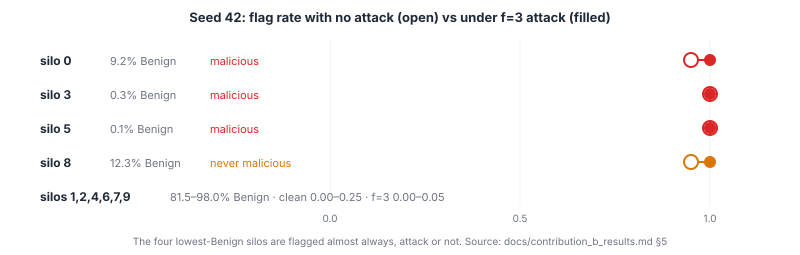

**The compositional confound, very simply.** Picture a school where the attendance system flags "unusual" students. The four students who always take unusual classes get flagged every day — whether or not they misbehave. Three of them are also the troublemakers we planted. The system flags them at 100%, but it also flagged them at 95–100% *before they did anything*, and it flags the fourth unusual student (silo 8, never malicious) just as often. So a 100% flag rate on the attackers mostly reflects "unusual," not "attacking." At seed 42, the attackers' **lift** over their own no-attack rate is at most +0.05 (source: `docs/contribution_b_results.md` §5).

Why can't we just pick ordinary-looking attackers to fix this? Because in this partition **a silo with enough attack traffic to poison meaningfully is necessarily compositionally unusual**. The Benign-heavy group {1, 2, 4, 6, 7, 9} holds only 211 of the federation's 3,174 Bot rows (6.65%). The strongest attacker triple drawn from that group reaches 5.42% Bot coverage vs {0, 3, 5}'s 38.60% (7.1× weaker) (source: `docs/contribution_b_results.md` §5). A matched control attack is not constructible here — a structural finding, not an oversight.

*Decision stability* (round 10, 3 independent calls): 27/30 (90%) exact match; every flip was a downweight ↔ quarantine wobble; **0** crossed the trust/flagged boundary (30/30 = 100% binary stability) (source: `docs/contribution_b_results.md` §5).

*Fidelity audit at seed 42 — do the reasons match the decisions?* (source: `docs/contribution_b_results.md` §5):

| Statistic | How often cited (clean / f3 / f2) | Correlation with decision severity (ρ) | Citation error |
|---|---|---|---|
| cosine_to_global | 99.5% / 86% / 71.5% | −0.808 | 4.4% |
| train_loss | 7.5% / 39% / 53% | +0.793 | 3.8% |
| val_accuracy | 43.5% / 65% / 57.5% | −0.745 | 8.6% |
| update_norm | 93% / 73% / 49% | +0.419 | 25.1% |
| cosine_to_peer_mean | 7% / 11.5% / 3% | +0.298 | n too small |

Overall citation strict error: **11.7%**. The pattern: train_loss is the second-strongest real driver of decisions but is rarely cited; update_norm is cited constantly despite being the weakest driver and the most often misdescribed. "Right answer, wrong stated reason," measured.


**This is why the locked wording is:** ByzAgent **produces decisions plus a rationale of measured fidelity**. Never say it "explains its reasoning" (source: `CLAUDE.md`).

**Why no live run.** A live run where ByzAgent's decisions drive aggregation would answer "what macro-F1 would we get?" But any number from it would inherit the compositional confound, and no matched control attack exists. So Phase 3 closed on the replay numbers plus the structural finding (source: `docs/contribution_b_results.md` §5).

**Phase 4 — rolling history (pre-registered, failed).** Idea: composition is static, attacks are changes. If the agent sees each silo's last 5 rounds, maybe it can spot "recently turned bad." The interpretation rule was written and locked *before* the data existed (source: `docs/contribution_b_results.md` §6):

> "If rolling-history's lift over clean baseline is comparable to current-round-only's (both near zero), or if silo 8 rises alongside the malicious silos → rolling history does NOT separate them."

Result: silo 8 (the never-malicious canary) got a rolling-history lift of +0.60 (sudden) and +0.45 (gradual) — **equal to or above every real attacker's** (source: `docs/contribution_b_results.md` §6). **Verdict: negative, as pre-registered.** Also, the agent's reasoning degraded on the longer prompt: decision-severity correlations collapsed (e.g. cosine_to_global −0.7789 → −0.2091), boundary stability fell from 100% to 70–80%, and 45.00% of 920 volunteered trend claims ("increasing," "decreasing") were wrong against the sequence it was given (source: `docs/contribution_b_results.md` §6).

**Multi-seed validation — the ceiling effect.** Three findings were re-run at seeds 1337 and 2024 (α=0.5): the confound/canary result, the fidelity audit, and a hand-check of the trend-error figure (source: `docs/contribution_b_results.md` §7). At seed 42, attackers were *already* flagged 0.95–1.00 with no attack, so their lift *couldn't* exceed ~0.05 — a **ceiling**. The new seeds have graded, not bimodal, composition, and the ceiling is mostly absent:

| Silo | Seed | Clean baseline | Sudden attack | Lift |
|---|---|---|---|---|
| 5 | 1337 | 0.00 | 0.95 | **+0.95** |
| 5 | 2024 | 0.25 | 1.00 | **+0.75** |
| 3 | 1337 | 0.00 | 0.40 | **+0.40** |
| 3 | 2024 | 1.00 | 0.95 | −0.05 (ceiling still present) |

(source: `docs/contribution_b_results.md` §7; the 0.95 for silo 3 at seed 2024 from `results/agents/MULTISEED_VALIDATION_SUMMARY.md`)

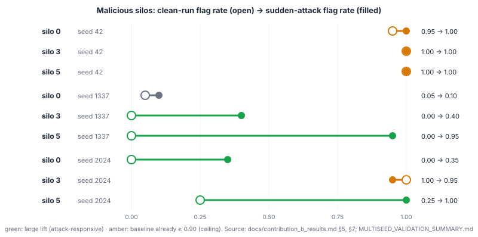

**The locked ByzAgent claim — say it exactly:**

> Both effects are present. A real compositional confound saturates some silos' flag rates independent of any attack; real attack-responsive detection is also present and becomes visible where silos are not already saturated. Seed 42's apparent null was partly a ceiling artifact of that seed's unusually bimodal composition.

(source: `CLAUDE.md`; `docs/contribution_b_results.md` §7)

**Fidelity at the new seeds gets worse, specifically** (source: `docs/contribution_b_results.md` §8): overall citation strict error rises from 11.7% to 22.5%; update_norm's link to decisions collapses to about zero and flips sign (+0.419 → −0.076) while it is still cited in about 59% of explanations, with 42.6% citation error. train_loss (3.8% → 4.7%) and val_accuracy (8.6% → 10.3%) stay reliable.

**The 45.00% trend-error figure was hand-checked**: of 35 sampled claims, 32 (91.4%) confidently validated, 3 (8.6%) ambiguous, 0 confident disagreements; adjusted error range ≈35–45%, point estimate ≈39% (source: `docs/contribution_b_results.md` §8). That's where "~35–45% of trend claims contradicted the data they were given" comes from.

**Attacker-selection portability.** {0, 3, 5} is the worst-case triple (rank 1/120) at seed 42 by construction, but only rank 8/120 at seed 1337 and 33/120 at seed 2024 (source: `docs/contribution_b_results.md` §9). A silo-index-pinned attack silently changes strength under a new partition draw — a general methodological observation.

### What we found

- **train_loss is the only strong attack signal** (33.8×–154.3×, seed-42 effect-size ratios); geometry statistics are weak-to-null; val_accuracy inverts.
- **Multi-Krum excluded a malicious silo 0% of the time**; its f=2 "success" is a compositional artifact. Defending with nobody attacking costs Krum −22.7pp, Multi-Krum −4.9pp, trimmed mean −1.6pp.
- **ByzAgent:** the locked claim above. Decisions are stable on the trust/flag boundary (30/30); exact decisions 27/30.
- **Rationale fidelity is measured, not assumed:** citation error 11.7% (seed 42) → 22.5% (seeds 1337/2024); trend claims ≈35–45% wrong under rolling history (source: `docs/contribution_b_results.md` §5, §8).
- **Rolling history failed its pre-registered test.**

### What this does NOT mean

- **Not "ByzAgent beats Krum."** The trust check is explicitly not that claim; Phases 3 and 4 are negative results on the agent's own headline metric (source: `docs/contribution_b_results.md` §1).
- **Not a realistic attack.** Every configuration is a worst-case, full-knowledge adversary.
- **Not a fair fight in the baselines' disfavour** — the opposite: the baselines were given the true f as an oracle; ByzAgent was not.
- **Not "explains its reasoning."** It produces decisions plus a rationale of measured fidelity.
- **Not deterministic.** One logged decision is one draw at temperature 0.2; stability is reported with it.
- **Not general.** Whether these failures are general properties of the detectors, or entangled with our worst-case attacker-selection rule (which selects on the same compositional axis), is **still open** (source: `docs/contribution_b_results.md` §10).
- **Mostly n=1.** Phase 2 baselines, the Phase 4 matrix and gradual mode are seed 42 only, by design (source: `CLAUDE.md`).
- **Silo 0 at seed 1337** (near-zero lift) can't be attributed: it is the most Benign-heavy silo there (95.44% Benign), so it had little attack material to flip (source: `docs/contribution_b_results.md` §7, §10).
- **A disclosed correction:** earlier documents claimed the oracle asymmetry was written to an `agent_config.json` on every run. That file never existed; the asymmetry is real and documented in prose, and the file was deliberately *not* created afterwards, because that would backdate the claim (source: `docs/contribution_b_results.md` §5).
- Under ByzAgent, `cosine_to_global` is computed against a diagnostic plain-FedAvg aggregate, not the model actually deployed that round (source: `docs/contribution_b_results.md` §5).
- Small-class caveat: Bot (n=353) and WebAttack (n=154) validation recall deltas move 0.0028 and 0.0065 per sample, so an early "damaged families" reading was retracted (source: `docs/contribution_b_results.md` §10).

### Where it lives in the code

| File | What it does |
|---|---|
| `configs/attack.yaml`, `configs/defense.yaml`, `configs/agent.yaml` | Attack, baseline and agent settings (all inert by default) |
| `src/attacks/label_flip.py` | The label-flip attack (sudden and gradual) |
| `src/monitoring/client_stats.py` | The five behaviour statistics |
| `src/agents/byz_agent.py` | Prompts, JSON schema, `decide_round()`, rolling-history extensions |
| `federated/xfed_federated/server_app.py` | `LoggingFedAvg`, `LoggingMultiKrum`, `LoggingKrum`, `LoggingFedTrimmedAvg`, ByzAgent strategy |
| `scripts/phase1_verification_gate.py` … `scripts/phase4_analysis.py`, `scripts/phase_multiseed_*.py` | Phase gates and analyses |
| `results/attacks/PHASE0_SUMMARY.md`, `results/monitoring/PHASE1_SUMMARY.md`, `results/defenses/PHASE2_SUMMARY.md`, `results/agents/PHASE3_SUMMARY.md`, `PHASE4_SUMMARY.md`, `MULTISEED_VALIDATION_SUMMARY.md` | Phase summaries |
| `docs/contribution_b_results.md` | Canonical results |

### Questions an examiner might ask

_Numbers in these model answers repeat numbers already given with their source earlier in this chapter; the source notes are not repeated here._

**Q: Krum is standard. Why did it fail?**
A: Krum assumes honest updates cluster and attackers sit apart. Under non-IID data, honest organizations with unusual traffic also sit apart. In our partition, Krum-family selection was dominated by silo size and composition: Multi-Krum excluded the same large, Benign-heavy silos every round, even with zero attackers, and excluded a malicious silo 0% of the time.

**Q: Classical Krum excluded malicious silos 100% of the time — isn't that good?**
A: No. Classical Krum keeps one client in ten every round, so it excludes nine regardless; its chance baseline is 0.900. The meaningful 0% figure is Multi-Krum's.

**Q: Why trust an LLM with security decisions?**
A: We don't trust it blindly — we audit it. We measured how often its cited numbers are wrong (11.7% at seed 42, 22.5% at other seeds), how its decisions correlate with the statistics, and how stable repeated calls are. That's why we say it produces decisions plus a rationale of measured fidelity.

**Q: ByzAgent flagged attackers 100% of the time. Why isn't that your headline?**
A: Because it flagged the same silos at 95–100% with no attack, and also a never-malicious silo. That 1.00 is mostly the compositional confound. Where the ceiling was absent (seeds 1337 and 2024), real lifts of +0.40 to +0.95 appeared.

**Q: Isn't giving the baselines the true f unfair to ByzAgent?**
A: It's unfair *in the baselines' favour*, on purpose. If they still fail with the oracle, the failure isn't due to a bad guess of f.

**Q: Why didn't you run ByzAgent live in the training loop?**
A: Any live number would inherit the compositional confound, and no compositionally matched attack can be built in this partition. So it couldn't be interpreted either way.

**Q: Why use val_accuracy at all if it inverts?**
A: It's what a human operator would see, so we kept it and told the agent, in the prompt, that high val_accuracy is not evidence of trust for this attack.

**Q: Rolling history sounds sensible. Why did it fail?**
A: Our pre-registered rule said: if the never-malicious canary rises alongside the attackers, it fails. The canary's lift (+0.60 sudden) matched or exceeded every attacker's. The agent's reasoning also degraded on longer prompts.

**Q: Is the attack realistic?**
A: No, and we say so everywhere: it's a worst-case adversary chosen by searching all 120 triples with full knowledge of every silo's composition.

**Q: Isn't train_loss enough on its own? Why an LLM?**
A: At seed 42 it separates attackers by 33.8×–154.3× as an effect size, but a per-round threshold tuned on seed 42 didn't transfer to seed 1337 (flag rate 0.017 vs 0.483 logged). And for a 100% flip, loss can *fall*, because the flipped labels become self-consistent.

## 2.6 Accuracy improvement (preregistered) {#ch-prereg}

### In one line

We wrote down, before running anything, how we would pick a better federated optimizer using validation data only; the rule picked FedAvgM with server momentum 0.9; we sealed its 9 checkpoints by SHA256 and scored them on the test set exactly once.

### Why this exists

FedAvg collapses at α=0.1 (0.516 ± 0.048). The obvious question: does a smarter way of combining updates help? But the test set had already been read in several documented ways (Part 3), and trying optimizers until one looks good on test would be exactly the "peeking at the exam" problem. So on 2026-10-12 the team adopted a rule: **the test set is evaluated one further time, once, for a single federated configuration selected beforehand on validation data only. No other configuration is ever scored on the test set** (source: `docs/preregistration_accuracy.md`; commit `b2b9bee`).

### How it works — the sealed envelope

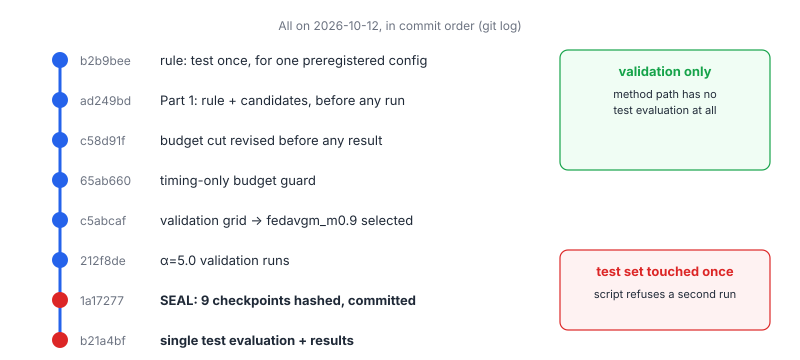

1. **Part 1, committed before any candidate run** (commit `ad249bd`): the question, the candidates, the baseline and the selection rule.
2. Run the candidates on validation only. The method path has **no test evaluation at all**: client-side evaluation is switched off and `client_app.evaluate` refuses method runs (source: `docs/preregistration_accuracy.md`).
3. Apply the rule mechanically (`tools/select_federated_method.py`).
4. **Part 2, committed on its own before the test** (commit `1a17277`): the chosen configuration, and the SHA256 of each of its 9 checkpoints.
5. Run `tools/federated_method_test_once.py` **once**. Before touching test it checks the preregistration is committed and clean, re-hashes every checkpoint, re-computes each checkpoint's validation score (must match exactly), writes a LOCK file, then scores (source: `docs/preregistration_accuracy.md`, Procedure).
6. Report the result **whatever it is**.

**The selection rule** (source: `docs/preregistration_accuracy.md`):

1. **Guard:** a candidate is eligible only if its α=0.5 validation mean is at least FedAvg's minus 0.01 (i.e. ≥ 0.9325).
2. **Pick:** among eligible candidates, the highest α=0.1 validation mean.
3. **Threshold:** if that is below FedAvg's α=0.1 mean + 0.02 (0.5428), the outcome is "no improvement" and **the test set is not touched**.
4. **Ties:** higher α=0.5 mean, then table order.

### What we actually did

**Candidates planned: 9 (plus FedAvg as baseline)** — FedProx μ ∈ {0.001, 0.01, 0.1}, FedAvgM momentum ∈ {0.5, 0.9}, FedAdam η ∈ {0.01, 0.001}, FedYogi η ∈ {0.01, 0.001} (source: `docs/preregistration_accuracy.md`).

**Only 4 of the 9 were run.** The other 5 were cut on wall-time grounds only, each recorded in the preregistration *before that candidate started* (source: `docs/contribution_a_results.md`, optimizer section):

- `fedprox_mu0.1` was cut by the budget estimate before any candidate ran.
- `fedprox_mu0.001`, `fedprox_mu0.01`, `fedadam_lr0.001`, `fedyogi_lr0.001` were dropped by a **timing-only budget guard** (it reads wall times, never scores). Disclosure: the guard was added after one `fedavgm_m0.5` validation score (α=0.1, seed 42) had been seen; none of the four candidates it could drop had started (source: `docs/preregistration_accuracy.md`).
- SCAFFOLD was not run: no Flower strategy, it needs persistent client state, and its correction assumes local SGD while our local optimizer is AdamW.

**Regression check:** FedAvg re-run on the new code path reproduced the published α=0.1 seed 42 validation curve **exactly**, all 21 rounds (max difference 0.0) (source: `docs/preregistration_accuracy.md`).

**Validation results (selection)** (source: `results/federated_methods/selection.json`):

| Candidate | α=0.1 val mean | α=0.5 val mean | Guard (≥ 0.9325) |
|---|---|---|---|
| FedAvg (baseline) | 0.5228 | 0.9425 | — |
| FedAvgM m=0.5 | 0.5386 | 0.9502 | pass |
| **FedAvgM m=0.9** | **0.6068** | **0.9861** | pass |
| FedAdam η=0.01 | 0.4583 | 0.8482 | fail |
| FedYogi η=0.01 | 0.4627 | 0.9004 | fail |

FedAvgM m=0.9 cleared the 0.5428 threshold → selected. Then trained at α=5.0 too, so all three α can be tested.

**Recorded before the test, so it couldn't be explained away later:** FedAvgM m=0.9's α=0.1 validation curves oscillate strongly, and its best rounds are often spikes. Its *final-round* α=0.1 val mean (0.5248) is close to FedAvg's (0.5062). Taking the max over noisy rounds favours a jumpier method, so some of the +0.084 validation gain was expected to shrink on test (source: `docs/preregistration_accuracy.md`, Part 2).

### What we found

**The single test evaluation** (source: `results/federated_methods/test_once/result.json`; prereg commit `1a172773523e9ce549952631fe3b89797af83bb7`):

| α | FedAvg (published) | FedAvgM m=0.9 | Per seed 42 / 1337 / 2024 (FedAvg → FedAvgM) |
|---|---|---|---|
| 0.1 | 0.516 ± 0.048 | **0.5930 ± 0.0632** | 0.5426→0.6558 / 0.4481→0.5065 / 0.5572→0.6167 |
| 0.5 | 0.941 ± 0.057 | **0.9852 ± 0.0005** | 0.9753→0.9846 / 0.9866→0.9856 / 0.8605→0.9856 |
| 5.0 | 0.990 ± 0.001 | **0.9911 ± 0.0005** | 0.9900→0.9918 / 0.9905→0.9906 / 0.9889→0.9910 |

(per-seed values: `docs/contribution_a_results.md`, optimizer section)

**What it means, in the agreed wording** (source: `docs/contribution_a_results.md`):

- **α=0.5: stability.** Mean 0.941 → 0.985, spread 0.057 → 0.0005. Most of the change is seed 2024 (0.8605 → 0.9856); seed 1337 moved −0.001. It removes a bad seed rather than raising good ones.
- **α=0.1: consistent but modest.** Up in all 3 seeds (+0.113, +0.058, +0.060). Still far below centralized (0.990); whole families still get F1 near 0 in some seeds.
- **α=5.0: parity.** +0.0001 to +0.0021 per seed, within the centralized model's own seed spread.
- As predicted, the α=0.1 validation gain (+0.084) was larger than the test gain (+0.077).

### What this does NOT mean

- **Not a tuned optimum**: "the best of these four." Momentum only tried at {0.5, 0.9}; server lr fixed at 1.0.
- **n=3 seeds**; no significance test is claimed.
- **Not GPU results**: Flower's runtime trained with torch 2.13.0+cpu.
- **Explanation and trust findings remain FedAvg findings.** Whether momentum changes explanation agreement is untested. The headline explanation numbers were *not* recomputed.
- **α=0.1 is not solved.** Per-class F1 at α=0.1 for PortScan is 0.2964 and WebAttack 0.3088 (source: `docs/contribution_a_results.md`, per-class table).
- Side note: Flower 1.33's FedAdam sends float64 weights from round 2 (1.5× the per-round payload, 2,381,880 vs 1,587,920 bytes); it wasn't selected (source: `docs/contribution_a_results.md`).

### Where it lives in the code

| File | What it does |
|---|---|
| `docs/preregistration_accuracy.md` | The preregistration, Parts 1 and 2 |
| `configs/federated_methods.yaml` | Candidates, `cut:` and `skipped:` reasons |
| `tools/run_federated_methods.py` | Sequential driver with `budget_allows` guard |
| `tools/select_federated_method.py` | Applies the selection rule |
| `tools/federated_method_test_once.py` | The one-shot test, with all its checks |
| `results/federated_methods/` | `selection.json`, `budget_guard.jsonl`, `sealed_checkpoints.json`, `test_once/result.json`, per-run logs |

### Questions an examiner might ask

_Numbers in these model answers repeat numbers already given with their source earlier in this chapter; the source notes are not repeated here._

**Q: Didn't you just keep trying optimizers until the test score went up?**
A: No. The rule and candidates were committed before any run, selection used validation only, the chosen 9 checkpoints were sealed by hash in a commit, and the test was run once by a script that refuses to run twice. We'd have reported a worse result too.

**Q: You only ran 4 of 9 candidates. Isn't that cherry-picking?**
A: The cuts were on wall time only, by a guard that reads timings, never scores, and each cut was recorded before that candidate started. We disclose that the guard was added after one validation score was seen. Our claim is "best of these four," not "best optimizer."

**Q: So FedAvgM solves non-IID?**
A: No. At α=0.1 it's 0.5930 ± 0.0632, still far below centralized 0.9900. The clearest effect is stability at α=0.5.

**Q: Why are FedAvgM numbers to 4 decimals but FedAvg to 3?**
A: The FedAvg row is the published table; FedAvgM's is shown to 4 decimals so no sd reads as zero (commit `1e2f453`).

---

## 2.7 Efficiency {#ch-eff}

### In one line

ONNX Runtime fp32 serves each flow about 4× faster than PyTorch (p50 45.7 vs 186.5 µs) with identical predictions; each training round moves 1,587,920 bytes; compressing updates saves 50–75% of upload with no detectable accuracy effect at n=3; and a train_loss pre-screen for ByzAgent failed — a negative result we report (source: `docs/efficiency_results.md`).

### Why this exists

An IDS has to keep up with live traffic, and federated training has to fit network budgets. Efficiency is a separate experiment from both checks and changes neither (source: `docs/efficiency_results.md`). **No test rows were read**: Part A replays logs, Part B uses the 143,513 validation rows, Part C uses parameter counts, run logs and validation-only runs.

### How it works

- **ONNX** (Open Neural Network Exchange) is a portable file format for trained models; **ONNX Runtime** is a fast engine that runs it. Analogy: compiling a script into an executable.
- **Quantization** stores weights in fewer bits (int8 instead of 32-bit floats), like saving a photo as a smaller JPEG — usually fine, sometimes visibly worse.
- **Update compression** sends each client's *change* in fp16 (half precision) or int8 instead of fp32.
- **Pre-screen**: only send an organization to the LLM if its train_loss is more than t times the round's median; auto-trust the rest. Fewer LLM calls, cheaper prompts.

### What we actually did, and what we found

**Part B — serving speed** (3 timing sessions, median [min, max]; CPU only, AMD Ryzen 7 7435HS; source: `results/efficiency/inference_speed_summary.json`, `docs/efficiency_results.md`):

| Variant | Val macro-F1 | p50 latency, batch 1 | Throughput, batch 1024 |
|---|---|---|---|
| PyTorch eager | 0.9760 | 186.5 µs [172.7, 193.2] | 1,482,368 rows/s |
| **ONNX Runtime fp32** | 0.9760 | **45.7 µs** [40.6, 46.9] | 1,071,700 rows/s |
| ONNX int8 (dynamic) | **0.8332** (−0.1428) | 47.9 µs | 1,256,956 rows/s |

- ONNX fp32 gives **identical predictions** on all 143,513 validation rows. It's about 4× faster per flow, but **slower** at large batches.
- **int8 was a stop-and-flag**: only 0.54% of predictions changed, but they fell on small classes (Bot F1 0.8815 → 0.4509; WebAttack 0.9671 → 0.4401). **int8 was dropped**.
- The backend now serves ONNX fp32 by default, behind a **startup gate** that refuses to start unless every validation prediction equals PyTorch's (source: `docs/efficiency_results.md`).

**Part C1 — bytes per round** (source: `results/efficiency/communication.json`): 19,849 parameters × 4 bytes = 79,396 bytes per model; × 10 orgs = 793,960 bytes each way; **1,587,920 bytes per round both directions**. Cross-checked exactly against harness logs over 500 logged rounds. Excludes metadata and gRPC/TLS framing; simulation on one machine.

**Part C2 — wall time**: median 51.4 s per round over 500 rounds from 25 runs on CPU (range 26.8–98.7 s) (source: `results/efficiency/communication.json`).

**Part C3 — update compression** (α=0.5, 3 seeds, validation; source: `results/efficiency/update_compression.json`):

| Scheme | Uplink per round | Saved vs fp32 uplink | Mean best-by-val change |
|---|---|---|---|
| fp32 | 793,960 B | — | — |
| fp16 | 396,980 B | 50.0% | −0.0007 ± 0.0054 |
| int8 per-tensor | 198,890 B | 74.9% | −0.0011 ± 0.0048 |

Agreed reading: **no detectable effect at n=3** (seed 2024 −0.0068 / −0.0066, within round-to-round noise). Not "harmless," not "harmful": unresolved. The byte saving is exact. Seed 2024 crossed the session's 0.005 stop-and-flag bound for both schemes; it was flagged and reported, not tuned (source: `docs/efficiency_results.md`).

**Part A — the failed pre-screen** (replay; source: `results/efficiency/agent_prescreen_replay.json`): t was chosen on seed 42 as the largest value keeping every logged flag on a poisoned org: **t = 10.0**. On seed 1337 it hid the attack: poisoned flag rate **0.017 vs logged 0.483**; 59 of 60 poisoned (org, round) pairs never reached the LLM. Why: at seed 1337, poisoned silo 0 is 95.4% Benign, so flipping its few attack rows barely moves its loss, while some clean but unusual silos reach 24.6× the median. Worse, in the gradual run at 100% flip the attackers' loss *collapses* (ratios 0.005 / 0.096 / 0.126), because fully flipped labels become self-consistent. **Reported as a negative result; no redesign planned** (source: `docs/efficiency_results.md`).

**Why a negative result is still a result.** It tells the next person not to waste time on this idea, and it sharpens the trust check's message: "33.8×–154.3×" is an effect size, not a threshold that transfers.

### What this does NOT mean

- 4× faster per flow is on one laptop CPU, batch 1. At batch 1024 PyTorch wins.
- A hot-swapped model always runs on torch, not ONNX.
- Compression's accuracy effect is unresolved at n=3, not shown to be zero.
- The pre-screen replay is one sample of a nondeterministic agent, and assumes the LLM would decide the same with fewer orgs in the prompt.

### Where it lives in the code

| File | What it does |
|---|---|
| `configs/efficiency.yaml` | All efficiency parameters; `serving.engine` |
| `tools/efficiency_inference_speed.py`, `tools/efficiency_inference_summary.py` | Part B |
| `tools/efficiency_communication.py` | Parts C1, C2 |
| `tools/efficiency_compression_runs.py`, `tools/efficiency_compression_summary.py` | Part C3 |
| `tools/efficiency_agent_prescreen.py` | Part A |
| `backend/model_loader.py` | `load_and_verify()` and the ONNX startup gate |
| `docs/efficiency_results.md` | Canonical write-up |

### Questions an examiner might ask

_Numbers in these model answers repeat numbers already given with their source earlier in this chapter; the source notes are not repeated here._

**Q: Why not quantize to int8 — it's standard?**
A: We tried. Validation macro-F1 fell by 0.1428 because the changed predictions hit small classes: WebAttack F1 dropped from 0.9671 to 0.4401. Overall prediction agreement (0.994593) hides that (source: `docs/efficiency_results.md`). We dropped it.

**Q: How do you know the ONNX model is the same model?**
A: The backend refuses to start unless ONNX predictions equal PyTorch's on all 143,513 validation rows.

**Q: Does compression hurt accuracy?**
A: At n=3 we can't tell: mean change −0.0007 (fp16) and −0.0011 (int8), smaller than normal round-to-round swings. The byte saving (50% / 74.9% uplink) is exact.

**Q: Why report a failed idea?**
A: Because it's informative: a seed-42 train_loss threshold hid the attack at seed 1337 (0.017 vs 0.483 flag rate). Hiding it would leave others to repeat it.

---

## 2.8 Dashboard {#ch-dash}

### In one line

A FastAPI backend and a React frontend with three routes — **Live**, **Investigate**, **Limits** — show live detection with per-flow SHAP, the trust check, accuracy, explanation agreement and efficiency, where every number links to the results file it was read from.

### Why this exists

Results in CSV files don't help an analyst. The dashboard is stage 5: it puts detection, explanations and trust decisions together, the way an operator would use them. It also enforces honesty in the UI: numbers carry their sources, and the claims page shows the project's limitations verbatim.

### How it works

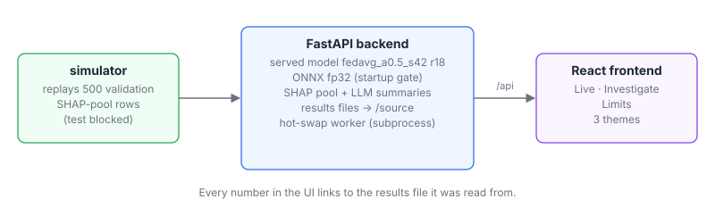

- **Backend** (`backend/main.py`, FastAPI): loads the served model `fedavg_a0.5_s42` round 18, re-checks its validation macro-F1 against the logged value at startup, and never reads the test set (source: `README.md`, step 7). Endpoints include `/health`, `/config`, `/predict`, `/alerts`, `/shap/{id}`, `/explain/{id}`, `/trust`, `/agreement`, `/agreement/summary`, `/accuracy`, `/figures`, `/faithfulness`, `/federation`, `/limits`, `/source/{path}` and the hot-swap endpoints.
- **Simulator** (`backend/simulator.py`): replays rows as "live traffic." By default it replays the **500-row validation SHAP pool** in stored order (`simulator.source_split: val_shap_pool`), so every alert has a SHAP panel and an LLM summary. It **refuses** to replay test rows unless the served checkpoint's hash is on an allowlist, which is empty by default (source: `README.md`, step 7).
- **Frontend** (`frontend/`, React 19 + Vite): hand-built SVG/CSS charts.

**Why the demo replays validation rows.** The test set is reserved for the single preregistered evaluation. Replaying test rows on the dashboard would be another exposure, so since 2026-10-13 the simulator replays validation rows. It marks each alert against its true label, but **no aggregate metric is computed and nothing is selected from it** (source: `CLAUDE.md`). Before 2026-10-13 the simulator replayed test rows (display only, not logged, no aggregate) — disclosed in Part 3.

### What we actually did — every panel

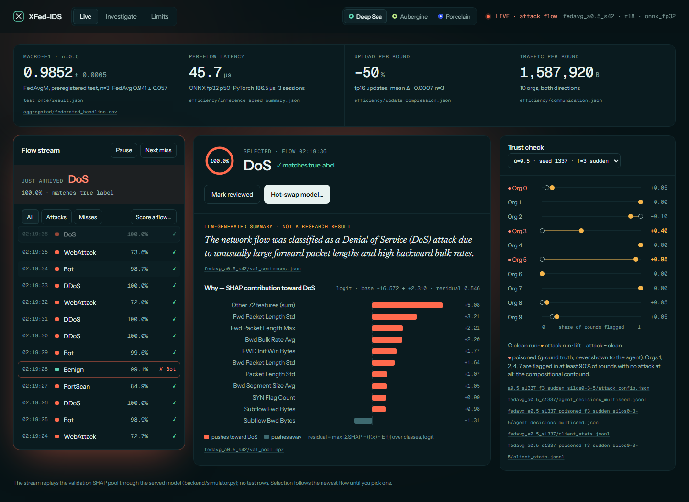

**Live (`/`)** — the operations console:

| Panel | What it shows | Fed by |
|---|---|---|
| Header | Route tabs, theme switch, LIVE status, served model tag, round, engine (`onnx_fp32`) | `/config`, `/health` |
| Key figures | Macro-F1 (FedAvgM prereg), per-flow latency, upload per round, traffic per round, each with its source file | `/figures` |
| Flow stream | Newest flows first, predicted family, confidence, ✓/✗ against the true label; filters (All / Attacks / Misses), Pause, Next miss, "Score a flow…" drawer | `/alerts`, `/predict` |
| Selected flow | Predicted family, confidence ring, "matches true label," **LLM-generated summary (labelled "not a research result")**, and "Why — SHAP contribution toward [family]" bars with base value, output and residual | `/shap/{id}?source=val`, `/explain/{id}` |
| Trust check (dumbbell) | Each org's share of rounds flagged, clean run vs attack run, and the lift; seed/attack selector | `/trust` |
| Hot-swap button and dialog | See below | `/hotswap/*` |

**Investigate (`/investigate`)** — four questions on one page, trust first:


1. **Is anyone poisoning it?** Per-org clean/attack flag rates and lift, Multi-Krum 0%, cost with no attack (−22.7 / −4.9 / −1.6 pp), decision stability 27/30, round-by-round decision strips, the five statistics as small multiples, the agent's verbatim rationale labelled "a rationale of measured fidelity," and the locked claim.
2. **Is it accurate?** FedAvg vs FedAvgM per α, centralized and XGBoost references, per-class F1 and per-run tables.
3. **Do the orgs agree on why?** The agreement number line with chance and the floor, weighted τ, the α=0.1 CI vs floor labelled "directional, not significant," faithfulness, round-wise agreement, and a data & eligibility heatmap.
4. **What does it cost to run?** Latency, upload size, traffic per round, time per round, and the dropped int8 and pre-screen results.

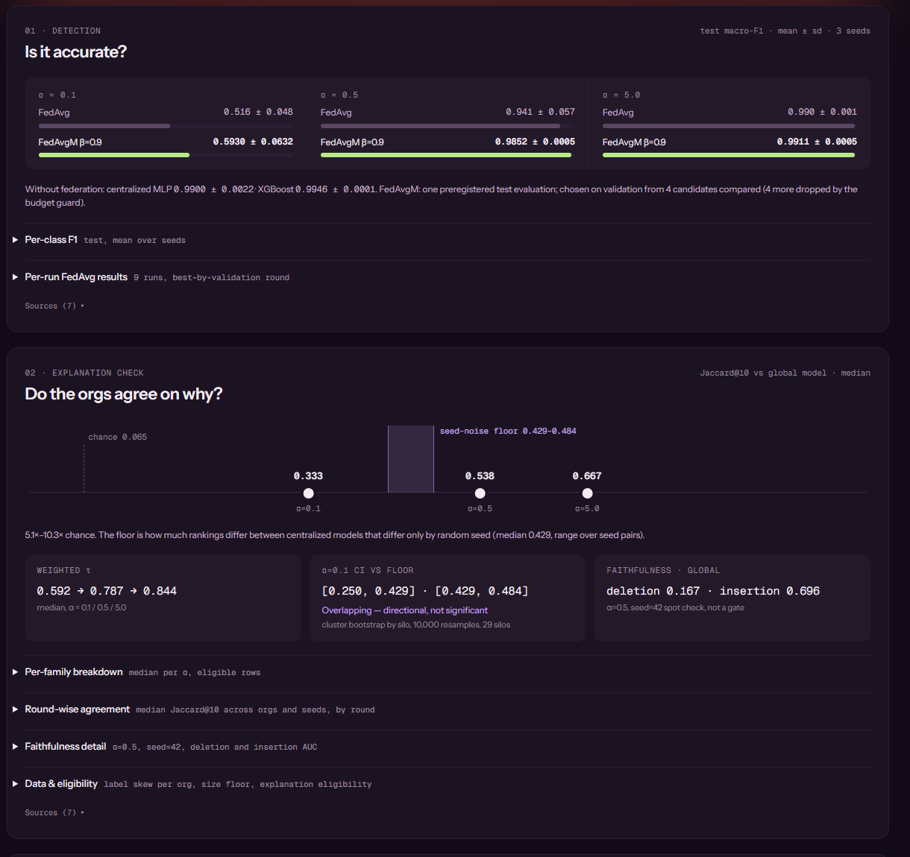


**Limits (`/limits`)** renders the claims section of `PROJECT_INSTRUCTIONS.md` as written (`/limits` endpoint parses it verbatim).


**Every number links to its source** through `/source/{path}`, which only serves a whitelist of results files (source: `README.md`, step 7).

**Themes and ambient light.** Three themes — Deep Sea, Aubergine, Porcelain — remembered in `localStorage`. Two blurred light pools behind the content take the colour of the newest flow on Live (benign, attack, or a stronger pulse for a miss) and of the selected organization on Investigate (poisoned, flagged without an attack, or clean). A shimmering skeleton stays up until the view's data has arrived (at least 600 ms). With `prefers-reduced-motion`, shimmer, pulse and fades are off (source: `README.md`, step 7; `frontend/src/components/Ambient.jsx`).


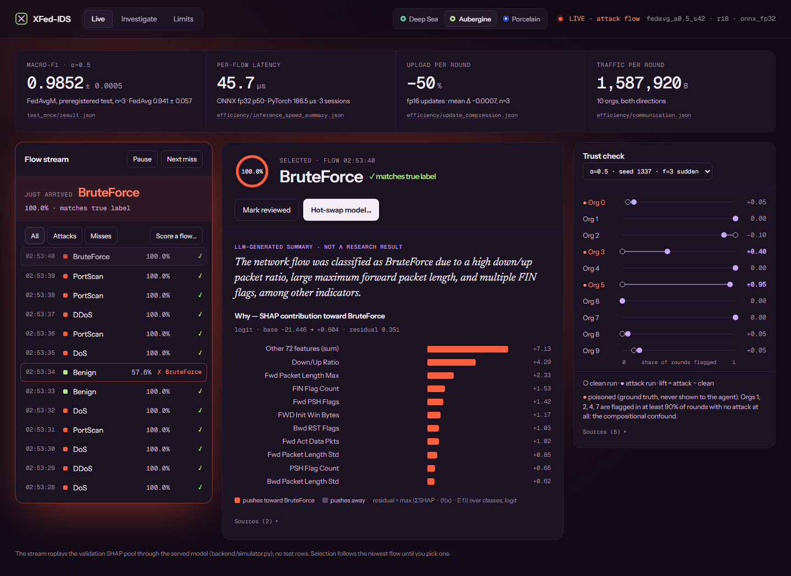

**Hot-swap and its gate.** An analyst who confirms an alert can ask for a quick model update:

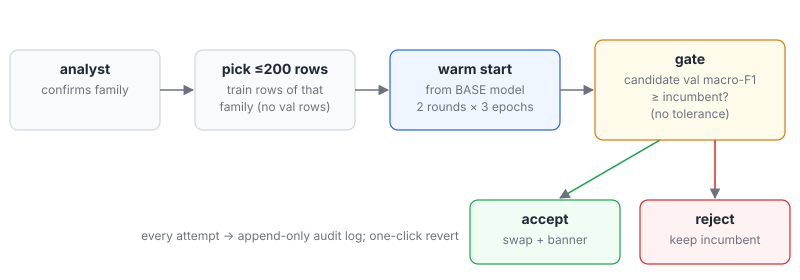

- `POST /hotswap/trigger` takes **a family label only**. The backend picks up to 200 more training rows of that family (never validation rows) (source: `configs/hotswap.yaml`).
- Retraining **warm-starts from the base checkpoint**, never from a previous swap (no chaining), and runs 2 rounds × 3 local epochs on CPU in a **separate subprocess**, so a crash can't take down the backend (source: `configs/hotswap.yaml`).
- **The gate:** strict non-regression on `val_macro_f1_headline`, no tolerance band. The candidate replaces the served model only if it is ≥ the incumbent on validation (source: `configs/hotswap.yaml`). The round lottery is why leniency is the wrong default.
- Every event goes to an append-only audit log with code version, seed, sample IDs and the resulting checkpoint's SHA256, and the writer refuses to log against uncommitted code — so any swapped model can be reproduced from its logged seed (source: `src/hotswap/audit_log.py`).
- A banner shows on every page while a swapped model is active; **revert** is one click.
- Which silo receives the new rows is an **engineering choice for the live system, not a research finding**.

### What we found

This is an engineering stage, not an experiment; it has no research findings of its own. Verified behaviour: the startup gate passed (0 differences on 143,513 validation rows), and 50/50 sampled `/predict` calls matched the torch engine (source: `docs/efficiency_results.md`).

### What this does NOT mean

- The ✓/✗ marks on replayed alerts are not an accuracy measurement; nothing is aggregated.
- The **LLM summary sentences are a usability feature, not a research claim** (length not enforced).
- The dashboard is a demo on one machine, not a production deployment.
- A fresh clone can't run it until the data pipeline and demo files are rebuilt locally (`*.parquet` is git-ignored) (source: `README.md`).

### Where it lives in the code

| File | What it does |
|---|---|
| `backend/main.py` | FastAPI app and endpoints |
| `backend/figures.py` | `/figures`, `/accuracy`, `/agreement/summary`, `/limits`, `/source` |
| `backend/model_loader.py` | Load and verify the served model; ONNX gate |
| `backend/simulator.py` | Replays validation rows as traffic |
| `backend/hotswap_service.py`, `src/hotswap/`, `tools/hotswap_worker.py` | Hot-swap service, retraining, audit log |
| `configs/backend.yaml`, `configs/hotswap.yaml` | Settings |
| `frontend/src/views/Live.jsx`, `Investigate.jsx`, `Limits.jsx` | The three routes |
| `frontend/src/views/live/*`, `frontend/src/views/inv/*` | Panels |
| `frontend/src/components/Ambient.jsx`, `Src.jsx`, `HotSwapDialog.jsx` | Light pools, source links, hot-swap dialog |
| `APP.bat` | One-click start on Windows |
| `app.py`, `app_lib/` | Older Streamlit dashboard (superseded) |

### Questions an examiner might ask

_Numbers in these model answers repeat numbers already given with their source earlier in this chapter; the source notes are not repeated here._

**Q: Is the dashboard showing test-set performance?**
A: No. It replays validation rows; each alert is marked against its true label, but no aggregate metric is computed and nothing is selected from it. Test rows can't be replayed unless a checkpoint is allowlisted, and the allowlist is empty.

**Q: What stops a hot-swap from making the model worse?**
A: A strict gate: the candidate must score at least the incumbent's validation macro-F1. We've seen candidates rejected live; every attempt is in an audit log, and revert is one click.

**Q: Are the LLM sentences explanations?**
A: They're one-sentence summaries for usability, labelled "not a research result." The research explanations are the SHAP bars.

---

## 2.9 Showcase site and film {#ch-site}

### In one line

A public static website and a 70.8-second explainer film (source: `film/README.md`) tell the project's story to a general audience, with every number built from exported JSON files that trace back to `results/` and `docs/`.

### Why this exists

Examiners, recruiters and other students won't run the dashboard. The site and film present the same results, at the same honesty standard, to people who will only scroll or watch.

### How it works / what we did

- **Site** (`site/`, Vite + React), deployed to Vercel at `xfed-ids-byzagent.vercel.app` (source: `README.md`). Sections: hero, a pinned seven-step story with a live diagram, system stages, explanation check, trust check and trust grid, a replay stream, limits and footer (source: `site/src/sections/`; git history 2026-10-07).
- **Data:** `tools/export_showcase_data.py` reads `results/` and `docs/` (read-only) and writes small JSON files to `site/public/data/` (e.g. `headline.json`, `agreement_by_alpha.json`, `byzagent_decisions.json`, `replay_alerts.json`, `ci.json`). Each JSON carries its own source list, and `npm run check:sources` fails the build if any source link points at an untracked file (source: `README.md`, step 8).
- **The site's replay** uses the 500 stored test-row outputs documented in the test-set disclosure (source: `CLAUDE.md`). This is display only.
- **Film** (`film/`, Remotion): 70.8 s, in 16:9 and 9:16, plus a hero loop. Every on-screen number comes from the site's JSON at render time; `film/out/numbers.json` maps each number to file, key and raw value (source: `film/README.md`).
- Since 2026-10-13 the round-20 (unselected) test score is no longer exported to the site (commit `2fcf8c4`).

### What we found

Not an experiment. Accessibility work (WCAG AA contrast, self-hosted fonts) is recorded in git history (2026-10-07).

### What this does NOT mean

- The site is a presentation of results, not a new source of them. Where it disagrees with the two `contribution_*_results.md` files, they win.
- The film's README warns not to run the simulator for captures because, at the time, it read the test set; since 2026-10-13 the simulator replays validation by default.

### Where it lives in the code

`site/` (sections in `site/src/sections/`, copy in `site/src/copy.js`, sources in `site/src/sources.js`), `tools/export_showcase_data.py`, `configs/showcase_export.yaml`, `film/` (`film/src/numbers.js`, `film/src/timeline.json`), rendered film in `site/public/film/`.

### Questions an examiner might ask

_Numbers in these model answers repeat numbers already given with their source earlier in this chapter; the source notes are not repeated here._

**Q: Could the site show a number that isn't in your results?**
A: Every number is built from exported JSON with its source list, and the build checks that every source link is a tracked file. The film reads the same JSON.

**Q: Why does the public site replay test rows when the dashboard doesn't?**
A: It replays 500 *stored* outputs extracted earlier for display; no new test evaluation happens and nothing is computed from them. It's listed in our test-set disclosure as display-only use.

# Part 3 — Honesty and rigor {#part-3}

This part collects every disclosure in one place. Present it as a strength: **we checked, and here is what we found.** An examiner who finds a problem you didn't mention will doubt everything; an examiner who hears you name it first will trust everything else more.

## 3.1 The test-set story, start to finish {#test-story}

**In one line:** all model and round selection used validation data; the test set was nevertheless read in several documented ways during development; three early choices were recorded with test numbers as their justification and were re-checked on validation; and since 2026-10-12 only one preregistered configuration may ever be scored on test.

### What the rule should be

From [1.3.1](#bg-splits): choose everything on validation, score the test set once at the end. The test set is `data/processed/test_global.parquet`, 478,376 rows (source: `docs/test_set_exposure_audit.md`).

### What actually happened

On 2026-10-13 we ran a read-only audit of every way code in the repository had read the test set (source: `docs/test_set_exposure_audit.md`). The full disclosure, as agreed by the team and used everywhere:

> All model and round selection used validation data. Three early design choices were recorded with test-set numbers as their justification: 3 local epochs, FedProx μ=0.0005 and StandardScaler. Re-checked on validation, the same μ and scaler are selected; for local epochs, validation also selects 3 epochs over 1 at α=0.5 in all three seeds (mean best-by-validation macro-F1 0.9425 vs 0.8602). Headline test metrics come from one evaluation of each run's validation-selected checkpoint. The test set was also read, without informing any later choice, in these ways: (a) legacy client-side per-round scoring in 35 runs, unread by any analysis; (b) round-20 scoring for an earlier round-lottery comparison, since replaced by a validation-based one; (c) 14 fixed rows as SHAP explanation inputs; (d) display-only use: 514 extracted rows, and the dashboard simulator before 2026-10-13 (not logged, no aggregate); (e) centralized pilot and baseline runs (18) and XGBoost seeds (3) scored on test during development; (f) one preregistered re-evaluation of a single validation-selected configuration (`docs/preregistration_accuracy.md`).

(source: `CLAUDE.md`, "Test-set use"; `docs/test_set_exposure_audit.md`)

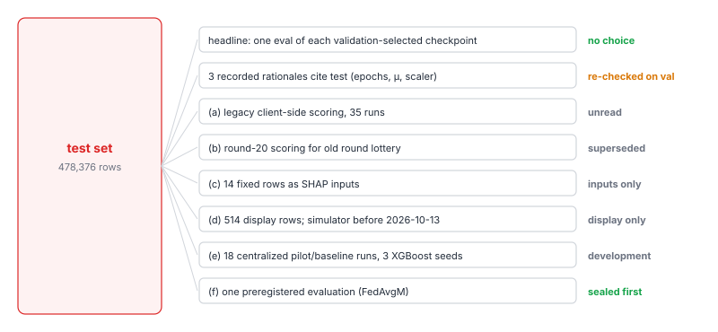

### Each item in plain words

| Item | What happened | Did it influence a choice? |
|---|---|---|
| Headline test numbers | One evaluation of each run's validation-selected checkpoint | No — the checkpoint was already chosen |
| Three recorded rationales | 3 local epochs, μ=0.0005 and StandardScaler were *written down* with test numbers as the reason | Yes, as recorded. Re-checked on validation: same μ and scaler; 3 epochs beat 1 in all three seeds (0.9425 vs 0.8602) |
| (a) Legacy client-side scoring | 35 runs scored each silo on its own test shard every round | No — nothing reads those rows |
| (b) Round-20 scoring | Round-20 test scores fed an early round-lottery figure | No — replaced by `round_lottery_val.csv` |
| (c) 14 SHAP rows | 14 fixed test rows are the explanation inputs | No — inputs, never a selection score |
| (d) Display | 514 rows extracted for the demo; the simulator replayed test rows before 2026-10-13 | No — display only, nothing aggregated |
| (e) Development runs | 18 centralized pilot/baseline runs and 3 XGBoost seeds scored on test | Pilots ranked on validation, but some lock rationales cite test (see above) |
| (f) The prereg | One evaluation of the sealed FedAvgM checkpoints | No — selection, sealing and commit came first |

Also checked and *not* exposures: hot-swap retraining, backend model loading, XGBoost tuning (early-stops on validation), all ByzAgent statistics, the new method runs (source: `docs/test_set_exposure_audit.md`).

### How we disclosed it

- An earlier sentence — "No model selection, stopping round, hyperparameter or method choice used any test score" — **was not used**, because the audit showed it wasn't strictly true. The planning chat replaced it with the disclosure above, now in `README.md`, `PROJECT_INSTRUCTIONS.md` and `docs/contribution_a_results.md` (source: `docs/test_set_exposure_audit.md` §2).
- The round-20 test score was **removed from the site export** and disclosed in contribution B (commit `2fcf8c4`).
- The simulator was switched to **validation rows by default**, with test replay blocked by an empty allowlist (commit `ea59b83`).
- Legacy client-side test scoring is **off by default** (commit `61460e3`).
- **Rule going forward** (team decision, planning chat, 2026-10-12): **no configuration other than the preregistered one is ever scored on the test set** (source: `CLAUDE.md`).

### How to say it out loud (30 seconds)

"All selection was done on validation. Our audit found the test set had also been read during development — mostly for logging and display, nothing chosen from it — and three early settings had been written down with test numbers as the reason. We re-checked those three on validation and got the same choices. We published the full table, and since October 12 only one preregistered configuration can ever be scored on test."

## 3.2 Every audit we ran, and what it found {#audits}

| Audit | What it checked | Finding | Source |
|---|---|---|---|
| Test-set exposure audit | Every read of `test_global.parquet` | 9 kinds of exposure; 3 choices with test-cited rationales, all re-confirmed on validation | `docs/test_set_exposure_audit.md` |
| Epochs provenance on validation | Was "3 local epochs" right without test? | 3 > 1 in all three seeds (0.9425 vs 0.8602) | `results/federated/epochs_provenance_val.json` |
| Round lottery (validation only) | Best round vs round 20 | Up to 0.118 (α=5.0, seed 42) | `results/federated/round_lottery_val.csv` |
| Additivity residual audit | 594 stored SHAP files | 4 of 99 final FedAvg files above 3.336, clustered at α=0.1 small silos; none at α=0.5 | `results/inspection/residual_audit.md` |
| Residual sensitivity (pre-specified) | Does excluding flagged silos move the headline? | α=0.1 Jaccard@10 0.333 → 0.333; τ 0.592 → 0.597 | `results/inspection/residual_sensitivity.json` |
| Unbacked residual figure | Was "~3–8%" traceable? | No backing file → dropped; replaced by median 3.2%, p95 7.7%, max 21.2% | `results/shap/fedavg_a0.5_s42/val_pool_summary.json` |
| Explainer cross-check | Kernel vs Gradient SHAP | τ 0.730, Jaccard@10 0.538 (n=14) | `results/inspection/kernel_vs_gradient_validation.csv`; `docs/contribution_a_results.md` §3 |
| Background ablation | Common vs per-silo background | τ 0.807, Jaccard@10 0.603 (n=42) | `results/inspection/common_background_ablation.csv`; `docs/contribution_a_results.md` §3 |
| Faithfulness spot-check | Deletion < insertion AUC? | Yes for all four probed models (one config) | `results/inspection/deletion_auc.csv`, `insertion_auc.csv` |
| Parity monitor single-draw bug | Do flags reproduce? | Single-draw flags were artifacts (MAD crushed to 0.042); fixed with N≥3 draws | `docs/contribution_a_results.md` §4 |
| SHAP determinism | Same inputs, same SHAP? | No: mean abs. difference 0.0188, max 0.403 — sampling is unseeded | `docs/contribution_a_results.md`, Lim. #17 |
| Eval-set duplication | Were 7 copies of the eval-set code identical? | Yes, byte-identical; consolidated into `tools/eval_set_config.py` (latent defect that did not fire) | `docs/measurement_protocol.md` §2 |
| Bot/WebAttack near-duplication | Do near-duplicate rows inflate agreement? | Tested, **not confirmed** | `docs/contribution_a_results.md`, Lim. #2 |
| Krum/trimmed-mean clean control | Is the confound attack-independent? | Confirmed: same silos excluded with zero attackers | `docs/contribution_b_results.md` §4 |
| ByzAgent decision stability | Repeat calls agree? | 27/30 exact; 30/30 on trust/flag boundary | `docs/contribution_b_results.md` §5 |
| ByzAgent citation accuracy | Are cited numbers correct? | 11.7% error (seed 42), 22.5% (seeds 1337/2024) | `docs/contribution_b_results.md` §5, §8 |
| Trend-claim hand-check | Is the 45.00% automated figure trustworthy? | 32/35 validated, 3 ambiguous, 0 disagreements; ≈35–45% | `docs/contribution_b_results.md` §8 |
| `agent_config.json` claim | Does the cited file exist? | No — disclosed, deliberately not created afterwards | `docs/contribution_b_results.md` §5 |
| Wrong-harness landmine | Could a bare `flwr run` train the wrong app? | Yes → root Flower section removed; now fails on purpose | `docs/contribution_b_results.md` §10 |
| CPU vs GPU | Which device trained federated runs? | CPU (torch 2.13.0+cpu in Flower's env), disclosed | `docs/preregistration_accuracy.md` |
| FedAvg regression run | Does the new code path match published runs? | Identical over all 21 rounds | `docs/preregistration_accuracy.md` |
| ONNX startup gate | Same predictions as PyTorch? | 0 differences on 143,513 validation rows | `docs/efficiency_results.md` |
| Data cleaning bugs | Conflict/dedup keys | Two caught (58,307 and 58,228 rows would have been lost) | `data/README.md` §4 |

**Negative results we report on purpose:** rolling history failed its pre-registered test; the train_loss pre-screen didn't transfer; int8 quantization was dropped; compression showed no detectable effect at n=3; entropy failed the size conditioning; the live ByzAgent run was not done because it couldn't be interpreted.

**n=1 experiments, by design:** Phase 2 baselines, the Phase 4 matrix and gradual mode (seed 42 only) (source: `CLAUDE.md`). Only the confound/canary finding, the fidelity audit and the trend hand-check were multi-seeded (source: `docs/contribution_b_results.md` §10).

## 3.3 What we do NOT claim {#not-claim}

Memorise this list. Each line is a sentence you should never say, or a stronger version you should correct if someone else says it. The numbers in it are sourced in chapters [2.4](#ch-expl), [2.5](#ch-trust), [2.6](#ch-prereg) and [2.7](#ch-eff).

1. We do **not** claim to be the first to measure explanation agreement in federated IDS.
2. We do **not** claim the broad "FL + IDS + XAI" combination as new; several 2025–2026 papers cover it.
3. We do **not** claim the α=0.1 below-floor result is significant. It is **directional, not significant**.
4. We do **not** claim heterogeneity *causes* lower agreement; the KL result is observational.
5. We do **not** claim ByzAgent beats Krum, Multi-Krum or trimmed mean.
6. We do **not** claim ByzAgent "explains its reasoning." It produces decisions plus a rationale of measured fidelity.
7. We do **not** claim any attack here is realistic; all are worst-case, full-knowledge.
8. We do **not** credit classical Krum with the 0% figure; it belongs to Multi-Krum.
9. We do **not** cite Multi-Krum's f=2 recovery (1.35) as attack mitigation.
10. We do **not** claim "33.8×–154.3×" is a detection threshold; it's a seed-42 effect-size ratio.
11. We do **not** claim the LLM summary sentences on the dashboard are research results.
12. We do **not** claim FedAvgM is a tuned optimum, or that it changes explanation agreement (untested).
13. We do **not** claim compression is harmless; the effect is unresolved at n=3.
14. We do **not** claim the faithfulness check covers every configuration; it's one spot-check.
15. We do **not** claim federated training ran on the GPU.
16. We do **not** blend the explanation check and the trust check into a single claim.
17. We do **not** report p-values for silo-level correlations.

# Part 4 — Prior work {#part-4}

Only what our docs record is stated here. Anything an examiner might probe further, and that our docs don't record, is marked **[to verify in lit review]**.

## 4.1 The works we build on {#prior}

**Oki et al. (IEEE Networking Letters, 2024).** Measured the distance between explanations (feature sets) of distributed and non-distributed IDS models, and reported that federated learning *reduces* explanation distance (source: `docs/contribution_a_results.md` §1; `CLAUDE.md`). Their exact setup, dataset and distance measure: [to verify in lit review].

**Gholizade et al. (arXiv 2607.13045, June 2026 FedXAI survey).** Names **explanation consistency under non-IID data** as an open challenge and notes there are **no standard metrics** for it (source: `CLAUDE.md`; `docs/measurement_protocol.md` §1).

**Krum and Multi-Krum (Blanchard et al.).** Distance-based Byzantine-robust aggregation; our implementation "matches textbook Blanchard et al. Krum/Multi-Krum" (source: `results/defenses/PHASE2_SUMMARY.md`). Year and venue: [to verify in lit review].

**Coordinate-wise trimmed mean.** Implemented with Flower's `FedTrimmedAvg`, β = f/n (source: `docs/contribution_b_results.md` §4). Original paper: [to verify in lit review].

**FedAvgM (Hsu et al., 2019)** — server momentum (source: `docs/preregistration_accuracy.md`). **FedProx**, **FedAdam**, **FedYogi**, **SCAFFOLD**: used or considered as named Flower strategies; original papers [to verify in lit review].

**Dataset lineage:** Engelen, Rimmer & Joosen (WTMC 2021); Liu, Engelen, Lynar, Essam & Joosen (IEEE CNS 2022). A third correction branch, Lanvin et al. (CRiSIS 2022), is not used (source: `data/README.md` §1).

**Modified z-score threshold:** Iglewicz & Hoaglin 1993 (source: `docs/contribution_a_results.md` §4).

## 4.2 How we differ {#differ}

Using only what the docs say (source: `CLAUDE.md`, "How this project differs from prior work"; `README.md`):

- **Boundary conditions on Oki et al.**, not a contradiction: Oki et al. showed federation reduces explanation distance; we characterise **where that reduction breaks down** as client data becomes more heterogeneous (α=0.1 vs 0.5 vs 5.0).
- **A null control no prior work reports**: how much explanation rankings differ between centralized models that differ only by random seed. Without it, a reported difference can't be told apart from seed noise. (Our README words it carefully: "as far as we found.") Breadth of that search: [to verify in lit review].
- **A reusable measurement protocol** (`docs/measurement_protocol.md`) with two built-in reference lines (chance and seed noise), addressing the "no standard metrics" gap Gholizade et al. name. It doesn't invent a new statistic; Jaccard@k and weighted τ predate us.
- **The trust check tests Krum and its variants with 10 clients and an oracle attacker count** in a non-IID IDS setting, and **audits how often the agent's own explanations are accurate**.
- **What is not different:** "FL + IDS + XAI" as a combination is not new; several 2025–2026 papers cover it [to verify in lit review: which papers]. LLM-based trust agents in FL: [to verify in lit review]. The dashboard's LLM sentences are usability, not a claim.

**One sentence for the examiner:** "We don't claim the combination is new; our contributions are the seed-noise null control with a reusable protocol, the finding of where explanation agreement breaks down under heterogeneity, and an audited LLM trust agent whose limits we quantify."

# Part 5 — Running it {#part-5}

## 5.1 Running the dashboard for a demo (Windows) {#run}

**Before the day (one-time).** A fresh clone has no processed data. On the demo laptop, the data pipeline, the `fedavg_a0.5_s42` checkpoint, `best_rounds_manifest.json`, the validation SHAP pool and `node_modules` must already exist (source: `README.md`, Quick start and step 7). Check:

- `data/processed/train_pool.parquet` and `val_mask.parquet` exist;
- `results/shap/fedavg_a0.5_s42/val_pool.npz` exists (rebuild: `python -m tools.build_shap_val_pool`, about 45 minutes on CPU);
- `frontend/node_modules` exists (`cd frontend; npm ci`).

**Option A — one click.** Double-click **`APP.bat`** in the repo root. It starts the backend on port 8000, waits until `/health` answers (the backend re-checks the model, about a minute), then starts the simulator and the frontend, and opens `http://localhost:5173/` (source: `APP.bat`). Close the three windows to stop.

**Option B — three PowerShell terminals** (from the repo root; use PowerShell, because `conda activate` is a no-op in cmd.exe on this machine):

```powershell
conda activate xfed
uvicorn backend.main:app --reload
```

```powershell
conda activate xfed
python -m backend.simulator
```

```powershell
cd frontend
npm run dev
```

Then open `http://localhost:5173/`. The API is at `http://127.0.0.1:8000`; Vite proxies `/api` to it.

**Optional:** Ollama doesn't need to run for the demo — the LLM summaries are stored in `results/explanations/fedavg_a0.5_s42/val_sentences.json`.

## 5.2 A five-minute demo script {#demo}

| Time | Click | Say |
|---|---|---|
| 0:00 | Open **Live** (Deep Sea) | "This is XFed-IDS. Ten organizations trained this detector together without sharing traffic. The flows on the left are validation rows replayed as live traffic — never test rows." |
| 0:30 | Point at **key figures** | "Top row: our preregistered FedAvgM model's test macro-F1, 0.9852 at α=0.5, scored once. Per-flow latency 45.7 µs with ONNX. Each number links to the file it came from." Click one source link. |
| 1:00 | Click a **DoS** flow in the stream | "The model says DoS. On the right is *why*: SHAP shows which features pushed it there — here packet-length statistics. Base value, output and residual are shown, because SHAP's sums aren't exact and we measured that." |
| 1:30 | Point at the **LLM summary** | "This sentence is an LLM summary for the analyst. It's labelled 'not a research result' — a usability feature." |
| 1:50 | Click **Misses** filter, then **Next miss** | "We don't hide mistakes. Here's a flow the model got wrong." |
| 2:15 | Point at the **Trust check dumbbell** | "This is the trust check, a separate experiment. Open circle: how often our LLM agent flagged each organization with no attack. Filled: under attack. At seed 1337, org 5 goes from 0.00 to 0.95 — real detection. But some orgs are flagged in almost every round with no attack at all — the note under the chart names them. That's the compositional confound." |
| 3:00 | Go to **Investigate** | "Investigate answers four questions, trust first. Multi-Krum excluded a poisoned org 0% of the time. ByzAgent's result, in our locked words:" read the quote on screen. |
| 3:40 | Scroll to **Do the orgs agree on why?** | "Explanation check. Chance is 0.065, the seed-noise floor is 0.429. At α=5.0 agreement is 0.667; at α=0.1 it's 0.333, below the floor — directional, not significant, the intervals overlap." |
| 4:20 | Scroll to **What does it cost?** | "1,587,920 bytes per round; compression saves up to 74.9% of upload with no detectable effect at n=3; and two ideas we tested and dropped." |
| 4:40 | Open **Limits** | "Finally, Limits shows our claims and limitations verbatim from the project instructions. We'd rather you read them here than find them yourself." |
| 5:00 | (optional) Switch theme | Done. |

Sources for the numbers spoken in this script: FedAvgM 0.9852 (source: `results/federated_methods/test_once/result.json`); 45.7 µs (source: `results/efficiency/inference_speed_summary.json`); org 5 at seed 1337 0.00 → 0.95 (source: `docs/contribution_b_results.md` §7); Multi-Krum 0% (source: `docs/contribution_b_results.md` §4); chance 0.065, floor 0.429, agreement 0.667 / 0.333 (source: `docs/contribution_a_results.md` §2); 1,587,920 bytes (source: `results/efficiency/communication.json`); 74.9% (source: `results/efficiency/update_compression.json`). The dashboard itself links every number on screen to its file.

**Optional hot-swap (adds ~2 minutes):** on Live, select an alert → **Hot-swap model…** → confirm. Say: "This retrains for two rounds from the base model in a separate process. It only replaces the served model if it's at least as good on validation; otherwise it's rejected — and that happens often, because of the round lottery." Then **revert**.

## 5.3 If something breaks {#broken}

| Symptom | Likely cause | Fix |
|---|---|---|
| `APP.bat` waits forever | Backend failed to start | Look at the "XFed backend" window. Missing parquet or checkpoint → run the data pipeline / restore files |
| Backend refuses to start mentioning ONNX | ONNX predictions differ from torch (startup gate) | Set `serving.engine: torch` in `configs/efficiency.yaml` for the demo; report it afterwards |
| Flow stream is empty | Simulator not running | Start `python -m backend.simulator` |
| SHAP panel empty | Validation SHAP pool missing | Rebuild with `python -m tools.build_shap_val_pool` (≈45 min) — do it before the day |
| Page shows skeleton forever | Frontend can't reach `/api` | Check the backend is on port 8000; restart `npm run dev` |
| `conda activate` does nothing | Running in cmd.exe | Use PowerShell |
| Port already in use | Old process still running | Close old windows, or `Stop-Process` the old python/node |
| Simulator refuses to start with "test" | `source_split: test` set and allowlist empty | Intended. Set `simulator.source_split: val_shap_pool` |
| Hot-swap rejected | Candidate scored below the incumbent on validation | Not a bug — the gate working. Say so. |
| Laptop has no network | — | Fine; everything is local. Ollama is not needed |

**Fallback:** if the live demo fails entirely, show the six screenshots in `docs/dashboard_v2/screens/` and the public site at `xfed-ids-byzagent.vercel.app`.

# Part 6 — Final-review preparation {#part-6}

## 6.1 Top 40 examiner questions {#top40}

Each model answer is under 80 words (the small source note after each answer is not part of what you say). Practise them out loud.

### Questions an examiner might ask — the whole project

**1. What is your project, in one sentence?**
A federated IDS that doesn't just detect attacks, but checks whether its own explanations and its own participants can be trusted. Ten organizations train a shared detector without sharing traffic; we then test whether their models detect attacks for the same reasons, and whether an LLM agent can spot poisoned participants.

**2. What's novel here?**
Not the FL + IDS + XAI combination — several 2025–2026 papers cover it. Our contributions: a seed-noise null control for explanation agreement, which we didn't find in prior work in this space, inside a reusable measurement protocol; showing where Oki et al.'s explanation convergence breaks down as α falls; and an LLM trust agent whose decisions and rationales we audit, with its limits quantified. (source: `CLAUDE.md`; `docs/contribution_a_results.md` §1)

**3. Isn't your federated accuracy worse than centralized?**
Only under heterogeneity. At α=5.0 FedAvg scores 0.990 ± 0.001, matching centralized 0.9900 ± 0.0022. At α=0.5 it's 0.941 ± 0.057; at α=0.1, 0.516 ± 0.048. The near-IID control shows the drop is caused by non-IID data, not federation itself. Our preregistered FedAvgM reaches 0.9852 ± 0.0005 at α=0.5. (source: `results/aggregated/federated_headline.csv`, `centralized_headline.csv`; `results/federated_methods/test_once/result.json`)

**4. Did you touch the test set?**
Yes, in documented ways, and we publish the full audit. All selection used validation. The test set was also read for logging, display and 14 SHAP input rows, with nothing chosen from those; three early settings were recorded with test numbers as rationale, and all three are re-confirmed on validation. Since 2026-10-12, only one preregistered configuration may ever be scored on test. (source: `docs/test_set_exposure_audit.md`; `CLAUDE.md`)

**5. Why trust an LLM?**
We don't, blindly. We measure it: citation error 11.7% at seed 42 and 22.5% at other seeds; ≈35–45% of its trend claims under rolling history contradicted its data; repeat calls agree 27/30 exactly and 30/30 on trust-versus-flag. Hence our wording: it produces decisions plus a rationale of measured fidelity. (source: `docs/contribution_b_results.md` §5, §8)

**6. Krum is standard. Why did it fail?**
Krum assumes honest updates cluster and attackers stand out. Under non-IID data, honest organizations with unusual traffic also stand out. Here selection was dominated by silo size and composition: Multi-Krum excluded the same large Benign-heavy silos every round, even with zero attackers, and excluded a malicious silo 0% of the time — despite being told the true number of attackers. (source: `docs/contribution_b_results.md` §4)

**7. Is 0.333 vs 0.429 significant?**
No. The cluster-bootstrap CI at α=0.1 is [0.250, 0.429] and the floor's range is [0.429, 0.484]; they overlap. We call it directional, not significant. What is robust: agreement rises with α, and every α is 5.1×–10.3× above chance. (source: `docs/contribution_a_results.md` §2)

**8. What's the seed-noise floor and why does it matter?**
Three centralized models differing only by random seed agree at a median Jaccard@10 of 0.429. That's how much explanations move from randomness alone. Without it, a federated agreement of, say, 0.53 has nothing to be compared against. (source: `results/inspection/centralized_instability_floor.csv`)

**9. Why Jaccard@10 and weighted Kendall's τ — why two metrics?**
Jaccard@10 asks whether the analyst sees the same top-10 features; it ignores order. Weighted τ compares the whole ranking, giving important features more weight. Two models can agree on one and not the other, so we report both. (source: `docs/measurement_protocol.md` §6)

**10. Why did you choose the Distrinet V4 dataset?**
The original CICIDS2017 has documented labelling and flow-construction errors. Engelen et al. (WTMC 2021) and Liu et al. (IEEE CNS 2022) corrected them; V4 is the release from the second paper. We cite both. (source: `data/README.md` §1)

**11. How did you stop duplicates leaking into the test set?**
Every distinct feature vector is a group; `StratifiedGroupKFold` keeps each group on one side, and the pipeline verifies it and raises if any vector appears on both sides. 213,752 rows shared a vector with another row, so this mattered. (source: `data/README.md` §6)

**12. Why macro-F1 and not accuracy?**
Benign is 75% of the data, so predicting "Benign" always would score about 75% accuracy and catch nothing. Macro-F1 averages per-class F1, so each of the 7 headline classes counts equally. (source: `data/README.md` §5)

**13. What is Dirichlet α, simply?**
A slider for how different the organizations' data is. For each attack family we draw how its flows are split across 10 silos. Small α (0.1): one silo gets nearly all of a family. Large α (5.0): each gets about a tenth. (source: `data/README.md` §7)

**14. What is the round lottery?**
Under non-IID data the global model's quality jumps between rounds. At α=5.0, seed 42, round 20 was 0.118 lower on validation than the best round. So every reported model is its best-by-validation round. (source: `results/federated/round_lottery_val.csv`)

**15. Why LayerNorm instead of BatchNorm?**
BatchNorm stores running statistics of its training data; in FL those come from incompatible per-silo distributions and averaging them is meaningless. LayerNorm normalises each example by itself and has no such state. (source: `configs/model.yaml`)

**16. Why GradientExplainer?**
We tested DeepExplainer first: it fails on LayerNorm, with additivity error 2.43 against a 0.01 tolerance. GradientExplainer handles any differentiable layer. A KernelExplainer cross-check gave median τ 0.730. (source: `CLAUDE.md`; `results/inspection/kernel_vs_gradient_validation.csv`)

**17. Your SHAP values don't sum exactly. Is that a problem?**
We measured it: on 500 validation rows, median relative residual 3.2%, p95 7.7%, max 21.2%. Large residuals cluster in small α=0.1 silos. A pre-specified rule excluding them leaves α=0.1 Jaccard@10 at 0.333, τ 0.592 → 0.597. (source: `results/shap/fedavg_a0.5_s42/val_pool_summary.json`; `results/inspection/residual_sensitivity.json`)

**18. Doesn't SHAP leak private data from each organization?**
Only top-k feature rankings leave each organization, never SHAP magnitudes or raw rows (locked decision 4). That protects the privacy premise, but it also means the server only ever sees a compressed summary. (source: `CLAUDE.md`, locked decision 4)

**19. Why no p-values?**
Silos in one run share one training trajectory, so they aren't independent; effective sample size is closer to 3 seeds than 30 silos. A p-value assuming independence would overstate the evidence. We report r and n. (source: `docs/contribution_a_results.md`, Limitations #18)

**20. You switched from entropy to KL. Isn't that p-hacking?**
We disclose the order: entropy was pre-specified and failed — after controlling for silo size its sign flipped. KL was tested afterwards and survived (partial r −0.57 at α=0.1, −0.82/−0.87 at α=0.5). That's why we call it observational. (source: `docs/contribution_a_results.md` §5)

**21. Why couldn't you control silo size directly?**
Under the Dirichlet partitioner a silo's size is determined by the same draw that creates its skew; size-controlled partitions were proven impossible with it. Partial correlation on log(size) replaced them. (source: `docs/contribution_a_results.md` §5; `CLAUDE.md`)

**22. Does FedProx help explanations?**
At μ=0.0005 only: at α=0.5, Jaccard@10 rose in all 3 seeds with flat accuracy; at α=0.1 inconclusive; at α=5.0 nothing. μ wasn't swept — μ=0.01 collapsed macro-F1 to 0.71. (source: `docs/contribution_a_results.md` §6)

**23. What does the parity monitor do, and did it work?**
It flags a silo whose top-10 list deviates unusually from the fleet, using only rankings. 3 flags in 356 rows, all at α=0.5. An early single-draw version raised false flags; averaging N≥3 explainer draws fixed it. (source: `results/inspection/parity_monitor.csv`; `docs/contribution_a_results.md` §4)

**24. Zero parity flags at α=0.1 — so α=0.1 is fine?**
No. When every silo disagrees, nobody stands out as an outlier. α=0.1's median deviation (0.694) was worse than any flagged α=0.5 silo. Read absolute agreement from Jaccard and τ, not flag counts. (source: `docs/contribution_a_results.md` §4)

**25. Is your attack realistic?**
No, and we say so everywhere. It's a worst-case, full-knowledge adversary: we searched all 120 possible attacker triples for the one covering the most attack traffic. No real attacker has that global view. (source: `docs/contribution_b_results.md` §2)

**26. Which statistic actually detects attackers?**
Only train_loss: 33.8× (f=3) and 154.3× (f=2) as seed-42 effect-size ratios. Geometry statistics are weak to null, and val_accuracy inverts. But a per-round threshold tuned on seed 42 didn't transfer to seed 1337. (source: `docs/contribution_b_results.md` §3; `docs/efficiency_results.md` Part A)

**27. Why does val_accuracy invert?**
The attack relabels attack flows as Benign, and the validation set is mostly Benign. So a poisoned model gets *better* at validation. A naive reader — or LLM — would trust attackers more; our prompt warns against exactly that. (source: `docs/contribution_b_results.md` §3)

**28. ByzAgent flagged attackers 100% of the time. Isn't that great?**
It also flagged them 95–100% with no attack, and flagged never-malicious silo 8 just as often. That's the compositional confound. Where silos weren't saturated (seeds 1337, 2024), real lifts of +0.40 to +0.95 appeared. (source: `docs/contribution_b_results.md` §5, §7)

**29. State your ByzAgent claim exactly.**
"Both effects are present. A real compositional confound saturates some silos' flag rates independent of any attack; real attack-responsive detection is also present and becomes visible where silos are not already saturated. Seed 42's apparent null was partly a ceiling artifact of that seed's unusually bimodal composition." (source: `CLAUDE.md`; `docs/contribution_b_results.md` §7)

**30. Why didn't you just choose ordinary-looking attackers?**
Because in this partition a silo with enough attack traffic to poison meaningfully is necessarily unusual. The Benign-heavy silos hold only 6.65% of Bot rows; the best attacker triple from them is 7.1× weaker. A matched control isn't constructible. (source: `docs/contribution_b_results.md` §5)

**31. Wasn't giving the baselines the true f unfair?**
Unfair in their favour, deliberately. Krum, Multi-Krum and trimmed mean were told the true number of attackers; ByzAgent wasn't. They still failed, so the failure isn't from guessing f wrong. (source: `docs/contribution_b_results.md` §1, §4)

**32. What does it cost to defend when nobody attacks?**
Compared with clean FedAvg's test macro-F1: Krum −22.7 points, Multi-Krum −4.9, trimmed mean −1.6. Robust aggregation isn't free under non-IID data. (source: `CLAUDE.md`; `docs/contribution_b_results.md` §4)

**33. Why did rolling history fail?**
Our pre-registered rule: it fails if the never-malicious canary rises with the attackers. The canary's lift was +0.60 (sudden) and +0.45 (gradual), matching or exceeding every attacker. The agent's reasoning also degraded on longer prompts. (source: `docs/contribution_b_results.md` §6)

**34. LLMs are random. How can you report its decisions?**
We report stability with them: three repeat calls on the same round agreed exactly 27/30 times, and 30/30 on the trust-versus-flag boundary. Temperature is 0.2. Rolling-history mode was less stable (70–80%). (source: `docs/contribution_b_results.md` §5, §6; `configs/agent.yaml`)

**35. Why run the LLM locally?**
Privacy — sending organizations' behaviour statistics to a cloud API would undercut FL's premise — plus fixed model versions and no cost. llama3.1:8b (4-bit) fits our 6 GB GPU; it beat qwen2.5 and phi3.5 on valid IDs and grounded explanations. (source: `configs/agent.yaml`; `docs/contribution_b_results.md` §5)

**36. Why only 4 of 9 optimizer candidates?**
Wall time. A timing-only guard, which never reads scores, dropped later candidates before they started, each recorded in the preregistration. We disclose that the guard was added after one validation score was seen. Our claim is "best of these four." (source: `docs/preregistration_accuracy.md`)

**37. What did FedAvgM actually improve?**
At α=0.5, stability: mean 0.941 → 0.985, spread 0.057 → 0.0005, mainly by fixing seed 2024. At α=0.1, modest: +0.113, +0.058, +0.060 per seed. At α=5.0, parity. One test evaluation, n=3. (source: `docs/contribution_a_results.md`, optimizer section)

**38. Did federated training use your GPU?**
No. Flower's isolated runtime installed torch 2.13.0+cpu. The GPU trained the centralized MLP and XGBoost and ran Ollama. We disclose this because an earlier description said otherwise. (source: `docs/preregistration_accuracy.md`; `CLAUDE.md`)

**39. Why ONNX, and why not int8?**
ONNX fp32 gives identical predictions and cuts per-flow latency from 186.5 to 45.7 µs. int8 lost 0.1428 validation macro-F1 because errors hit small classes (WebAttack F1 0.9671 → 0.4401), so we dropped it. (source: `results/efficiency/inference_speed_summary.json`; `docs/efficiency_results.md` Part B)

**40. If you had three more months, what would you do?**
More seeds for the floor and the trust baselines; seed SHAP sampling and average draws for the headline; a permutation-based chance baseline; a full faithfulness gate; test whether FedAvgM changes explanation agreement; and a design that separates attack strength from compositional extremity. (Scope changes go to the planning chat first.)

## 6.2 Who explains what {#speakers}

A suggested 15–20 minute split. Each speaker owns the questions for their section.

| Speaker | Sections | Handbook chapters to master | Must-say lines (numbers sourced in the chapters listed) |
|---|---|---|---|
| **[Member 1]** | Problem, pitch, data, model, federated accuracy | 0, 1.1–1.4, 2.1–2.3 | One-line pitch; FedAvg 0.516 / 0.941 / 0.990 vs centralized 0.9900 |
| **[Member 2]** | Explanation check | 1.5–1.6, 1.9, 2.4 | "Accuracy parity does not imply explanation parity"; floor 0.429; "directional, not significant" |
| **[Member 3]** | Trust check (ByzAgent) | 1.7–1.8, 2.5 | Multi-Krum 0%; the locked claim verbatim; "a rationale of measured fidelity" |
| **[Member 4]** | Prereg, efficiency, honesty, live demo | 1.9.7, 2.6–2.8, Part 3, Part 5 | Sealed-envelope story; test-set disclosure; demo script |

**Hand-off lines:**

- **[Member 1] → [Member 2]:** "So the organizations can train an accurate model together — when their data isn't too different. But accurate for the *same reasons*? [Member 2] will show you."
- **[Member 2] → [Member 3]:** "That was the explanation check. The trust check is a separate experiment with its own evidence: what if one of the organizations is lying? [Member 3]."
- **[Member 3] → [Member 4]:** "Those are the two checks, reported separately. [Member 4] will show how we improved accuracy without peeking at the test set, what it costs to run, and the system live."
- **[Member 4] closing:** "Detect the attack, then check the detector. And every number you saw links to the file it came from. We're happy to take questions."

**Rules for the Q&A:** whoever owns the section answers first; anyone may add "and the limitation is…"; nobody combines the two checks into one claim; if you don't know, say "we didn't measure that" rather than guess.

# Part 7 — Reference {#part-7}

## 7.1 Glossary, A–Z {#glossary}

Numbers in the glossary are given with their sources in the chapters and in the headline table ([7.2](#headline)).

- **Accuracy** — share of all predictions that are correct; misleading here because Benign dominates, so never reported as a headline.
- **Activation function** — the simple bend a neuron applies to its weighted sum; we use ReLU.
- **AdamW** — the optimizer used for local training: Adam with decoupled weight decay.
- **Additivity** — SHAP's property that base value plus all SHAP values equals the model's output.
- **Additivity residual** — how far the estimated SHAP values miss exact additivity.
- **α (alpha), Dirichlet** — the slider controlling how different silos' data is; 0.1 severe, 0.5 realistic, 5.0 near-IID.
- **Attempted (flow)** — a flow from an attack whose payload didn't land; joined to its parent family here.
- **AUC** — area under a curve; used for deletion/insertion faithfulness curves.
- **Background (SHAP)** — the reference rows used to compute the base value; seeded and drawn from each silo's training data.
- **Base value** — the model's average output over the background; SHAP's starting point.
- **BatchNorm** — a normalisation layer with running data statistics; rejected for FL.
- **Best-by-validation round** — the round whose global model scored highest on validation; the one we report.
- **ByzAgent** — our LLM trust agent: reads five statistics per silo per round and decides trust, downweight or quarantine.
- **Byzantine client** — a participant that may send arbitrary or malicious updates.
- **Canary (silo)** — a never-malicious silo watched to see whether a detector flags it anyway (silo 8 at seed 42).
- **Ceiling effect** — when a baseline rate is already near its maximum, any increase is capped; why seed 42 showed near-zero lift.
- **Chance level** — the Jaccard@10 two random top-10 lists would get; 0.065 here.
- **CICFlowMeter** — the tool that turns packets into flow records with features.
- **Class weights** — multipliers making mistakes on rare classes cost more in training.
- **Client** — an organization that trains locally in FL; also "silo" or "org."
- **Cluster bootstrap** — estimating uncertainty by resampling whole groups (silos) rather than individual rows.
- **Compositional confound** — detectors reacting to how unusual a silo's traffic mix is, not to whether it attacks.
- **Confidence** — the softmax probability of the predicted class.
- **Cosine similarity** — how closely two vectors point the same way (1 = same direction).
- **DeepExplainer** — a fast SHAP method that failed on our LayerNorm layers.
- **Dirichlet distribution** — a way to draw random proportions that sum to 1; controlled by α.
- **Downweight** — ByzAgent decision: include the silo's update at 0.3× its normal weight.
- **Dropout** — randomly switching off neurons during training to reduce overfitting.
- **Effect size** — how big a difference is, not how surprising; we use Glass's delta.
- **Effective-number class weights** — class weights based on (1 − β)/(1 − βⁿ); β = 0.999 here.
- **Eligibility (explanation)** — rule deciding which (silo, row) pairs count: silo ≥ 400 flows and ≥ 20 of that family.
- **Epoch** — one full pass over a client's training data; 3 local epochs per round.
- **Explanation check** — stage 3: do the organizations' models detect attacks for the same reasons?
- **f** — the number of attacking silos (3 or 2 here).
- **Faithfulness** — whether an explanation reflects what the model actually relies on.
- **False positive / negative** — an alarm on normal traffic / a missed attack.
- **Family** — one of our 8 attack groups (or Benign) after mapping 14 raw labels.
- **Feature** — one number describing a flow; we use 82.
- **FedAdam / FedYogi** — server-side adaptive optimizers; candidates that failed the α=0.5 guard.
- **FedAvg** — federated averaging: weighted mean of client weights by data size.
- **FedAvgM** — FedAvg plus server momentum; selected by our preregistration (momentum 0.9).
- **Federated learning (FL)** — training a shared model across data holders without moving their data.
- **FedProx** — FedAvg with a penalty (μ) for drifting from the global model.
- **Final-5 mean** — mean validation macro-F1 over rounds 16–20; the attack-effect statistic.
- **Flow** — a summary record of one network conversation.
- **Flower (flwr)** — the FL framework we use (1.33.0).
- **Glass's delta** — (mean of group A − mean of control) ÷ sd of control.
- **GradientExplainer** — SHAP via expected gradients; our explainer.
- **Group-aware split** — a split that keeps identical feature vectors on the same side.
- **Hot-swap** — replacing the served model live with a briefly retrained one, behind a validation gate.
- **IDS** — intrusion detection system.
- **IID / non-IID** — clients' data drawn from the same mix / from different mixes.
- **IQR** — interquartile range: spread of the middle half of the data.
- **Jaccard@k** — overlap of two top-k sets ÷ their union.
- **Kendall's τ (weighted)** — rank agreement over all features, weighting important ones more.
- **KL divergence** — how far one distribution is from another, directionally; our heterogeneity measure.
- **Krum** — keeps the single most central update.
- **Label flipping** — poisoning by changing training labels; here attack → Benign.
- **LayerNorm** — per-example normalisation layer; FL-safe.
- **Lift** — flag rate under attack minus the same silo's flag rate with no attack.
- **LLM** — large language model; ours is llama3.1:8b-instruct-q4_K_M via Ollama.
- **Logit** — a raw class score before softmax.
- **Macro-F1** — unweighted mean of per-class F1; our headline metric over 7 classes.
- **Manifest (SHA256)** — file of hashes that proves partitions weren't changed.
- **MLP** — multilayer perceptron; ours is [128, 64].
- **Multi-Krum** — keeps the n − f most central updates and averages them.
- **Non-IID** — see IID.
- **Null control / seed-noise floor** — agreement between centralized models differing only by seed; median 0.429.
- **ONNX / ONNX Runtime** — portable model format / fast engine; serves our model at fp32.
- **Oracle f** — telling a defense the true number of attackers; given to baselines, not ByzAgent.
- **Overfitting** — fitting training data's quirks so well that new data suffers.
- **Parity monitor** — server-side alarm flagging silos whose top-10 lists are outliers.
- **Partial correlation** — correlation after removing the influence of a third variable.
- **Partition** — the assignment of training rows to silos.
- **Poisoning** — corrupting a model by sending bad updates or training on bad data.
- **Pre-registration** — committing the analysis plan before seeing results.
- **Precision / recall** — share of alarms that are real / share of real attacks caught.
- **Quantization** — storing numbers with fewer bits (e.g. int8).
- **Quarantine** — ByzAgent decision: exclude the silo's update that round.
- **Rationale of measured fidelity** — our wording for ByzAgent's written reasons: produced, and audited for accuracy.
- **Recovery fraction** — share of the attack's damage a defense undoes; ≥ 0.5 counts as success.
- **Round** — one cycle of send model → local training → aggregate.
- **Round lottery** — large quality swings between rounds; why we select by validation.
- **Seed** — the number fixing a run's randomness; we use 42, 1337, 2024.
- **SHAP** — SHapley Additive exPlanations; fair-share attribution of a prediction to features.
- **Silo** — an organization in our federation (10 of them).
- **Softmax** — turns logits into probabilities summing to 1.
- **Spearman correlation** — correlation on ranks.
- **StandardScaler** — rescales each feature to mean 0, sd 1.
- **Test set** — held-out data for one final measurement; 478,376 rows here.
- **Trimmed mean** — per-coordinate average after dropping the extremes.
- **Trust check** — stage 4: is any organization poisoning the model?
- **Validation set** — data used for all choices; 143,513 rows here.

## 7.2 Headline numbers with sources {#headline}

| Quantity | Value | Source |
|---|---|---|
| Centralized MLP macro-F1 | 0.9900 ± 0.0022 | `results/aggregated/centralized_headline.csv` |
| XGBoost macro-F1 | 0.9946 ± 0.0001 | `results/aggregated/xgboost_headline.csv` |
| FedAvg α=0.1 / 0.5 / 5.0 | 0.516 ± 0.048 / 0.941 ± 0.057 / 0.990 ± 0.001 | `results/aggregated/federated_headline.csv` |
| Jaccard@10 across α | 0.333 → 0.538 → 0.667 | `results/inspection/agreement_metrics.csv`; `docs/contribution_a_results.md` §2 |
| Weighted Kendall's τ across α | 0.592 → 0.787 → 0.844 | `results/inspection/agreement_metrics.csv`; `docs/contribution_a_results.md` §2 |
| Chance-level Jaccard@10 | 0.065 (5.1×–10.3× chance) | `tools/agreement_metrics.py`; `docs/contribution_a_results.md` §2 |
| Centralized-seed instability floor | median 0.429, range [0.429, 0.484] | `results/inspection/centralized_instability_floor.csv`; `docs/contribution_a_results.md` §2 |
| α=0.1 cluster-bootstrap CI | [0.250, 0.429] | `docs/contribution_a_results.md` §2 |
| Served demo model | fedavg_a0.5_s42, round 18, val macro-F1 0.9760 | `results/federated/fedavg_a0.5_s42/final_metrics.json` |
| FedAvgM β=0.9 (preregistered, test once) α=0.1 / 0.5 / 5.0 | 0.5930 ± 0.0632 / 0.9852 ± 0.0005 / 0.9911 ± 0.0005 | `results/federated_methods/test_once/result.json`; `docs/contribution_a_results.md` (optimizer section) |
| Per-flow latency p50, ONNX fp32 vs PyTorch | 45.7 µs vs 186.5 µs | `results/efficiency/inference_speed_summary.json` |
| Bytes per round (10 silos, fp32, up + down) | 1,587,920 (793,960 each way) | `results/efficiency/communication.json` |
| Round lottery (max, validation) | 0.118 (α=5.0, seed 42) | `results/federated/round_lottery_val.csv` |
| train_loss separation (Glass's delta ratio) | 33.8× (f=3) / 154.3× (f=2) | `results/monitoring/PHASE1_SUMMARY.md` |
| Multi-Krum malicious exclusion | 0% (f=3 and f=2) | `results/defenses/PHASE2_SUMMARY.md` |
| Cost of defending with no attack | Krum −22.7pp, Multi-Krum −4.9pp, trimmed mean −1.6pp | `CLAUDE.md`; underlying test macro-F1 in `docs/contribution_b_results.md` §4 |
| ByzAgent decision stability | 27/30 exact; 30/30 trust-vs-flag | `results/agents/PHASE3_SUMMARY.md` |
| Citation strict error | 11.7% (seed 42) → 22.5% (seeds 1337/2024) | `docs/contribution_b_results.md` §5, §8 |
| Trend claims contradicted (rolling history) | ≈35–45% (automated 45.00%) | `results/agents/MULTISEED_VALIDATION_SUMMARY.md` |
| Cleaned flows | 1,913,502 of 2,099,976 | `data/README.md` |
| Train / test | 1,435,126 / 478,376 | `data/README.md` |

## 7.3 Repository map {#repo}

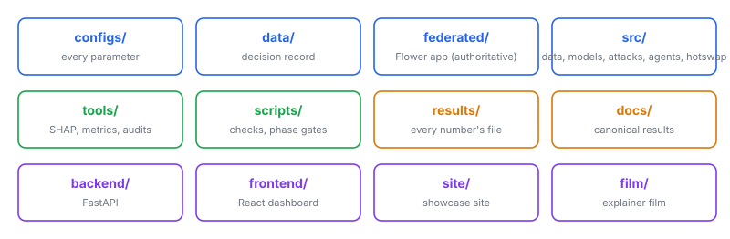

| Path | What's there |
|---|---|
| `CLAUDE.md`, `PROJECT_INSTRUCTIONS.md` | Project rules, locked decisions, headline numbers (identical text) |
| `README.md` | Overview, key results, reproduction steps |
| `APP.bat` | One-click dashboard start |
| `configs/` | Every parameter: `data.yaml`, `model.yaml`, `attack.yaml`, `defense.yaml`, `agent.yaml`, `backend.yaml`, `hotswap.yaml`, `efficiency.yaml`, `federated_methods.yaml`, `val_shap_pool.yaml`, `showcase_export.yaml` |
| `data/README.md` | Data decision record; `data/processed/` is git-ignored |
| `federated/xfed_federated/` | The authoritative Flower app (`server_app.py`, `client_app.py`, `_vendored/`) |
| `src/data/` | Cleaning, mapping, split, partitioning |
| `src/models/`, `src/train/` | MLP; centralized and XGBoost training |
| `src/attacks/`, `src/monitoring/`, `src/agents/` | Label flip; behaviour statistics; ByzAgent |
| `src/hotswap/` | Hot-swap retraining and audit log |
| `src/federated/` | Early prototype, unused |
| `tools/` | SHAP pipeline, agreement metrics, floor, parity monitor, audits, efficiency, prereg, showcase export |
| `scripts/` | Partition checks, aggregation, val split, class weights, trust-check phase gates |
| `results/aggregated/` | Headline tables |
| `results/federated/` | Per-run histories, metrics, checkpoints, agent logs |
| `results/inspection/` | Agreement, floor, parity, residual and phase-gate outputs |
| `results/shap/`, `results/explanations/` | SHAP files; LLM summary sentences |
| `results/attacks/`, `monitoring/`, `defenses/`, `agents/` | Trust-check phase summaries |
| `results/federated_methods/`, `results/efficiency/` | Prereg and efficiency outputs |
| `results/figures/` | Analysis figures reused in this handbook |
| `backend/` | FastAPI app, simulator, model loader, hot-swap service |
| `frontend/` | React dashboard (Live, Investigate, Limits) |
| `site/`, `film/` | Showcase site; explainer film |
| `docs/` | Canonical results A and B, protocol, prereg, test-set audit, efficiency, dashboard screenshots, this handbook |
| `app.py`, `app_lib/` | Older Streamlit dashboard |

## 7.4 Timeline from git history {#timeline}

Dates are commit dates; the repository's history begins on 2026-09-11. Work before that date (data pipeline, training, explanation and trust phases) is recorded in the docs, not in this git history.

| Date | Milestone (from commit messages) |
|---|---|
| 2026-09-11 | First commit: pipeline, backend, React dashboard (`0d9a8aa`) |
| 2026-09-13 | Hot-swap audit log; warm-started retraining service; live backend hot-swap with banner and one-click revert |
| 2026-10-02 | Streamed SHAP pool and LLM explanation layer; `contribution_a_results.md` named canonical |
| 2026-10-03 | Test-set access note; "present as one system" wording; showcase data export |
| 2026-10-07 | Showcase site built and merged; 0% exclusion attributed to Multi-Krum; WCAG AA contrast; explainer film merged |
| 2026-10-12 | README rewrite; decision to re-run the test set once for a preregistered config (`b2b9bee`); prereg Part 1 (`ad249bd`); validation grid; seal (`1a17277`); single test evaluation (`b21a4bf`) |
| 2026-10-13 | Simulator replays validation by default; validation-only round lottery; test-set exposure audit; epochs provenance; CPU disclosure; efficiency parts A–C merged; ONNX fp32 default; validation SHAP pool and summaries; "~3–8%" replaced |
| 2026-10-14 | Residual audit and pre-specified sensitivity check; headline table additions; dashboard v2 (Live, Investigate, Limits); README restyle; `APP.bat` |
| 2026-11-12 | This handbook |

## 7.5 Citations, as they appear in the docs {#citations}

- L. Liu, G. Engelen, T. Lynar, D. Essam and W. Joosen, "Error Prevalence in NIDS datasets: A Case Study on CIC-IDS-2017 and CSE-CIC-IDS-2018," IEEE Conference on Communications and Network Security (CNS), 2022, pp. 254–262. (source: `README.md`)
- G. Engelen, V. Rimmer and W. Joosen, "Troubleshooting an Intrusion Detection Dataset: the CICIDS2017 Case Study," IEEE Security and Privacy Workshops (SPW), Workshop on Traffic Measurements for Cybersecurity (WTMC), 2021. (source: `README.md`)
- Oki et al., IEEE Networking Letters, 2024. (source: `README.md`; full entry not in the docs — [to verify in lit review])
- Gholizade et al., arXiv 2607.13045 (June 2026), federated-XAI survey. (source: `README.md`; full entry [to verify in lit review])
- Lanvin et al., CRiSIS-2022 (third correction branch, not used). (source: `data/README.md`)
- Blanchard et al., Krum/Multi-Krum. (source: `results/defenses/PHASE2_SUMMARY.md`; full entry [to verify in lit review])
- Hsu et al., 2019, FedAvgM. (source: `docs/preregistration_accuracy.md`)
- Iglewicz & Hoaglin 1993, modified z-score. (source: `docs/contribution_a_results.md`)
- Repository: V Naga Adithya, T Shaun, P Sampath and D Tharun, "XFed-IDS-ByzAgent: A federated intrusion detection system that checks whether its own explanations and its own participants can be trusted," VIT-AP University capstone project, 2026. (source: `README.md`)
- Mentioned in Part 1 for teaching, not recorded in the docs: McMahan et al. (FedAvg), Li et al. (FedProx), Lundberg & Lee (SHAP), Yin et al. (trimmed mean), Cui et al. (effective number) — all [to verify in lit review].
